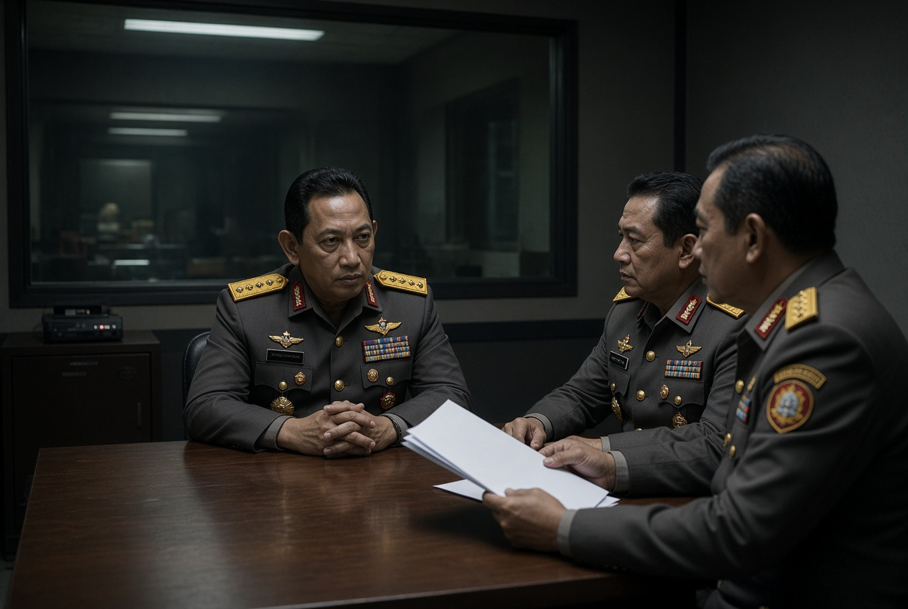

# Siapa yang Menyadap Presiden, dan Apakah ini Makar?

*Ilustrasi(pic: Grok AI).*

  
***Jangan melompat dari penyadapan langsung ke makar. Dalam analisis politik, jarak antara keduanya harus dijembatani bukti, bukan imajinasi***
  

Per 4 November 2026, yang diumumkan secara resmi adalah penetapan tiga perwira tinggi Polri sebagai tersangka dugaan penyadapan ilegal terhadap Presiden Prabowo Subianto dan sejumlah tokoh lain. Tetapi Menteri Koordinator Bidang Hukum, HAM, Imigrasi, dan Pemasyarakatan, Yusril Ihza Mahendra, secara eksplisit menyatakan bahwa sejauh ini belum ditemukan indikasi makar.

Jadi, kita perlu memisahkan dua hal: dugaan penyadapan memang sedang ditangani sebagai perkara pidana; narasi bahwa ini merupakan makar belum didukung keterangan resmi yang tersedia.

Mari kita bedah dengan pisau analisis yang tajam, bukan pisau dapur yang dipakai membelah rumor lalu menyebutnya bukti. 

## Siapa Saja yang Terseret?

Menurut keterangan Bareskrim Polri yang diberitakan pada 3 November, tiga perwira tinggi yang ditetapkan sebagai tersangka adalah:
- Jenderal Listyo Sigit Prabowo, mantan Kapolri yang kemudian menjabat Kepala Kantor Staf Presiden.
- Irjen Ahrie Sonta Nasution, Kepala Divisi Hukum Polri.
- Irjen Eko Hadi Santoso, pejabat pengajar senior di lembaga pendidikan dan pelatihan Polri.
Polisi menduga penyadapan berlangsung pada periode 2025 hingga 2026. Nomor-nomor telepon disebut dimasukkan ke sistem Lawful Interception Management System (LIMS) tanpa verifikasi dan tanpa keterkaitan dengan proses penyelidikan atau penyidikan yang sah. Penyidik juga menduga ada penghapusan berkas hasil penyadapan pada Oktober 2026.

Bareskrim menyatakan telah memeriksa 10 saksi dan tiga ahli, serta menyita 11 ponsel, satu iPad, dan empat flashdisk. Seorang perwira lain, berinisial SU, diberitakan masih berstatus saksi, bukan tersangka dalam pengumuman tersebut.

Catatan penting: penetapan tersangka berarti penyidik menyatakan telah memiliki dasar untuk melanjutkan proses pidana. Itu belum sama dengan putusan pengadilan bahwa para tersangka bersalah. Kita juga belum mengetahui dari bukti publik apa isi komunikasi yang disadap, siapa yang menerima hasilnya, atau apa motif akhirnya.

## Mengapa Kasus ini Lebih Besar Daripada Sekadar Penyadapan?

Karena dugaan penyalahgunaan alat intersepsi negara memiliki tiga lapisan masalah sekaligus:

A. Penyalahgunaan kekuasaan teknis

Lawful Interception Management System pada dasarnya merupakan sistem yang memungkinkan intersepsi komunikasi untuk keperluan yang dibenarkan hukum. 

Sistem seperti ini bukan otomatis ilegal. Yang menentukan legalitasnya adalah dasar hukum, otorisasi, tujuan, cakupan, dan prosedur penggunaannya.

Menurut penyidik, nomor-nomor telepon dalam kasus ini dimasukkan ke sistem tanpa verifikasi yang diwajibkan, dan penyadapan tidak berkaitan dengan proses penegakan hukum yang sah. Polisi juga menduga berkas hasil intersepsi dihapus untuk menutupi jejak.

Jika dugaan itu terbukti, persoalannya bukan sekadar seseorang mendengar percakapan orang lain. Persoalannya adalah apakah perangkat pengawasan yang dimiliki negara digunakan tanpa dasar hukum terhadap orang-orang yang seharusnya dilindungi oleh hukum itu sendiri.

B. Targetnya bukan hanya presiden

Menurut Bareskrim, sasaran yang diduga disadap juga mencakup menteri, pejabat negara, tokoh politik, media, organisasi masyarakat, LSM, dan pengusaha.

Ini membuat penyidikan perlu menjawab pertanyaan yang jauh lebih luas:
Siapa yang menentukan daftar target?
Apakah daftar itu dibuat untuk kepentingan pribadi, politik, atau kepentingan lain?
Siapa yang dapat mengakses hasil intersepsi?
Apakah hasilnya disalin, dibagikan, atau digunakan untuk memengaruhi keputusan?
Apakah penghapusan data benar-benar dimaksudkan untuk menghilangkan jejak, dan siapa yang memerintahkannya?
Belum semua jawaban itu tersedia untuk publik. Jadi, motif politik masih merupakan kemungkinan yang harus diuji, bukan kesimpulan yang boleh diumumkan lebih dahulu.

C. Penghapusan data bisa sama pentingnya dengan penyadapan

Jika penyidik dapat membuktikan bahwa berkas dihapus untuk menghilangkan jejak, penghapusan tersebut akan menjadi bagian penting dari perkara karena berkaitan dengan integritas bukti elektronik.

Tetapi secara forensik, penyidik tetap perlu menunjukkan jejak akses, log sistem, waktu penghapusan, perintah yang diberikan, dan hubungan tindakan itu dengan masing-masing tersangka.

Narasi yang dramatis belum menggantikan rantai bukti. Justru pada perkara berprofil tinggi seperti ini, standar pembuktian harus makin ketat, bukan makin longgar.

## Lalu, Dari Mana Muncul Isu Makar?

Pada 3 November, Yusril Ihza Mahendra menyatakan bahwa penyidik belum menemukan indikasi makar. Ia menjelaskan bahwa perkara saat ini menggunakan pasal-pasal terkait penyadapan, akses ilegal, dan penghapusan atau perubahan data elektronik, bukan pasal makar. Tujuan penyadapan sendiri masih didalami.

Secara hukum, ketiganya merupakan persoalan berbeda:
| Dugaan tindak pidana | Pertanyaan yang harus dibuktikan |
|------|-------|
|Penyadapan ilegal|Apakah komunikasi diintersepsi tanpa dasar atau otorisasi yang sah?|
|Akses atau manipulasi data elektronik|Apakah sistem atau data diakses, diubah, atau dihapus secara melawan hukum?|
|Makar terhadap presiden atau pemerintah|Apakah terdapat perbuatan yang memenuhi unsur khusus makar menurut hukum pidana?|

Penyadapan terhadap presiden dapat menjadi perkara yang sangat serius tanpa otomatis menjadi makar. Untuk mengarah pada makar, penyidik harus membuktikan unsur tindak pidana tersebut, bukan sekadar menunjukkan bahwa korbannya adalah kepala negara. Sebaliknya, ketiadaan indikasi makar pada tahap awal juga tidak berarti penyadapan yang diduga terjadi menjadi persoalan ringan.

Kesimpulan hukum sementara: dugaan penyadapan ilegal telah menjadi perkara pidana; dugaan makar belum didukung keterangan resmi yang tersedia.

## Apakah ini Konflik Internal Elite Kekuasaan?

Ini hipotesis yang layak diuji, tetapi belum boleh diperlakukan sebagai fakta.

Ada tiga kemungkinan penjelasan yang perlu dibedakan:

Hipotesis 1: penyalahgunaan wewenang individual

Para tersangka diduga menggunakan akses institusional untuk kepentingan pribadi atau tujuan lain di luar prosedur resmi. Polri sendiri menyatakan bahwa dugaan tindak pidana itu merupakan tindakan individu, bukan kebijakan institusi. Pernyataan tersebut merupakan posisi resmi Polri yang masih harus diuji melalui penyidikan.

Hipotesis 2: pengumpulan intelijen politik

Jika targetnya mencakup presiden, menteri, tokoh politik, media, dan pengusaha, penyidik perlu memeriksa apakah data dikumpulkan untuk kepentingan politik atau jaringan kekuasaan tertentu. Namun, daftar target saja belum membuktikan motif tersebut.

Hipotesis 3: konflik antarjaringan elite

Jika bukti kelak menunjukkan adanya pengumpulan informasi untuk memengaruhi keputusan, melemahkan pejabat, atau mengamankan posisi tertentu, barulah hipotesis konflik elite memperoleh dasar yang lebih kuat. Saat ini, bukti publik belum cukup untuk memastikan adanya faksi, komando politik, atau rencana pengambilalihan kekuasaan.

Perhatikan satu detail kelembagaan: Listyo Sigit baru dicopot dari jabatan Kapolri pada 1 Oktober 2026 dan kemudian diangkat menjadi Kepala Kantor Staf Presiden. Dugaan penyadapan disebut berlangsung sejak 2025, sehingga rentang waktunya melintasi perubahan jabatan tersebut.

Kronologi ini patut diperiksa, tetapi tidak dengan sendirinya membuktikan bahwa pergantian jabatan berkaitan dengan dugaan penyadapan.

## Apa yang Seharusnya Dilakukan Negara Sekarang?

Ada empat hal yang menurut prinsip tata kelola demokratis perlu menjadi fokus:
- Audit forensik independen terhadap LIMS. Periksa log akses, perintah intersepsi, penghapusan data, dan siapa saja yang memiliki kewenangan.
- Perlindungan seluruh pihak yang diduga menjadi target. Mereka perlu memperoleh informasi yang dapat diberikan secara sah dan memiliki akses terhadap mekanisme pengaduan.
- Pengawasan terhadap proses penyidikan. Karena perkara ini melibatkan pejabat tinggi penegak hukum, transparansi prosedural dan pengawasan independen menjadi sangat penting.
- Pemisahan perkara pidana dari spekulasi politik. Jika ada bukti motif politik atau makar, buktikan melalui proses hukum. Jangan mengganti bukti dengan desas-desus, tetapi jangan pula menutup kemungkinan tersebut sebelum pemeriksaan selesai.
Kasus ini juga mengangkat persoalan struktural: siapa yang mengawasi lembaga yang memiliki kemampuan mengawasi orang lain? Jika mekanisme pengawasan internal tidak mampu mendeteksi penyalahgunaan kewenangan, pengawasan eksternal menjadi semakin penting.

Yang sudah diketahui dari keterangan resmi bukanlah bahwa tiga jenderal terbukti merencanakan makar, melainkan bahwa tiga perwira tinggi Polri telah ditetapkan sebagai tersangka dalam dugaan penyadapan ilegal terhadap presiden dan sejumlah tokoh.

Yang belum diketahui justru bagian paling menentukan: siapa yang sebenarnya ingin memperoleh informasi itu, untuk kepentingan siapa, dan apa yang hendak dilakukan dengan informasi tersebut?

Kalau jawabannya hanya penyalahgunaan wewenang individual, itu sudah merupakan persoalan serius. Jika kelak bukti menunjukkan adanya jaringan yang mengumpulkan informasi untuk mengendalikan atau memengaruhi kekuasaan, skala persoalannya akan berubah.

Tetapi kita jangan melompat dari penyadapan langsung ke makar. Dalam analisis politik, jarak antara keduanya harus dijembatani bukti, bukan imajinasi. Dan dalam perkara yang menyentuh pusat kekuasaan negara, justru itulah bagian yang paling wajib kita tuntut. 

  
**Referensi**

1. Associated Press. (2026, November 3). Indonesia detains 3 police generals suspected of wiretapping president. AP News. Baca laporan AP⁠.

2. ANTARA News. (2026, November 3). Yusril: Presiden Prabowo tahu disadap dari laporan Kapolri Suyudi. Baca laporan ANTARA⁠.

3. CNN Indonesia. (2026, November 3). Menko Yusril ungkap alasan penyadap Prabowo belum dijerat pasal makar. Baca laporan CNN Indonesia⁠.

4. Channel NewsAsia. (2026, November 3). Former Indonesian national police chief among three arrested for the alleged illegal wiretapping of Prabowo. Baca laporan CNA⁠.
