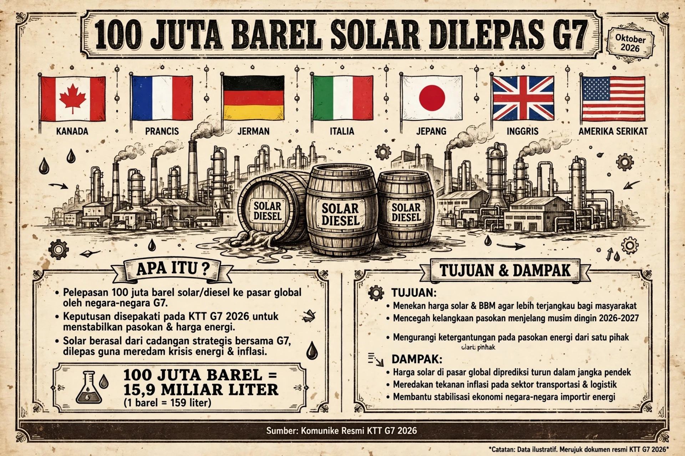

# Solar Darurat: G7 Membuka Brankas Energi

*Ilustrasi (pic: Grok AI).*

  
***Perang Iran, perang Rusia-Ukraina, kilang yang terbakar, dan mengapa diesel bisa menjadi bom inflasi yang lebih berbahaya daripada bensin***
  

Pada 2 Oktober 2026, G7 menyepakati pelepasan terkoordinasi sekitar 100 juta barel melalui IEA, dimulai segera dan berlangsung sekitar empat bulan.

Yang menarik adalah “substantial diesel release within the first 20 days” Jadi diesel diberi prioritas pada fase awal. 

G7 juga sepakat tidak memberlakukan pembatasan ekspor energi di antara negara anggota, karena larangan ekspor justru dapat memperparah kelangkaan. 

Dan ini bukan cuma AS, Inggris, Jepang, Prancis, Jerman, Italia, Kanada. IEA menjadi koordinatornya, dan negara mitra ikut terlibat dalam pelepasan. 

## Mengapa yang dikejar justru DIESEL? 

Diesel bukan sekadar bahan bakar mobil, ia menggerakkan truk; kapal; kereta barang; traktor; mesin panen; konstruksi; pertambangan; generator; serta distribusi barang.

Dengan kata lain, jika bensin terutama memukul konsumen, maka diesel memukul sistem produksi. Ini perbedaan yang sangat penting.

Kalau harga bensin naik, orang mungkin mengurangi perjalanan. Tetapi kalau diesel naik, maka truk ongkos logistik naik, makanan naik, bahan bangunan naik, distribusi naik, serta biaya produksi naik.

Makanya diesel bisa menjadi inflation multiplier. Seorang analis yang dikutip Al Jazeera bahkan menggambarkan kenaikan diesel sebagai semacam pajak atas produksi dan logistik, karena biaya bahan bakar masuk ke begitu banyak rantai pasok. 

## Mengapa Supply Diesel Tiba-tiba Sesak?

Nah, ini bagian geopolitiknya. 

Kita sedang mendapatkan beberapa pukulan sekaligus:

1. Timur Tengah

Perang AS-Israel dengan Iran dan gangguan terhadap lalu lintas energi melalui kawasan Teluk/Hormuz mengurangi aliran minyak mentah dan produk olahan dari kawasan yang sangat penting bagi pasar global. G7 sendiri secara resmi menyerukan pemulihan penuh navigasi di Selat Hormuz. 

2. Rusia

Serangan Ukraina terhadap fasilitas pengolahan Rusia mengganggu kapasitas refinery dan ekspor produk minyak Rusia. Reuters dan analisis pasar terbaru mengaitkan gangguan refinery Rusia dengan mengetatnya pasar diesel. 

3. China

Ekspor diesel China juga disebut lebih rendah, sehingga salah satu pemasok marginal pasar global ikut mengecil. 

Jadi masalahnya bukan sekadar minyak mentah mahal. Masalahnya adalah kapasitas mengubah minyak menjadi produk yang dibutuhkan dunia sedang terganggu di beberapa titik sekaligus. Dan itu jauh lebih merepotkan.

## Sering Salah Dipahami: Minyak Mentah Bukan Solar

Misalnya G7 mengeluarkan minyak mentah. Minyak itu belum menjadi diesel, ia harus crude, refinery, diesel/gasoil, terminal, kapal/truk, konsumen.

Jadi 100 juta barel cadangan tidak otomatis berarti 100 juta barel solar tambahan masuk pompa.

Euronews juga menekankan bahwa crude yang dilepaskan harus diproses terlebih dahulu, sehingga manfaat terhadap diesel bergantung pada: kapasitas refinery; lokasi refinery; jenis crude; transportasi; infrastruktur; dan waktu pemrosesan. 

Ini sebabnya front-loading diesel dalam 20 hari sangat penting.

G7 tidak cuma berkata: “nih minyak.” Mereka mencoba mengatakan: “yang paling kekurangan sekarang, terutama diesel, harus mendapatkan suplai lebih cepat.”

## Dan Sekarang Masuk Trump

Ini bagian politik-ekonominya menarik.

Trump sebelumnya menekan Eropa agar membuka cadangan diesel. Bahkan pemerintah AS mengancam kemungkinan melarang ekspor diesel AS kalau negara-negara Eropa tidak ikut melepaskan stok mereka. 

Lalu G7 sepakat membuka cadangan, dan Trump kemudian mencabut ancaman larangan ekspor diesel AS.

Financial Times melaporkan bahwa AS sendiri akan berkontribusi sekitar 40 juta barel dari Strategic Petroleum Reserve, sementara Eropa diperkirakan menyediakan sekitar 50 juta barel diesel, dengan Asia menyumbang sisanya. 

Jadi ada semacam ancaman, negosiasi, koordinasi, serta ancaman ekspor dicabut. Ini contoh klasik coercive bargaining dalam kebijakan energi.

## Tapi ada Paradoksnya

Trump awalnya: “Kalau kalian gak buka cadangan, kami bisa stop ekspor diesel.”
Masalahnya AS sendiri adalah eksportir diesel besar.

Kalau AS menghentikan ekspor maka Eropa akan kehilangan pasokan tetapi AS juga kehilangan pasar dan mengubah arus perdagangan global.

Dan dalam pasar energi yang sudah kekurangan suplai, tindakan tersebut berpotensi membuat harga internasional lebih tinggi, bukan lebih rendah.

Jadi larangan ekspor merupakan senjata yang punya recoil, seperti menembak pasar energi dengan shotgun ekonomi. Pelurunya mengenai lawan, tetapi serpihannya bisa mengenai diri sendiri.

## Mengapa Pasar Langsung Bereaksi?

Setelah pengumuman G7, harga energi turun. WSJ melaporkan harga Brent turun sekitar 1,1%, WTI sekitar 2,3%, sementara kontrak gasoil Eropa turun lebih dari 7% dan diesel AS sekitar 3,7% pada sesi tersebut. 

Tetapi hati-hati, harga turun bukan berarti krisis selesai, pasar bereaksi terhadap ekspektasi pasokan tambahan.

Namun secara fisik, tanker belum semuanya datang, refinery belum semuanya memproses, dan cadangan belum sepenuhnya masuk pasar.

Jadi pasar finansial bisa bergerak lebih cepat daripada barrel fisiknya.

## Apakah 100 juta Barel itu Besar?

Jangan dibayangkan sebagai 100 juta barel diesel dilempar sekaligus ke dunia. Kalau diratakan selama empat bulan: 100 juta ÷ sekitar 120 hari ≈ 833.000 barel/hari.

Euronews juga menggunakan kisaran sekitar 830 ribu barel/hari jika dilepaskan merata. Itu signifikan.

Tetapi dampaknya tergantung pada berapa besar supply yang hilang akibat perang dan gangguan refinery.

Kalau dunia kehilangan jauh lebih banyak daripada tambahan 830 ribu barel/hari, cadangan hanya menjadi shock absorber, bukan penyelesaian struktural.

## Inilah Alasan G7 Tidak Hanya Membuka Keran

G7 juga sepakat mengoordinasikan jadwal maintenance refinery. Mengapa?

Bayangkan, Refinery A berhenti maintenance Januari, Refinery B berhenti Februari, Refinery C berhenti Maret.

Normalnya tidak terlalu masalah. Tetapi dalam krisis: A + B + C berhenti bersamaan = pasokan produk olahan ambruk.

Jadi G7 ingin menghindari simultaneous refinery outages dan, jika memungkinkan, meningkatkan utilisasi refinery. 

Ini sebenarnya sangat penting. Karena problem dunia sekarang bukan hanya berapa banyak minyak yang ada di tanah, tetapi berapa banyak kapasitas pengolahan yang aktif, di mana lokasinya, dan apakah produk akhirnya bisa sampai ke konsumen.

## Bahaya Tersembunyi: Cadangan Bukan Uang Gratis

Ini bagian yang sering hilang dalam headline.
Strategic reserve dibuat untuk krisis. Sekarang cadangan dibuka, artinya buffer keamanan energi berkurang.

Kalau perang terus berlanjut dan krisis berikutnya muncul setelah stok dikuras, sudah pasti negara harus mengisi kembali cadangan.

Makanya pernyataan G7 meminta laporan tindak lanjut dalam 20 hari, termasuk rekomendasi mengenai replenishment, alias pengisian kembali stok. 

Jadi kebijakan ini pada dasarnya mengatakan: “Kita rela mengurangi bantalan keselamatan sekarang supaya sistem ekonomi tidak terlalu terpukul hari ini.” Itu trade-off yang nyata.

## Mengapa ini Sangat Berbahaya bagi Inflasi?

Bayangkan rantainya: perang, minyak mentah & produk olahan terganggu, diesel naik, truk + kapal + kereta + pertanian + konstruksi naik biaya, biaya produksi naik, harga barang naik, inflasi naik, akibatnya bank sentral menghadapi dilema.

Karena kalau bank sentral menaikkan suku bunga, inflasi bisa ditekan, tetapi pertumbuhan ekonomi makin tertekan. Namun bila tidak menaikkan maka inflasi bisa bertahan lebih lama.

Inilah yang disebut risiko stagflasi, yakni harga naik ketika aktivitas ekonomi justru tertekan. Dan diesel sangat cocok menjadi pemicu karena ia berada di tengah rantai produksi.

## Satu Fakta Politik yang Tidak Boleh Dilewatkan

Trump sendiri punya kepentingan domestik yang sangat jelas untuk menekan harga bahan bakar menjelang pemilu paruh waktu AS pada 3 November.

Reuters melaporkan tekanan harga energi menjadi perhatian politik bagi pemerintahan Trump dan Partai Republik. 

Jadi kebijakan ini mempunyai dua dimensi sekaligus, yaitu Dimensi sistemik yakni menstabilkan pasar energi global, serta Dimensi domestik, yakni mengurangi tekanan harga bahan bakar di Amerika.

Keduanya bisa benar secara bersamaan tetapi kita tidak perlu memilih salah satunya.

## Pelajaran Geopolitik Paling Menarik

Perang modern tidak perlu menghancurkan kilang secara langsung untuk menciptakan krisis energi global.

Cukup ganggu beberapa simpul, yaitu Hormuz, refinery Rusia, jalur perdagangan, kapasitas China, shipping, serta insurance, dan tiba-tiba harga diesel di pom bensin Amerika, Eropa, dan Asia ikut merasakan ledakan geopolitik ribuan kilometer jauhnya. Inilah yang disebut geopolitical transmission mechanism.

Perang lokal membuat gangguan supply, perubahan ekspektasi, harga futures, biaya transportasi, inflasi, kebijakan pemerintah, kebijakan bank sentral, akhirnya masuk ke dompet rumah tangga.

Perang itu tidak tinggal di medan perang. Ia bisa masuk ke harga roti melalui tangki solar truk yang mengangkut gandum.

G7 mengoordinasikan pelepasan 100 juta barel minyak mentah dan produk bahan bakar melalui IEA selama empat bulan, dengan pelepasan diesel dalam jumlah besar dipercepat pada 20 hari pertama.

Dan keputusan ini adalah shock absorber, bukan obat untuk perang. Hal ini bisa menambah likuiditas fisik, meredam kepanikan pasar, menurunkan tekanan harga jangka pendek, memberi waktu bagi refinery dan jalur perdagangan untuk pulih.

Tetapi ia tidak otomatis membuka kembali Hormuz, memperbaiki refinery Rusia yang rusak, menghentikan perang Iran, menghentikan serangan terhadap fasilitas energi, ataupun menciptakan kapasitas refinery baru.

Jadi dunia sekarang sedang melakukan sesuatu yang sangat klasik dalam krisis, yakni mengambil sebagian isi brankas hari ini supaya mesin ekonomi tidak mati sebelum sumber masalahnya selesai.

Dan yang paling menarik? Trump mengancam akan menutup pintu ekspor diesel AS. G7 justru memilih membuka brankas bersama-sama.

Itu menunjukkan bahwa ketika pasar energi sudah cukup tertekan, koordinasi internasional bisa menjadi lebih rasional secara ekonomi daripada perang dagang energi antar-sekutu. 
 
  
**Referensi**

Reuters, 2 Okt 2026: G7 sepakat melepas 100 juta barel dan menolak pembatasan ekspor energi. 

Reuters, 2 Okt 2026: mekanisme pelepasan melalui IEA dan fokus diesel 20 hari pertama. 

Pemerintah Kanada/G7, 2 Okt 2026: pernyataan resmi energy security dan koordinasi IEA. 

AP, 2 Okt 2026: harga diesel AS mencapai rekor dan konteks perang/gangguan pasokan. 

Financial Times, 3 Okt 2026: AS mencabut ancaman larangan ekspor dan kontribusi cadangan AS/Eropa. 
