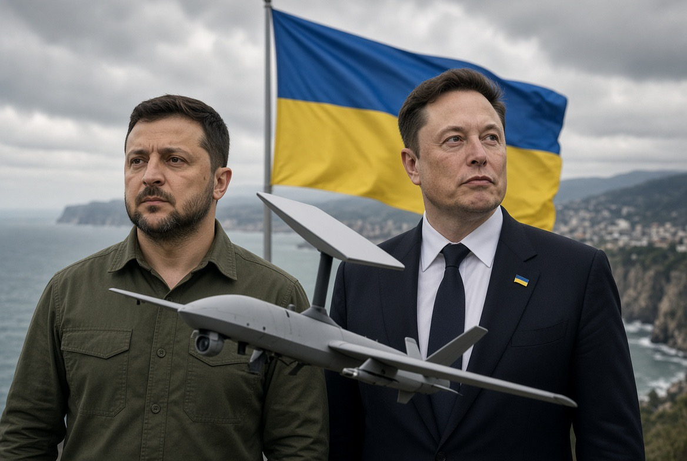

# Starlink Ikut Memegang Tombol Perang Ukraina?

*Ilustrasi (pic: Grok AI).*

  
***Menghentikan koneksi satelit bukan berarti menghentikan permusuhan, dan menguasai jaringan bukan berarti memiliki hak untuk menentukan hidup-mati manusia tanpa pengawasan***
  

Salah satu persoalan paling besar dalam perang modern adalah apakah kekuasaan militer masih berada di tangan negara, atau sudah ikut berpindah ke perusahaan teknologi swasta yang menguasai infrastruktur digital?

Kalau drone memerlukan koneksi satelit untuk menerima instruksi, menentukan posisi, atau mengirimkan data, bukankah pemilik satelit bisa memutus koneksinya dan menghentikan serangan?

Sebagian benar. Tetapi ada satu jebakan besar: mematikan jaringan satelit tidak sama dengan mematikan perang. Kita perlu membedakan kendali atas satu teknologi, kendali atas operasi militer, dan kendali atas keputusan untuk membunuh.

## Kasus Starlink: Teknologi Sipil Bisa Menjadi Infrastruktur Militer

Apa yang terjadi di Ukraina? Pada 24 Oktober 2026, Ukraina mengumumkan koneksi Starlink dan Starshield kembali beroperasi pada kecepatan yang dibutuhkan setelah pembatasan selama lebih dari sepekan. 

Militer Ukraina menyebut gangguan itu menghambat komunikasi garis depan dan upaya mencegat drone Rusia. 

Elon Musk kemudian menuduh militer Ukraina memakai Starlink untuk serangan drone ofensif yang melanggar ketentuan layanan. Ukraina membantah bahwa Starlink dipakai untuk operasi serangan jarak jauh sebagaimana dituduhkan.

Ada dua nama yang perlu dibedakan:
- Starlink adalah layanan internet satelit komersial milik SpaceX.
- Starshield adalah sistem berorientasi pemerintah dan militer yang menggunakan teknologi SpaceX, dengan kendali layanan yang tidak identik dengan Starlink biasa. Pemerintah AS memiliki peran penting dalam penggunaan Starshield.

Mengapa perbedaan itu penting? Karena ketika kita mengatakan “Elon Musk mematikan satelit”, gambaran tersebut terlalu sederhana. Pembatasan dapat menyangkut akses terminal, kecepatan koneksi, atau layanan tertentu, bukan berarti semua satelit dimatikan atau semua komunikasi Ukraina lenyap.

Tetapi dampak strategisnya nyata: pihak yang mengendalikan infrastruktur komunikasi bisa memengaruhi apa yang mampu dilakukan militer di lapangan.

## Semua Pemilik Satelit Mematikan Layanan, Drone Berhenti Menyerang?

Sebagian drone mungkin kehilangan kemampuan penting, tetapi tidak semua drone akan berhenti.

A. Drone yang bergantung pada komunikasi langsung

Jika drone membutuhkan tautan satelit untuk menerima perintah atau mengirim video, pemutusan koneksi dapat mengganggu kendali operator, pengintaian, atau perubahan misi. Pada sistem tertentu, drone bisa gagal menjalankan tugasnya.

B. Drone dengan navigasi atau misi mandiri

Sebagian drone bisa mengikuti rute yang telah diprogram, menggunakan navigasi inersial atau sensor lain, dan menyelesaikan sebagian misi tanpa koneksi satelit yang terus-menerus. Memutus internet tidak otomatis menghapus kemampuan tersebut.

C. Sistem yang menggunakan jalur komunikasi lain

Militer bisa memakai radio, jaringan terestrial, sistem navigasi alternatif, atau infrastruktur komunikasi lain. Jika satu jalur ditutup, sebagian kemampuan mungkin beralih ke jalur berbeda, meskipun tidak selalu semudah atau seandal sebelumnya.

Artinya, pada tingkat tertentu: mengendalikan akses komunikasi dapat membatasi kemampuan membunuh melalui sistem senjata tertentu. Namun, itu bukan tombol universal untuk menghentikan seluruh serangan drone.

Dan ada masalah lain. Jaringan satelit juga membantu pasukan bertahan, mendeteksi ancaman, berkoordinasi, serta memperingatkan warga terhadap serangan. 

Pemutusan layanan bisa menghambat serangan ofensif, tetapi juga bisa melemahkan pertahanan dan meningkatkan risiko korban sipil. Itulah dilema yang terlihat dalam kasus Ukraina.

## Siapa Sebenarnya yang Memegang Kekuasaan dalam Perang Modern?

Dulu, kita cenderung membayangkan perang sebagai pertarungan antara negara, tentara, senjata, dan wilayah. 

Sekarang, kekuasaan militer juga bergantung pada jaringan perusahaan yang mungkin tidak memiliki satu pun prajurit di medan tempur:
- Negara dan pemimpin politik: Menentukan tujuan politik dan keputusan perang.
- Perusahaan teknologi dan operator jaringan: Menyediakan komunikasi, data, komputasi, dan infrastruktur.
- Komandan dan sistem militer: Mengubah informasi menjadi koordinasi dan operasi lapangan.
- Dampak di medan perang: Keberhasilan misi, kegagalan operasi, kerusakan, dan korban manusia.

Ini adalah skema konseptual, bukan rantai komando yang berlaku sama pada semua negara.

Perusahaan teknologi tidak harus mengeluarkan perintah menembak untuk memengaruhi hasil pertempuran. Cukup dengan mengubah kemampuan komunikasi, perusahaan dapat mengubah pilihan yang tersedia bagi komandan.

Dalam ilmu politik dan studi keamanan, ini berkaitan dengan konsep infrastruktur sebagai kekuasaan (infrastructural power) dan ketergantungan strategis (strategic dependency).

Ada tiga bentuk kekuasaan yang perlu dibedakan:

| Jenis kekuasaan | Pertanyaan kuncinya |
|------|-------|
|Kekuasaan politik|Siapa yang memutuskan perang dilanjutkan atau dihentikan?|
|Kekuasaan operasional|Siapa yang menentukan target, waktu, dan penggunaan senjata?|
|Kekuasaan infrastruktur|Siapa yang bisa membuat sistem komunikasi atau data tersedia, dibatasi, atau dihentikan?|

Ketiganya bisa berada di tangan pihak yang berbeda. Itulah yang membuat perang modern semakin rumit.

Apakah Elon Musk bisa menentukan nasib perang? Ia dapat memiliki pengaruh besar atas kemampuan yang bergantung pada layanan perusahaannya. 

Namun, ia tidak otomatis menguasai seluruh operasi militer, dan pengaruhnya juga dibatasi oleh kontrak, pemerintah, infrastruktur alternatif, serta kemampuan pihak militer beradaptasi.

Kasus Starlink bahkan memperlihatkan persoalan tata kelola yang lebih rumit: siapa sebenarnya yang memutuskan pembatasan, apa dasar keputusannya, dan bagaimana keputusan itu diawasi? 

Laporan Reuters menyebut tanggung jawab atas pembatasan tersebut diperdebatkan antara SpaceX dan pemerintah AS. Sejumlah senator AS meminta penyelidikan atas gangguan layanan itu.

Dengan kata lain, kekuasaan strategis bisa berada pada perusahaan swasta tanpa berarti perusahaan tersebut memiliki kedaulatan penuh atas perang.

## Bagaimana kalau Seluruh Operator Satelit Dunia Sepakat Menghentikan Layanan Militer?

Kita andaikan semua operator satelit komersial dan pemerintah sepakat menolak penggunaan layanan mereka untuk serangan bersenjata.

Ada beberapa kemungkinan hasilnya:

- Dampak pertama: kemampuan tertentu menurun

Militer yang sangat bergantung pada jaringan satelit bisa kehilangan sebagian komunikasi, pengintaian, koordinasi, dan kendali jarak jauh. Operasi tertentu akan menjadi lebih sulit atau harus ditunda.

- Dampak kedua: negara mencari pengganti

Negara dapat membangun jaringan sendiri, mengandalkan sistem komunikasi lain, atau mengembangkan senjata yang tidak membutuhkan koneksi satelit terus-menerus. Peralihan ini memerlukan waktu dan biaya, tetapi penghentian satu layanan tidak menjamin ketergantungan militer akan hilang selamanya.

- Dampak ketiga: warga sipil ikut terkena akibatnya

Satelit juga menopang komunikasi darurat, navigasi, pemantauan cuaca, dan layanan sipil lainnya. Pemutusan total bisa mengganggu rumah sakit, bantuan kemanusiaan, pelayaran, dan masyarakat yang tidak terlibat dalam perang.

Ada pula masalah koordinasi: kesepakatan semua operator di seluruh dunia sangat sulit diwujudkan. Negara yang sedang berperang mungkin menganggap jaringan satelit militer sebagai kepentingan keamanan vital, sementara operator swasta memiliki kewajiban kontraktual dan aturan hukum yang berbeda-beda.

Jadi, gagasan itu mungkin mengurangi kemampuan perang tertentu jika diterapkan secara luas. Namun, ia tidak menjamin penghentian perang, dan jika dirancang tanpa pengecualian, justru bisa membahayakan orang-orang yang ingin dilindungi.

## Siapa yang Bertanggung Jawab kalau Teknologi Dipakai untuk Membunuh?

Perdebatan mengenai teknologi  jangan sampai membuat tanggung jawab manusia menghilang di balik mesin. Ada setidaknya tiga lapisan pertanggungjawaban:
- Negara dan komandan militer tetap harus mempertanggungjawabkan keputusan serta pelaksanaan operasi militer menurut hukum yang berlaku.
- Perusahaan teknologi perlu mempertimbangkan risiko penggunaan produknya, memenuhi kewajiban hukum dan kontrak yang berlaku, serta menjelaskan pembatasan layanan yang berdampak besar.
- Pembuat kebijakan dan regulator perlu memastikan infrastruktur yang sangat penting untuk keamanan tidak bergantung pada keputusan sepihak yang tanpa transparansi atau pengawasan memadai.

Tidak setiap perusahaan yang menyediakan konektivitas otomatis bertanggung jawab secara hukum atas setiap serangan yang menggunakan jaringannya. 

Pertanggungjawaban bergantung pada fakta, peran, pengetahuan, kewajiban hukum, dan hubungan dengan tindakan yang dipersoalkan.

Sebaliknya, menyebut layanan sebagai “teknologi sipil” juga tidak dengan sendirinya menyelesaikan persoalan. Penggunaan aktual, aturan layanan, dan hubungan antara penyedia dengan pengguna militer tetap perlu diperiksa.

Prinsip dasarnya: teknologi dapat memfasilitasi kekerasan, tetapi keputusan menggunakan kekerasan tidak boleh lenyap dari pertanggungjawaban manusia.

## Mengapa Laut Hitam Disebut Jalur Pelayaran Paling Berbahaya?

Berita tentang Starlink ini muncul di tengah memburuknya keamanan pelayaran Laut Hitam. 

Financial Times melaporkan pada 25 Oktober 2026 bahwa kawasan tersebut menjadi lingkungan pelayaran komersial paling mematikan pada 2026, dengan lebih dari 570 kapal terkena serangan dan sedikitnya 40 pelaut tewas menurut data yang dilaporkan. 

Serangan terhadap kapal dan infrastruktur pelabuhan, ditambah ranjau serta gangguan navigasi, memperbesar risiko bagi pelayaran sipil.

Laporan The Guardian juga mencatat peningkatan serangan terhadap kapal komersial pada Oktober, termasuk kapal yang beroperasi dekat perairan Rumania dan Bulgaria.

Ada hubungan penting antara kedua isu ini:
- Satelit membantu kapal menentukan posisi, berkomunikasi, dan menerima informasi.
- Sistem komunikasi dan navigasi dapat terganggu oleh pembatasan layanan atau peperangan elektronik.
- Kapal komersial yang tidak terlibat langsung dalam pertempuran tetap bisa menghadapi risiko serangan, salah identifikasi, atau kecelakaan.
- Perusahaan pelayaran dan asuransi merespons risiko tersebut dengan menaikkan premi atau mengubah rute. Biaya akhirnya dapat merambat ke harga barang dan pangan.

Laut Hitam bukan hanya medan konflik antara Rusia dan Ukraina. Ia juga merupakan jalur perdagangan internasional yang menghubungkan produsen dengan konsumen di banyak negara. Karena itu, dampaknya bisa terasa jauh dari medan perang.

## Perdamaian Tidak Bisa Diserahkan kepada Tombol Off Milik Perusahaan

Ada paradoks besar di sini. Teknologi satelit dapat membantu menyelamatkan nyawa dengan memberi peringatan serangan dan menjaga komunikasi pertahanan. 

Teknologi yang sama juga dapat membantu mengoordinasikan serangan. Infrastruktur yang identik bisa digunakan untuk tujuan yang sangat berbeda.

Karena itu, pertanyaan yang paling produktif bukan hanya, “Bisakah Elon Musk mematikan Starlink?” Melainkan:
Siapa yang berwenang membatasi layanan yang vital bagi keamanan?
Bagaimana memastikan pembatasan tidak justru melemahkan perlindungan warga sipil?
Bagaimana mencegah ketergantungan militer pada satu perusahaan?
Bagaimana memastikan keputusan serangan tetap tunduk pada hukum dan pertanggungjawaban?

Kalau kita ingin mengurangi korban perang, solusi yang lebih tahan lama adalah gabungan tata kelola teknologi, pengawasan terhadap penggunaan militer, perlindungan komunikasi kemanusiaan, diplomasi, dan aturan yang mengikat para pihak.

Satelit memang bisa menjadi salah satu tombol yang memengaruhi perang. Tetapi menghentikan koneksi bukan berarti menghentikan permusuhan, dan menguasai jaringan bukan berarti memiliki hak untuk menentukan hidup-mati manusia tanpa pengawasan. 

  
**Referensi**

Reuters. (2026, October 24). Ukraine says Starlink back to normal, Musk accuses Kyiv of violations. ThePrint, Reuters feed⁠

U.S. Senate Foreign Relations Committee, Democratic staff. (2026, October 19). Shaheen, Blumenthal, Whitehouse, and Coons demand answers from SpaceX after Starlink and Starshield failure leaves Ukraine vulnerable to Russian attacks. U.S. Senate⁠

Financial Times. (2026, October 25). The Black Sea is now the world’s deadliest shipping route. Financial Times⁠

The Guardian. (2026, October 18). Intensifying drone attacks on ships in Black Sea bring war ever closer to Nato shores. The Guardian⁠
