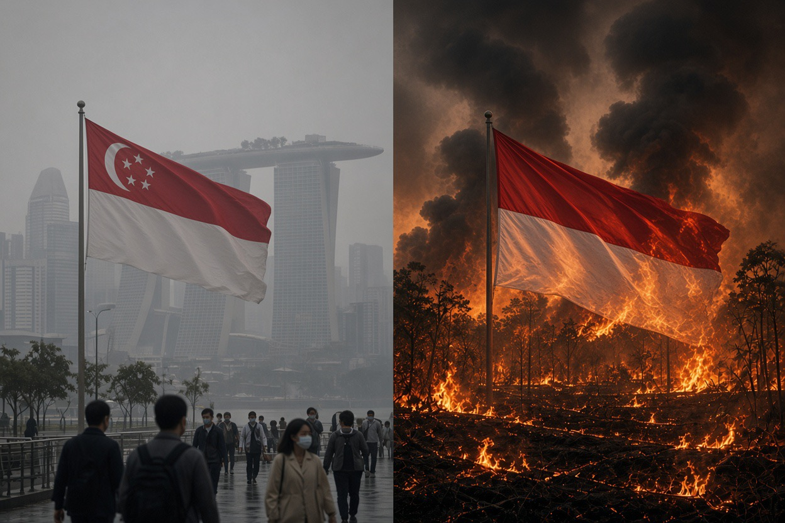

# Surat Singapura, Lahan Indonesia, Struktur Korporasi Berlapis: Siapa Sebenarnya yang Sedang Bermain?

*Ilustrasi (pic: Grok AI).*

  
***Kalau keuntungan bisnis bisa melintasi perbatasan dengan sangat mudah, tanggung jawab atas kerusakan lingkungan tidak boleh berhenti di perbatasan yang sama***
  

Apakah Singapura sedang membela hak warganya untuk menghirup udara bersih, atau sekaligus memainkan posisi ekonominya untuk memindahkan beban kerusakan lingkungan kepada Indonesia?

Dugaan mantan menteri Luthfi layak diuji. Sebab, dalam hubungan internasional, negara bisa sungguh-sungguh menghadapi masalah lingkungan sekaligus menggunakan masalah tersebut untuk memperkuat kepentingan nasionalnya. Dua hal itu tidak otomatis saling meniadakan.

Tetapi kita perlu memisahkan tiga tuduhan yang berbeda:
- Singapura bersikap munafik karena menikmati keuntungan ekonomi dari perdagangan dengan Indonesia.
- Singapura menjadi pusat perdagangan perantara, sehingga barang Indonesia bisa diperdagangkan kembali dengan nilai lebih tinggi.
- Surat peringatan terhadap perusahaan pemegang konsesi di Indonesia sengaja dijadikan alat politik untuk mengakali Indonesia.
Dua yang pertama bisa diuji melalui data perdagangan dan struktur kepemilikan. Tuduhan ketiga membutuhkan bukti tentang tujuan, pola tindakan, dan penerapan hukum. 

Jangan sampai kita punya kritik yang kuat, tetapi mencampur fakta yang terbukti dengan motif yang belum terbukti. Kita akan bedah satu per satu.

Setelah menelusuri pernyataan Muhammad Lutfi, laporan Greenpeace, data perdagangan Singapura, dan respons terbaru pemerintah Singapura, ada satu fakta yang membuat kritik ini jauh lebih menarik.

Lutfi tidak sedang mengkritik Singapura semata-mata karena negara itu protes soal asap. Ia mempertanyakan apakah Singapura mau bertanggung jawab terhadap kelompok usaha yang menikmati keuntungan dan beroperasi melalui struktur korporasi yang berhubungan dengannya. Itu persoalan yang sah secara ekonomi-politik. 

Tetapi apakah ini membuktikan Singapura sengaja mengakali Indonesia? Belum. Kita perlu menguji buktinya.

Ada perkembangan penting juga: per 19 Oktober, Singapura memperluas pemberitahuan pencegahan dari tujuh menjadi sepuluh perusahaan Indonesia. 

Pemerintahnya menyatakan akan menelusuri kelompok usaha, pihak yang mengendalikan perusahaan, kemungkinan manfaat pemerintah yang mereka terima di Singapura, dan risiko yang perlu diperhatikan bank pemberi pinjaman. Jadi, untuk saat ini, tindakan mereka tidak berhenti pada tujuh surat pertama.

Mari kita bedah tuduhan Lutfi satu per satu.

## Apakah Surat itu Cuma Pertunjukan Politik untuk Menyenangkan Pemilih Singapura?

Ini tuduhan utama Lutfi. Ia menilai pemerintah Singapura tidak seharusnya cuma mengumumkan surat peringatan demi membuat konstituennya puas. 

Jika benar-benar yakin perusahaan bertanggung jawab, menurutnya, Singapura harus berani menempuh tindakan hukum terhadap kelompok usaha yang punya hubungan dengan negara itu.

Kritik ini punya dasar yang bisa diuji, tetapi belum cukup untuk menyimpulkan bahwa surat tersebut semata-mata akal-akalan.

Lihat perkembangan sesudah surat pertama dikirim:
- 16 Oktober: NEA mengirim pemberitahuan pencegahan kepada tujuh perusahaan di Sumatra.
- 19 Oktober: NEA mengumumkan tiga perusahaan tambahan di Kalimantan akan menerima pemberitahuan.
- 19 Oktober: Menteri Senior Singapura K. Shanmugam mengatakan pemerintah akan memeriksa hubungan perusahaan dengan kelompok usaha, pemilik pengendali, bank, dan kemungkinan insentif pemerintah Singapura. Ia juga menyatakan tindakan lanjutan bisa menyasar kepentingan finansial dan reputasi perusahaan.
Artinya, bukti yang tersedia sekarang menunjukkan bahwa pemerintah Singapura sudah mengumumkan langkah lanjutan, tetapi efektivitas penindakannya belum terbukti.

Kritik Lutfi akan semakin kuat jika setelah asap hilang, Singapura tidak menindak perusahaan yang terbukti melanggar, tidak menyentuh kelompok usaha yang memperoleh keuntungan, dan membiarkan ancaman hukumnya menguap. 

Sebaliknya, jika investigasi berlanjut menjadi tindakan yang dapat diuji secara hukum, tuduhan bahwa surat itu hanya pertunjukan politik menjadi lebih sulit dipertahankan.
Kita harus membedakan niat politik dari hasil kebijakan. 

Politikus bisa memperoleh keuntungan popularitas dari tindakan yang sekaligus benar-benar melindungi kesehatan masyarakat. Tidak ada kontradiksi otomatis di sana.

## Benarkah 25 Perusahaan yang Terkait Kebakaran Milik Singapura?

Laporan Greenpeace Indonesia, Greenpeace Malaysia, dan Pantau Gambut tanggal 5 Oktober 2026 mengidentifikasi 20 entitas yang terkait dengan titik sumber asap dan kebakaran. 

Laporan itu menemukan setidaknya empat konsesi yang mempunyai hubungan korporasi dengan kelompok usaha Singapura. Itu tidak sama dengan menyatakan 25 perusahaan semuanya dimiliki Singapura.

Ada tiga jenis hubungan yang jangan dicampuradukkan:

| Jenis hubungan | Maknanya |
|------|-------|
|Perusahaan tercatat di bursa Singapura|Sahamnya diperdagangkan di SGX. Ini tidak otomatis berarti seluruh aset atau operasinya berada di Singapura.|
|Anak perusahaan atau konsesi di Indonesia|Perusahaan lokal menjalankan usaha dan menguasai atau mengelola lahan di Indonesia. Pemilik akhirnya bisa berada di negara lain.|
|Pemasok bagi kelompok usaha Singapura|Perusahaan menjual hasil produksinya kepada kelompok tersebut. Hubungan dagang tidak otomatis berarti kelompok pembeli memiliki atau mengendalikan pemasok.|

Laporan Greenpeace menyebut, misalnya, konsesi PT Damai Agro Sejahtera memiliki afiliasi dengan Bumitama Agri yang berkantor pusat di Singapura. Konsesi PT Kayung Agro Lestari dikaitkan dengan First Resources, ANJ, keluarga Fangiono, dan kelompok bisnis berbasis Singapura.

Sementara itu, Lutfi menyoroti bahwa empat dari tujuh perusahaan penerima pemberitahuan Singapura merupakan pemasok kelompok usaha besar yang memiliki hubungan korporasi dengan Singapura. 

Ia juga menyebut First Resources dan Bumitama Agri sebagai kelompok besar yang tercatat di bursa Singapura.

Jadi, inti kritiknya bukan sekadar berapa jumlah perusahaan yang “punya Singapura”. Intinya adalah siapa yang memperoleh keuntungan, siapa yang mengendalikan keputusan, dan siapa yang bertanggung jawab ketika operasi bisnis menimbulkan kerusakan.

Kepemilikan akhir dan kendali aktual harus dibuktikan melalui dokumen perusahaan, struktur pemegang saham, laporan keuangan, dan hubungan pengendalian. Alamat kantor pusat saja tidak cukup untuk membuktikan siapa yang memerintahkan pembakaran.

## Singapura Negara Perantara Perdagangan: Indonesia Menjual Murah, Singapura Menjual Mahal?

Ini bagian yang menarik secara ekonomi-politik. Dan memang, Singapura adalah pusat perdagangan perantara (entrepôt) yang besar.

Gambaran perdagangan Singapura pada 2025, total ekspor barang S$739,4 miliar, ekspor ulang (re-exports) S$454,8 miliar, porsi ekspor ulang 61,5%. Ini perhitungan dari statistik resmi perdagangan barang Singapura yang bersumber dari Singapore Department of Statistics, Merchandise Trade.

Angka ini menunjukkan betapa pentingnya ekspor ulang dalam perdagangan Singapura. Menurut definisi resmi, re-export adalah barang yang diekspor kembali dalam bentuk yang sama seperti ketika diimpor. Pengemasan ulang, pemecahan lot, penyortiran, atau pemberian label tidak dianggap sebagai transformasi barang.

Namun, ada tiga hal yang harus kita bedakan:

Pertama, ekspor ulang tidak otomatis berarti barang Indonesia dijual murah lalu dijual mahal oleh Singapura. Untuk membuktikan itu, kita perlu membandingkan komoditas yang sama, kualitas, volume, harga pada waktu transaksi, biaya pengangkutan, asuransi, pembiayaan, dan margin perdagangan.

Kedua, nilai ekspor ulang bukan berarti seluruh selisih harga menjadi keuntungan Singapura. Sebagian nilai itu adalah nilai barang yang dibeli dari luar negeri. Pendapatan dan nilai tambah lokal Singapura berasal dari kegiatan seperti perdagangan, logistik, penyimpanan, pembiayaan, asuransi, dan jasa lain, setelah memperhitungkan biaya.

Ketiga, walaupun perdagangan perantara sah, Indonesia tetap bisa kehilangan peluang untuk menangkap nilai tambah yang lebih besar. Jika Indonesia hanya memasok bahan mentah, sementara fungsi pembiayaan, perdagangan global, penetapan harga, dan pengelolaan jaringan pembeli terkonsentrasi di pusat perdagangan lain, sebagian pendapatan dari rantai nilai memang bisa terkumpul di luar Indonesia.

Itulah persoalan ekonomi yang lebih mendasar daripada sekadar tuduhan bahwa Singapura “membeli murah, menjual mahal”.

Pertanyaan yang perlu diajukan adalah: berapa besar nilai tambah yang benar-benar tertinggal di Indonesia, dan berapa besar yang dinikmati perusahaan perdagangan, pemilik merek, pemegang modal, serta pusat distribusi di luar negeri?

Untuk menjawabnya, kita perlu data perdagangan per komoditas dan data nilai tambah, bukan hanya statistik ekspor total.

## Apakah Sistem Pajak Singapura Sengaja Dirancang untuk Menampung Perusahaan yang Lahannya Ada di Negara Tetangga? 

Singapura memang menawarkan lingkungan bisnis yang menarik bagi perusahaan multinasional. Keunggulannya mencakup infrastruktur keuangan, kepastian regulasi, jaringan perdagangan, dan berbagai skema pajak.

Contohnya, Major Exporter Scheme memungkinkan perusahaan yang banyak melakukan ekspor ulang menangguhkan GST atas impor tertentu, sehingga biaya pajak di muka dan tekanan arus kas berkurang. Skema itu bukan pembebasan tanpa syarat: perusahaan harus memenuhi persyaratan yang berlaku.

Perusahaan multinasional juga bisa menempatkan kantor pusat, fungsi pembiayaan, pengadaan, perdagangan, atau pengelolaan investasi di Singapura, sementara kebun, pabrik, dan pekerjanya berada di Indonesia.

Struktur semacam ini tidak otomatis ilegal atau manipulatif. Pusat bisnis dapat memberikan layanan dan fungsi ekonomi yang nyata. Tetapi struktur itu menjadi persoalan jika dipakai untuk memisahkan keuntungan dari kewajiban, menyembunyikan pemilik manfaat, menghindari tanggung jawab, atau memindahkan laba secara tidak wajar.

Jadi, insentif pajak bukan bukti bahwa Singapura mengakali Indonesia. Tetapi keberadaan insentif pajak dan struktur korporasi lintas negara membuat pemeriksaan terhadap kendali perusahaan, aliran laba, dan tanggung jawab lingkungan menjadi sangat penting.

Dan inilah yang membuat kritik Lutfi relevan: jika Singapura memperoleh manfaat ekonomi dari kehadiran kelompok usaha tersebut, apakah pemerintahnya bersedia menggunakan instrumen yang dimilikinya untuk menuntut perilaku yang bertanggung jawab?

Pertanyaan itu bahkan mulai disentuh oleh pemerintah Singapura sendiri. Pada 19 Oktober, Shanmugam menyatakan pemerintah akan memeriksa apakah perusahaan yang terkait kabut asap menerima hibah atau insentif pemerintah Singapura dan apakah mereka masih memenuhi syarat untuk memperoleh manfaat tersebut.

## Kalau Perusahaan Punya Hubungan dengan Singapura, Mengapa Singapura Tidak Langsung Menuntut Kantor Pusatnya?

Inilah inti tantangan hukum yang diajukan Lutfi.

Perlu dibedakan antara dua pertanyaan:
- Apakah Singapura mempunyai kewenangan untuk menangani dampak kabut asap yang masuk ke wilayahnya?
- Apakah Singapura mempunyai bukti dan dasar hukum yang cukup untuk menuntut induk perusahaan atau individu yang mengendalikan operasi di Indonesia?
Pertanyaan pertama diatur oleh hukum kabut asap lintas batas Singapura. Pertanyaan kedua lebih sulit karena hubungan kepemilikan tidak otomatis membuktikan bahwa induk perusahaan memerintahkan, mengetahui, atau secara hukum bertanggung jawab atas tindakan anak perusahaan.

Pemerintah Singapura mengatakan akan menelusuri hubungan tersebut, termasuk kelompok usaha besar dan individu yang pada akhirnya mengendalikan perusahaan. 

Mereka juga menyatakan akan mempertimbangkan tindakan hukum, regulasi, dan ekonomi. Artinya, permintaan Lutfi agar Singapura bertindak terhadap perusahaan yang memiliki hubungan dengannya merupakan tantangan yang masuk akal. 

Tetapi tindakan itu perlu didasarkan pada bukti mengenai hubungan kendali dan dasar hukum yang tepat, bukan semata-mata pada fakta bahwa sebuah perusahaan tercatat di bursa Singapura.

Jika induk perusahaan memang terlibat dalam pengambilan keputusan yang menyebabkan pelanggaran, bukti itu harus diuji. Jika tidak, menganggap induk perusahaan bersalah hanya berdasarkan hubungan kepemilikan juga tidak adil.

## Jadi, Apakah ini Politik Akal-akalan Singapura?

Kita bisa menyusun penilaian berdasarkan bukti yang tersedia sekarang.

Didukung bukti: Singapura memiliki kepentingan domestik yang nyata dalam menangani kabut asap. Negara itu juga merupakan pusat perdagangan besar dan menjadi lokasi pencatatan atau kantor pusat bagi kelompok usaha yang terkait dengan operasi perkebunan di Indonesia.

Layak diselidiki lebih jauh: Apakah kelompok usaha yang mendapat manfaat dari ekosistem bisnis Singapura juga memperoleh insentif, akses pembiayaan, atau keuntungan lain tanpa pertanggungjawaban yang sepadan atas dampak lingkungannya. Pemerintah Singapura mengatakan sedang memeriksa persoalan ini.

Belum terbukti: Bahwa surat peringatan itu semata-mata merupakan sandiwara politik, bahwa seluruh perusahaan yang dikaitkan dengan kebakaran dimiliki Singapura, atau bahwa selisih harga dalam perdagangan perantara membuktikan Indonesia sengaja dirugikan.

Ada satu kenyataan yang tidak boleh diabaikan: pemerintah Singapura sendiri mengakui bahwa perusahaan yang ditargetkan berada di Indonesia dan bahwa mereka mungkin mengajukan persoalan teknis maupun hukum. Namun, pemerintah itu juga menyatakan akan menyelidiki hubungan korporasi dan mengambil langkah lebih jauh jika diperlukan.

Karena itu, pernyataan bahwa Singapura hanya berpura-pura bertindak masih merupakan interpretasi politik, bukan fakta yang telah terbukti.

## Apa yang Seharusnya Dituntut Indonesia?

Kalau Indonesia ingin menghindari posisi sebagai pemasok bahan mentah sekaligus lokasi kerusakan lingkungan, ada beberapa langkah yang bisa diuji secara konkret.

1. Buka struktur kepemilikan manfaat akhir. Publik perlu mengetahui siapa pemilik akhir dan siapa yang benar-benar mengendalikan perusahaan pemegang konsesi, termasuk jika struktur kepemilikannya melibatkan negara lain.

2. Tuntut pertanggungjawaban berdasarkan bukti. Pemerintah Indonesia harus menyelidiki titik api, penyebab kebakaran, tindakan perusahaan, dan kewajiban pengendalian api. Hubungan dengan Singapura tidak boleh menjadi alasan untuk menghindari pemeriksaan, tetapi juga bukan bukti kesalahan dengan sendirinya.

3. Dorong penindakan lintas negara. Jika bukti menunjukkan bahwa induk perusahaan atau pengendali berada di Singapura dan terlibat dalam pelanggaran, kedua negara perlu menggunakan jalur hukum dan kerja sama yang tersedia.

4. Naikkan nilai tambah di Indonesia. Selain mengekspor komoditas mentah, Indonesia dapat memperkuat pengolahan, pembiayaan, perdagangan, teknologi, dan kapasitas perusahaan domestik. Tujuannya bukan memusuhi pusat perdagangan lain, melainkan memperbesar nilai ekonomi yang dinikmati Indonesia sendiri.

5. Ukur hasil, bukan hanya pengumuman. Indikatornya harus jelas: luas lahan terbakar, jumlah kejadian berulang, pelaksanaan sanksi, pemulihan lahan, dan pertanggungjawaban perusahaan.

Kritik Lutfi membuka persoalan yang penting, tetapi belum membuktikan adanya operasi akal-akalan yang disengaja. Yang sudah terlihat adalah hubungan rumit antara kebakaran di Indonesia, kelompok usaha lintas negara, perdagangan perantara Singapura, dan pertanggungjawaban lingkungan.

Tuntutan paling kuat bukan sekadar meminta Singapura berhenti mengeluh. Tuntut agar setiap perusahaan yang terbukti terlibat dimintai pertanggungjawaban, termasuk induk atau pengendali yang terbukti berperan, tanpa membiarkan struktur korporasi lintas negara menjadi tirai untuk menghindari hukum.

Sebab kalau keuntungan bisnis bisa melintasi perbatasan dengan sangat mudah, tanggung jawab atas kerusakan lingkungan tidak boleh berhenti di perbatasan yang sama. 

  
**Referensi**

Muhammad Lutfi. (2026, 20 Oktober). Pernyataan mengenai kritik terhadap penanganan kabut asap Singapura, dikutip oleh detikFinance. Eks Menteri Kritik Singapura soal Karhutla: 4 dari 7 Perusahaan Tercatat di Sana!⁠

Greenpeace Indonesia, Greenpeace Malaysia, & Pantau Gambut. (2026, 5 Oktober). Malaysian and Singaporean in top 20 entities linked to fires in Indonesia⁠.

Ministry of Home Affairs, Singapore. (2026, 19 Oktober). Transcript of Media Doorstop on the Haze Situation⁠.

National Environment Agency, Singapore. (2026, 19 Oktober). NEA Issues Additional Notices Under The Transboundary Haze Pollution Act⁠.

Singapore Department of Statistics. Our Data Explained: Merchandise Trade⁠.

Singapore Customs. (2026). Major Exporter Scheme⁠.
