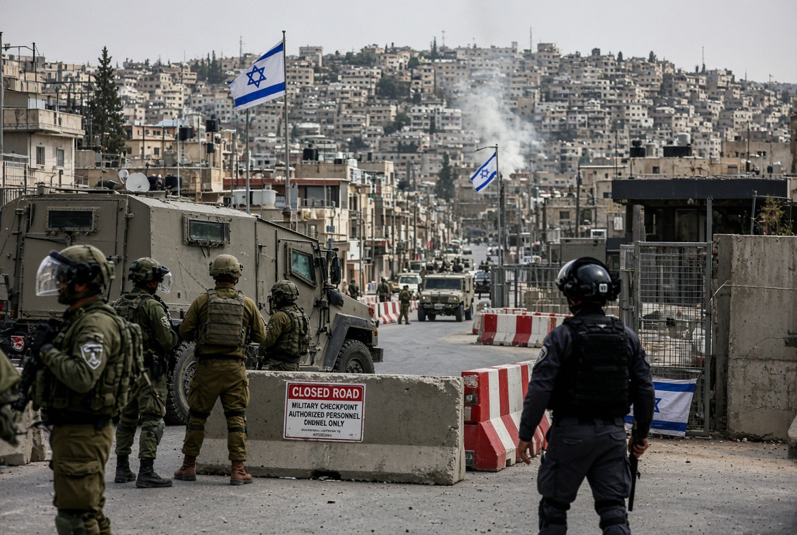

# Tepi Barat, Netanyahu, dan Politik yang Tumbuh Subur di Tengah Ketakutan

*Ilustrasi (pic: Grok AI).*

  
***Serangan terhadap tentara tidak memberi cek kosong kepada pemerintah untuk menghukum seluruh penduduk suatu wilayah***
  

Kita sedang berhadapan dengan tiga hal yang bisa terjadi bersamaan: serangan bersenjata yang nyata, penderitaan warga Palestina akibat pendudukan, dan pemanfaatan ancaman keamanan untuk kepentingan politik menjelang pemilu Israel.

Laporan terbaru per 23 Oktober 2026. Ada perkembangan yang sangat relevan: terjadi serangan bersenjata di dekat Hebron, dua tentara Israel dilaporkan tewas, dan Perdana Menteri Benjamin Netanyahu memerintahkan penutupan Hebron serta persiapan penutupan penuh Tepi Barat, dan pemilu parlemen Israel dijadwalkan pada 27 Oktober, hanya empat hari lagi.

Kedekatan waktunya menimbulkan pertanyaan. Tetapi kita perlu membedakan serangan yang sengaja direkayasa, serangan nyata yang kemudian dimanfaatkan secara politik, dan tindakan keamanan yang mungkin memiliki alasan operasional sekaligus keuntungan elektoral. Ketiganya bukan hal yang sama.

## Apa yang Sebenarnya Terjadi?

Menurut Associated Press, dua tentara Israel tewas dalam serangan yang melibatkan dua warga Palestina bersenjata. Tiga tentara lainnya dilaporkan terluka ringan. Pasukan Israel membunuh kedua orang yang dituduh melakukan serangan tersebut. Militer Israel mengatakan keduanya datang ke posisi militer dan terjadi baku tembak sekitar 20 menit.

Hamas mengklaim bertanggung jawab atas serangan itu dan menyebutnya sebagai respons terhadap tindakan Israel di Tepi Barat, Yerusalem, dan Gaza. 

Militer Israel menyatakan kedua penyerang membawa senapan M16 dan pistol. Namun, kita harus tetap membedakan klaim Hamas, keterangan militer Israel, dan fakta yang sudah dikonfirmasi secara independen.

Ada beberapa hal yang bisa kita simpulkan:
- Ada laporan tentang serangan bersenjata dan korban jiwa, bukan sekadar pernyataan politik tanpa kejadian fisik.
- Hamas mengaku bertanggung jawab, tetapi pengakuan suatu kelompok tetap perlu dinilai bersama bukti investigasi.
- Belum ada bukti publik bahwa Netanyahu mengatur atau merekayasa serangan tersebut agar memperoleh keuntungan elektoral.

Jadi, berdasarkan bukti yang tersedia, serangannya tampak sebagai peristiwa nyata. Tuduhan bahwa serangan itu direkayasa Netanyahu belum memiliki bukti yang mendukungnya.

Itu tidak berarti kita harus menerima setiap versi resmi Israel tanpa pemeriksaan. Justru dalam konflik, keterangan pihak yang sedang berperang harus diperiksa dengan standar yang sama.

## Mengapa Netanyahu Langsung Memerintahkan Penutupan Tepi Barat?

Setelah serangan itu, kantor Netanyahu menyatakan bahwa ia memerintahkan penutupan Hebron dan meminta persiapan untuk penutupan penuh Tepi Barat. Pemerintah Israel menyebut langkah itu sebagai bagian dari respons keamanan.

Di sini ada dua dimensi yang perlu dipisahkan.

Dimensi keamanan

Setelah serangan bersenjata yang menewaskan tentara, pemerintah dapat berusaha mencegah serangan susulan, mencari tersangka, mengamankan lokasi, dan mengendalikan pergerakan senjata maupun orang yang dicurigai terlibat.

Dimensi politik

Penutupan wilayah dan pengerahan aparat memperlihatkan kepada pemilih bahwa pemerintah sedang bertindak menghadapi ancaman. Menjelang pemilu, citra ketegasan dapat menjadi modal politik, terutama bagi pemimpin yang menjadikan keamanan nasional sebagai bagian utama kampanyenya.

Kedua dimensi itu bisa hadir sekaligus. Pemerintah bisa mempunyai alasan keamanan yang sungguh-sungguh, sementara tindakan yang sama juga menguntungkan citra politiknya.

Tetapi jangan sampai kita melompat dari “tindakan ini menguntungkan Netanyahu” menjadi “Netanyahu pasti menciptakan serangannya”. Dalam analisis politik, manfaat dari suatu kejadian bukan bukti bahwa penerima manfaat adalah dalang kejadian tersebut.

Ada detail tambahan: menurut Times of Israel, penutupan Tepi Barat dan Gaza juga sudah diperkirakan untuk Senin dan Selasa, bertepatan dengan periode pemilu. Serangan hari ini terjadi sebelum jadwal tersebut dan diikuti perintah penutupan segera. 

Ini membuat kita perlu membedakan pengaturan keamanan terkait pemilu dari penutupan tambahan sebagai respons terhadap serangan.

## Apakah Netanyahu Punya Insentif Politik untuk Memperbesar Isu Keamanan?

Pemilu Israel dijadwalkan pada 27 Oktober 2026. Pemilu ini merupakan pemilu pertama sejak serangan Hamas pada 7 Oktober 2023, yang menewaskan sekitar 1.200 orang di Israel dan menyebabkan 251 orang disandera. Kegagalan keamanan pada hari itu menjadi salah satu persoalan utama yang dihadapi Netanyahu.

Reuters melaporkan pada September bahwa Netanyahu kembali membangun citra dirinya sebagai pemimpin yang mampu menjaga keamanan Israel. Namun, ia menghadapi tantangan karena serangan Hamas pada 2023 terjadi ketika ia menjabat sebagai perdana menteri.

Analisis pusat kajian OSW pada September juga mencatat bahwa sebagian pengamat khawatir Netanyahu dapat memanfaatkan atau mengeksploitasi krisis keamanan untuk memperbaiki posisi politiknya, bahkan muncul kekhawatiran mengenai kemungkinan krisis baru yang bisa memengaruhi jadwal pemilu.  

Tetapi itu merupakan analisis mengenai risiko dan insentif politik, bukan bukti bahwa serangan Hebron hari ini direkayasa oleh pemerintah Israel.

Maka ada pertanyaan ilmiah yang tepat:
Apakah Netanyahu menggunakan serangan hari ini untuk membingkai dirinya sebagai pelindung Israel?
Apakah ia memperluas penutupan melebihi yang diperlukan untuk mengatasi ancaman?
Apakah kebijakannya efektif mencegah serangan lanjutan?
Apakah pembatasan itu diterapkan secara proporsional dan disertai perlindungan bagi warga sipil?
Pertanyaan-pertanyaan ini bisa dijawab melalui kebijakan yang diumumkan, bukti operasional, dampak penutupan, serta pernyataan kampanye. Kita tidak perlu menuduh adanya konspirasi untuk mengkritik penggunaan politik atas sebuah tragedi.

## Apakah Penyerang Palestina Benar-benar Orang yang “Nekat karena Kekejaman Israel”?

Dua kemungkinan yang bisa terjadi:
- Orang Palestina menyerang karena mengalami atau menyaksikan kekejaman Israel.
- Orang Palestina sengaja dikorbankan untuk membantu kampanye Netanyahu.
Ada kemungkinan lain: serangan itu merupakan keputusan operasional kelompok bersenjata, dalam hal ini Hamas mengklaim bertanggung jawab, yang bertujuan membalas tindakan Israel, menimbulkan korban, memengaruhi dinamika konflik, atau mengirim pesan politiknya sendiri.

Kita juga perlu membedakan motif pelaku dari konteks yang melatarbelakangi konflik. Pendudukan, kekerasan terhadap warga Palestina, pembatasan pergerakan, kehilangan rumah atau tanah, serta kematian anggota keluarga dapat menjadi bagian dari konteks yang mendorong radikalisasi atau keinginan membalas dendam. 

Namun, kita tidak dapat memastikan motif pribadi kedua penyerang hanya dari pernyataan Hamas.

Dan sekalipun seseorang melakukan serangan sebagai respons terhadap penindasan, konteks penindasan tidak otomatis membenarkan penyerangan terhadap warga sipil atau menghapus kewajiban hukum pelaku. Hukum humaniter internasional tetap berlaku bagi semua pihak.

Sebaliknya, serangan yang dilakukan oleh dua orang Palestina tidak dapat dipakai untuk membenarkan hukuman kolektif terhadap seluruh penduduk Tepi Barat.

Itulah garis pemisah yang penting: kita dapat mengkaji akar konflik tanpa menganggap setiap tindakan kekerasan sebagai sesuatu yang sah.

## Apakah Warga Palestina juga Mengalami Kekerasan Menjelang Pemilu Israel?

Ya. Dan ini penting agar analisis kita tidak hanya melihat kekerasan yang menimpa Israel, lalu mengabaikan kekerasan yang menimpa warga Palestina.

Pada Oktober ini, laporan tentang serangan pemukim Israel terhadap warga Palestina meningkat. ACLED, organisasi pemantau konflik, mencatat peningkatan kekerasan pemukim menjelang pemilu dan selama musim panen zaitun. 

Dalam sembilan hari pertama Oktober, organisasi itu mencatat lebih dari 350 insiden, dengan sekitar 68% melibatkan serangan terhadap petani, pemanen zaitun, atau properti mereka. 

ACLED memperingatkan bahwa Oktober berpotensi menjadi bulan paling keras untuk kekerasan pemukim sejak organisasi itu mulai memantau wilayah tersebut satu dekade lalu.

Pada 16 dan 17 Oktober, serangan pemukim juga mengenai jurnalis foto Amerika Heidi Levine serta diplomat Eropa di Tepi Barat. Polisi Israel kemudian menangkap sejumlah tersangka, tetapi pada 22 Oktober Reuters melaporkan sembilan dari sepuluh orang yang ditangkap telah dibebaskan dari tahanan dan ditempatkan dalam tahanan rumah, sementara penyelidikan masih berlangsung.

Data ini penting karena menunjukkan bahwa ancaman keamanan di Tepi Barat bukan hanya soal serangan bersenjata terhadap tentara Israel. Warga Palestina juga menghadapi kekerasan pemukim, pembatasan pergerakan, dan perusakan properti.

Namun, kita juga perlu menghindari kesalahan yang berlawanan: keberadaan kekerasan pemukim tidak membuktikan bahwa serangan terhadap tentara Israel direkayasa. Kedua jenis kekerasan bisa nyata pada waktu yang sama.

## Bagaimana dengan Dugaan bahwa Pemerintah Israel Sengaja Membiarkan Kekerasan Pemukim?

Ada bukti yang relevan untuk menguji pertanyaan tentang kebijakan dan akuntabilitas.

Washington Post melaporkan pada 5 Oktober bahwa kelompok pemukim mempercepat perluasan permukiman dan pos-pos baru menjelang pemilu, sementara pemerintah Netanyahu memberikan dukungan politik terhadap agenda perluasan permukiman. 

ACLED juga mengaitkan peningkatan kekerasan pemukim dengan perluasan kendali Israel atas Tepi Barat dan tekanan terhadap komunitas Palestina.

Ini mendukung kritik bahwa kebijakan pemerintah dan lemahnya penegakan hukum dapat menciptakan kondisi yang memungkinkan kekerasan berulang. 

Tetapi untuk menyimpulkan bahwa pemerintah memerintahkan setiap serangan pemukim, diperlukan bukti khusus mengenai perintah, koordinasi, atau keterlibatan langsung.

Jadi, kita dapat mengkritik kebijakan yang mendorong perluasan permukiman atau gagal melindungi warga Palestina tanpa membuat klaim yang melampaui bukti.

## Apa Bukti yang Diperlukan untuk Membuktikan Serangan itu Direkayasa?

Kalau hipotesisnya adalah Netanyahu sengaja mengatur serangan atau mengorbankan orang Palestina agar bisa tampil sebagai pelindung Israel, standar pembuktiannya harus tinggi.

Kita perlu mencari hal-hal seperti:
- Komunikasi atau perintah: bukti bahwa pejabat pemerintah, aparat, atau perantara mengarahkan serangan.
- Hubungan operasional: bukti koordinasi antara pihak yang diduga merekayasa dan para pelaku.
- Rekayasa bukti: bukti senjata, identitas pelaku, atau rangkaian kejadian sengaja dipalsukan.
- Kesaksian yang dapat diverifikasi: saksi langsung, dokumen, rekaman, atau bukti forensik yang saling mendukung.
- Penyelidikan independen: hasil investigasi yang menguji versi pemerintah, Hamas, dan pihak lain.

Kedekatan waktu dengan pemilu, keuntungan politik bagi Netanyahu, atau fakta bahwa pemerintah langsung memerintahkan penutupan wilayah tidak cukup untuk membuktikan rekayasa.

Sebaliknya, jika ada bukti bahwa pemerintah mengetahui ancaman yang akan terjadi tetapi sengaja membiarkannya, atau bahwa aparat mengatur kejadian tersebut, itu akan menjadi persoalan yang sangat serius. Namun, kita belum memiliki bukti publik semacam itu untuk serangan Hebron hari ini.

## Serangan Nyata, Eksploitasi Politik Mungkin, Rekayasa Belum Terbukti

Mari kita rangkum secara tegas:

| Pertanyaan | Penilaian berdasarkan bukti yang tersedia |
|------|-------|
|Apakah serangan bersenjata terjadi di dekat Hebron?|Ya, dilaporkan oleh AP dan media lain.|
|Apakah Hamas mengklaim bertanggung jawab?|Ya. Klaim itu tetap perlu dinilai bersama bukti investigasi.|
|Apakah Netanyahu memerintahkan penutupan Tepi Barat setelah serangan?|Ya, pemerintah mengumumkan penutupan Hebron dan persiapan penutupan penuh.|
|Apakah keamanan menjadi isu penting menjelang pemilu?|Ya, isu keamanan merupakan bagian sentral dari kampanye Israel.|
|Apakah Netanyahu dapat memperoleh keuntungan politik dari respons keamanan yang keras?|Secara politik itu mungkin, tetapi keuntungan potensial bukan bukti rekayasa.|
|Apakah ada bukti publik bahwa Netanyahu merekayasa serangan atau mengorbankan orang Palestina?|Belum ada bukti yang saya temukan hingga 23 Oktober 2026.|

Hipotesis yang paling sesuai dengan bukti saat ini bukan bahwa serangan itu pasti direkayasa, melainkan bahwa serangan bersenjata terjadi di tengah konflik nyata dan menjelang pemilu, lalu pemerintah meresponsnya dengan langkah keamanan yang juga memiliki konsekuensi politik.

Kita boleh mencurigai bagaimana Netanyahu menggunakan peristiwa itu dalam kampanye. Kita juga boleh menuntut agar penutupan Tepi Barat tidak menjadi hukuman kolektif terhadap warga Palestina. 

Tetapi kita tidak boleh menyatakan bahwa dua orang Palestina sengaja dikorbankan untuk kampanye Netanyahu tanpa bukti yang menghubungkan pemerintah dengan serangan tersebut.

Dan satu hal terakhir yang paling penting: jika pemerintah Israel menggunakan serangan untuk membenarkan pembatasan luas terhadap warga Palestina, tindakan itu tetap harus dinilai berdasarkan kebutuhan keamanan, proporsionalitas, dan hukum internasional. 

Serangan terhadap tentara tidak memberi cek kosong kepada pemerintah untuk menghukum seluruh penduduk suatu wilayah. 

  
**Referensi**

Associated Press. (2026, October 23). The Israeli military says 2 soldiers were killed in West Bank attack. AP News⁠.

Reuters. (2026, September 29). Using old election playbook, Netanyahu projects image as Israel’s protector despite Hamas attack. Reuters⁠.

ACLED. (2026, October). Why is settler violence reaching record levels ahead of Israel’s elections? ACLED⁠.

The Washington Post. (2026, October 5). With attention on Gaza and Iran, Israeli settlers grab land in West Bank. The Washington Post⁠.

Reuters. (2026, October 22). Israel frees from custody almost all suspects in two settler attacks, puts them under house arrest. Reuters⁠.
