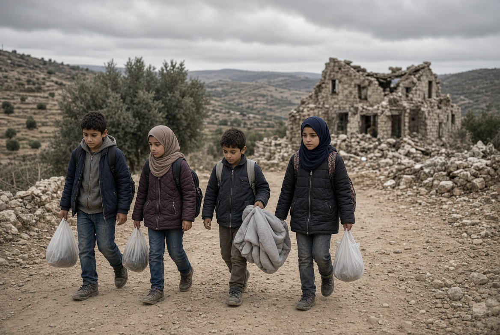

# Tepi Barat: Anak-anak yang Tidak Bersalah, Apa yang Sebenarnya Hilang Ketika Sebuah Rumah Dihancurkan?

*Ilustrasi (pic: Grok AI).*

  
***Ketika sebuah keluarga dipaksa pergi, pertanyaannya sederhana: apa yang telah dilakukan untuk melindungi mereka yang tidak melakukan serangan, dan siapa yang akan bertanggung jawab atas kerugian yang mereka alami?***
  

Rumah bukan sekadar empat dinding dan atap. Bagi anak, rumah adalah tempat ia tidur, menyimpan buku sekolah, mengenali suara ibunya, dan belajar bahwa dunia masih mempunyai sudut yang stabil.

Ketika keluarga dipaksa pergi dalam waktu singkat, kehilangan mereka berlapis-lapis.

Bayi dan balita

Mereka bergantung pada orang dewasa untuk susu, makanan, kebersihan, suhu yang layak, dan rasa aman. Perpindahan mendadak dapat memutus rutinitas perawatan dan meningkatkan kesulitan memperoleh kebutuhan dasar.

Anak usia sekolah

Sekolah yang sulit dijangkau, jalan yang ditutup, dan tempat tinggal yang tidak menentu dapat mengganggu pendidikan. Dampaknya bukan hanya hari belajar yang hilang, melainkan juga konsentrasi, perkembangan sosial, dan kemungkinan tertinggal dalam pelajaran.

Ibu hamil, lansia, dan penyandang disabilitas

Mereka mungkin membutuhkan obat rutin, pemeriksaan medis, alat bantu mobilitas, atau transportasi khusus. Jalan yang ditutup dapat mengubah perjalanan medis menjadi persoalan keselamatan.

Dalam laporan Reuters pada 24 Oktober, seorang warga mengatakan pembatasan pergerakan membuat putrinya tidak dapat dibawa ke Yerusalem untuk memperoleh perawatan kanker. Kisah tersebut menunjukkan bahwa dampak pembatasan tidak berhenti pada keluarga yang rumahnya dihancurkan.

Laporan kemanusiaan OCHA sebelum operasi Hebron juga mendokumentasikan berulangnya pengungsian anak-anak akibat pembongkaran rumah dan struktur penunjang kehidupan di Tepi Barat. 

Pada September 2026, pembongkaran di Jinba memaksa 55 orang, termasuk 32 anak, meninggalkan rumah mereka; sejumlah keluarga berlindung di gua-gua di wilayah tersebut.

Itu bukan berarti kita sudah memiliki data terverifikasi mengenai jumlah bayi, ibu hamil, atau penyandang disabilitas dalam setiap keluarga yang diungsikan dari Hebron pada 23 hingga 24 Oktober. 

Rincian tersebut perlu dikonfirmasi oleh petugas kemanusiaan. Tetapi kelompok-kelompok itu memang mempunyai kebutuhan perlindungan yang harus diperhitungkan sebelum dan selama pemindahan penduduk.

Dan ada satu persoalan mendasar: warga sipil tidak kehilangan haknya hanya karena tinggal di dekat seseorang yang melakukan serangan.

## Kalau Tidak Ada Superhero, Apa yang Benar-benar Bisa Menyelamatkan Warga Palestina?

Di dunia nyata, perlindungan warga sipil membutuhkan sesuatu yang lebih sulit daripada satu pahlawan: kekuatan politik yang bisa mengubah biaya dan insentif dari tindakan yang melanggar hukum.

Bukan berarti tidak ada yang dapat dilakukan. Ada beberapa jalur yang bisa bekerja bersamaan.

1. Tekanan diplomatik yang disertai konsekuensi

Kecaman saja sering tidak cukup. Pemerintah yang menuntut perlindungan warga sipil dapat menghubungkan hubungan bilateral, kerja sama militer, perdagangan senjata, dan bantuan dengan kepatuhan terhadap hukum internasional. Langkah konkret bergantung pada hukum masing-masing negara dan keputusan politiknya.

Amerika Serikat mempunyai pengaruh besar terhadap Israel, tetapi pengaruh itu baru menghasilkan perubahan jika digunakan untuk memperoleh komitmen yang dapat diverifikasi dan diikuti konsekuensi ketika komitmen dilanggar.

2. Diplomasi Qatar, Mesir, dan negara-negara lain

Qatar dan Mesir mempunyai pengalaman memediasi kesepakatan terkait Gaza bersama Amerika Serikat dan mitra lainnya. Namun, kesepakatan Gaza tidak otomatis menghentikan operasi di Tepi Barat.

Diplomasi perlu diarahkan pada penghentian pengusiran, akses bantuan, pembukaan jalur medis, perlindungan warga sipil, dan jaminan bahwa keluarga dapat kembali ke rumah apabila pemindahan mereka tidak lagi diperlukan.

3. Dokumentasi dan akuntabilitas hukum

Foto, video, citra satelit, kesaksian warga, catatan medis, daftar bangunan yang dihancurkan, dan identitas orang yang mengeluarkan perintah perlu dikumpulkan serta diverifikasi.

Bukti yang terjaga rantai penguasaannya dapat membantu proses pengadilan dan investigasi independen. Tujuannya bukan sekadar mempermalukan pelaku, melainkan menguji tanggung jawab individual dan membangun dasar bagi pertanggungjawaban hukum.

4. Bantuan kemanusiaan yang menjangkau keluarga

Prioritasnya adalah tempat tinggal sementara, air bersih, makanan, perlengkapan bayi, obat-obatan, transportasi medis, dukungan psikososial, dan kelanjutan pendidikan. Bantuan juga perlu menjangkau keluarga yang kehilangan penghasilan, bukan hanya mereka yang rumahnya hancur.

ICRC telah menyerukan perlindungan mendesak bagi penduduk sipil Tepi Barat serta penghormatan terhadap akses layanan esensial.

5. Tekanan masyarakat sipil dan dukungan terhadap hak Palestina

Publik dapat mendukung organisasi kemanusiaan yang transparan, menyebarkan laporan terverifikasi, menghubungi wakil politik, dan menuntut perlindungan hak warga sipil tanpa menyebarkan informasi palsu atau menyerang orang berdasarkan identitas mereka.

Pengakuan negara Palestina juga dapat memperkuat kedudukan diplomatik dan pengakuan atas hak menentukan nasib sendiri. Namun, pengakuan saja tidak otomatis menghentikan pembongkaran rumah atau menjamin keamanan penduduk.

## Mengapa Persatuan Politik Palestina juga Penting?

Persatuan tidak berarti seluruh faksi harus sepakat mengenai segala sesuatu. Yang dibutuhkan adalah kemampuan membangun representasi politik yang sah, menjaga koordinasi pemerintahan, memperjuangkan hak warga, dan menawarkan strategi yang dapat dipertanggungjawabkan kepada masyarakat Palestina sendiri.

Perpecahan politik dapat memperlemah kemampuan negosiasi dan menyulitkan penyelenggaraan layanan publik. Namun, tanggung jawab atas tindakan Israel tidak dapat dialihkan kepada Palestina hanya karena institusi politik mereka terpecah.

Hak warga sipil atas perlindungan tetap berlaku terlepas dari siapa yang memimpin mereka.

## Satu Pertanyaan yang Tidak Boleh Kita Hindari

Kita tidak dapat mengetahui pikiran setiap pengambil keputusan dari tindakan yang terlihat. Akan tetapi, kita bisa menilai struktur penalaran yang tercermin dalam kebijakan.

Ketika sebuah pemerintahan memprioritaskan penutupan wilayah, penghancuran bangunan, dan tekanan terhadap komunitas setelah serangan, beberapa pertimbangan mungkin bekerja sekaligus:
- Keinginan menghilangkan ancaman keamanan secepat mungkin.
- Anggapan bahwa tekanan terhadap lingkungan tempat pelaku berasal akan mencegah serangan berikutnya.
- Keinginan menunjukkan ketegasan kepada pemilih dan kelompok politik pendukung.
- Agenda teritorial atau ideologis yang lebih luas, jika didukung bukti mengenai tujuan dan pelaksanaannya.

Kita harus menyelidiki kontribusi masing-masing faktor, bukan menganggap semua pejabat mempunyai motif yang identik.

Tetapi satu prinsip tidak berubah: anak-anak tidak boleh diperlakukan sebagai alat untuk menekan orang dewasa. Keluarga tidak kehilangan perlindungan hukumnya hanya karena tinggal di kawasan tempat serangan terjadi.

Jika penghancuran rumah dilakukan untuk menghukum orang atas tindakan yang tidak mereka lakukan, persoalannya bukan lagi sekadar apakah strategi tersebut efektif. Persoalannya adalah apakah tindakan itu melanggar hukum dan siapa yang harus mempertanggungjawabkannya.

Dan jika pengusiran warga sipil menjadi bagian dari kebijakan yang lebih luas untuk mengubah komposisi penduduk suatu wilayah, pola, tujuan, serta bukti mengenai niat tersebut harus diselidiki dengan serius. Tidak perlu terburu-buru memberikan label hukum sebelum unsur-unsurnya diperiksa, tetapi tidak boleh pula menutup mata terhadap tanda-tandanya.

Dan kita tidak perlu menunggu seorang pahlawan untuk memulai pekerjaan itu.

Ketika satu rumah dihancurkan, yang hilang bukan hanya bangunan. Ada tahun-tahun kerja, tabungan keluarga, album foto, buku sekolah, obat-obatan, dan rasa bahwa esok hari masih bisa direncanakan.

Ketika sebuah keluarga dipaksa pergi, pertanyaan kemanusiaannya sederhana: apa yang telah dilakukan untuk melindungi mereka yang tidak melakukan serangan, dan siapa yang akan bertanggung jawab atas kerugian yang mereka alami?

Pertanyaan itu harus terus diajukan kepada pemerintah, lembaga internasional, pengadilan, dan siapa pun yang mempunyai kekuasaan untuk mengubah keadaan.

Bukan karena kita menganggap semua pihak sama, melainkan karena kehidupan manusia tidak boleh menjadi biaya yang dianggap sepele dalam perhitungan politik. 

  
**Referensi**

International Committee of the Red Cross. (2026, September 29). West Bank: ICRC calls for urgent protection of civilian population. Baca pernyataan ICRC⁠.

United Nations Office for the Coordination of Humanitarian Affairs. (2026, October 15). Humanitarian Situation Report. Baca laporan OCHA⁠.

United Nations Special Coordinator for the Middle East Peace Process. (2026, September 28). Security Council briefing on the implementation of Security Council Resolution 2334. Baca laporan PBB⁠.

Reuters. (2026, October 24). Around 1,200 Palestinians are displaced in Hebron as Israel begins military operation. Baca laporan Reuters⁠.
