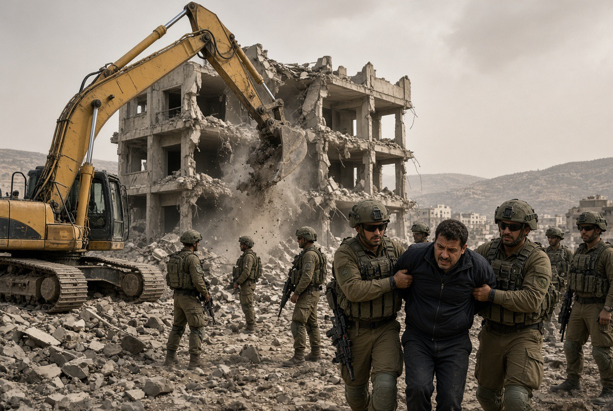

# Tepi Barat: Bumerang Penembakan Sebagai Alasan Menghancurkan Bangunan dan Menghukum Penduduk Sipil

*Ilustrasi (pic: Grok AI).*

  
***Menjelang pemilu, pernyataan pejabat menyerukan penghancuran dan operasi luas, serta dampak nyata terhadap penduduk Palestina memberikan alasan kuat untuk menyelidiki apakah insiden sedang digunakan untuk membenarkan kebijakan yang jauh melampaui penanganan pelaku***
  

Jumat, 23 Oktober terjadi baku tembak di dekat Hebron. Dua tentara Israel dan dua warga Palestina yang diduga sebagai pelaku penembakan tewas. Sejumlah tentara Israel lainnya dilaporkan terluka.

Benjamin Netanyahu memerintahkan penutupan luas Tepi Barat. Pada Sabtu, pasukan Israel telah merazia sedikitnya 15 kota atau permukiman di wilayah utara, termasuk Nablus, Jenin, dan Tubas. Puluhan orang ditangkap, sebuah bangunan tiga lantai di Hebron dihancurkan, dan keluarga Palestina diperintahkan meninggalkan rumah mereka.

Pernyataan politik yang memperluas persoalan datang dari Menteri Keuangan Bezalel Smotrich yang menyatakan telah memerintahkan penghancuran deretan bangunan Arab yang disebutnya ilegal di dekat lokasi serangan. 

Netanyahu juga mengatakan bahwa wilayah tempat tinggal para tersangka akan diubah secara menyeluruh. Smotrich bahkan menyerukan operasi luas dengan model yang diterapkan Israel di Gaza.

Persoalan kemanusiaannya sudah nyata. Reuters melaporkan bahwa sekitar 1.200 warga Palestina telah mengungsi di Hebron pada 24 Oktober, sementara sekitar 70 orang dilaporkan ditangkap menurut Palestinian Prisoners’ Club. Jumlah tersebut merupakan laporan awal dan dapat berubah seiring perkembangan operasi.

Dengan kata lain, kita tidak sedang membicarakan sekadar ancaman verbal. Kebijakan itu sudah memiliki konsekuensi fisik bagi penduduk.

## Penembakan Sengaja Diciptakan Sebagai Alasan?

Kita uji menggunakan tiga hipotesis, bukan memilih yang paling dramatis. Tiga hipotesis yang harus dibedakan:

Hipotesis A:
Serangan nyata, respons keamanan
Dua orang Palestina melakukan serangan bersenjata, lalu pemerintah Israel merespons dengan operasi militer. Sebagian operasi mungkin memiliki tujuan keamanan yang nyata, tetapi cakupan dan caranya tetap dapat melanggar hukum.

Hipotesis B:
Serangan nyata, dieksploitasi secara politik
Serangan benar-benar terjadi, tetapi pemerintah menggunakan peristiwa itu untuk membenarkan kebijakan yang jauh lebih luas daripada kebutuhan langsung untuk menangani pelaku. Inilah hipotesis yang perlu diuji melalui waktu, cakupan operasi, pernyataan pejabat, dan dampak terhadap penduduk.

Hipotesis C:
Serangan direkayasa atau sengaja dipancing
Ada pihak yang dengan sengaja menciptakan kondisi agar serangan terjadi, atau merekayasa bukti tentang serangan, demi memperoleh alasan politik maupun militer.
Hipotesis ini membutuhkan bukti tersendiri, misalnya komunikasi yang terverifikasi, dokumen perencanaan, kesaksian langsung yang teruji, atau temuan investigasi independen.

Apa yang didukung bukti sekarang? Laporan Reuters dan Associated Press pada 23 Oktober 2026 menyebut baku tembak yang menewaskan dua tentara Israel dan dua tersangka Palestina. 

Reuters juga melaporkan bahwa seorang fotografer AFP menyaksikan baku tembak tersebut. Ini mendukung kesimpulan bahwa insiden bersenjata benar-benar terjadi, meskipun belum menjawab semua pertanyaan tentang perencanaan dan motifnya.

Namun, bukti bahwa serangan terjadi tidak dengan sendirinya membuktikan bahwa respons Israel proporsional, sah, atau semata-mata didorong kebutuhan keamanan.

Sebaliknya, fakta bahwa pemerintah memperoleh keuntungan politik dari sebuah peristiwa juga tidak membuktikan bahwa pemerintah menciptakan peristiwa tersebut.

Di sinilah analisis intelijen sering gagal jika terlalu cepat mengambil kesimpulan: siapa yang diuntungkan diperlakukan seolah-olah sama dengan siapa yang merencanakan.
Padahal keduanya pertanyaan berbeda.

Bagaimana dengan kemungkinan sengaja memancing serangan? Ada mekanisme yang secara teoritis masuk akal: kebijakan represif meningkatkan kemarahan, kemarahan meningkatkan risiko radikalisasi, serangan kemudian terjadi, lalu serangan dipakai untuk membenarkan represi yang lebih luas. Pola ini dapat menjadi lingkaran umpan balik kekerasan.

Tetapi ada perbedaan besar antara dua hal:
Menciptakan kondisi yang meningkatkan risiko kekerasan, yang dapat dianalisis melalui kebijakan dan perilaku yang terdokumentasi.
Sengaja merencanakan atau mengatur serangan tertentu, yang memerlukan bukti langsung mengenai niat dan keterlibatan.
Untuk insiden Hebron ini, belum ditemukan bukti kredibel yang menunjukkan bahwa pemerintah Israel mengatur atau sengaja memancing penembakan tersebut. Jadi, hipotesis itu belum dapat ditegakkan.

Hal yang sama berlaku ketika kita membandingkannya dengan 7 Oktober 2023. Ada pertanyaan serius mengenai kegagalan intelijen Israel, peringatan yang tidak ditindaklanjuti, dan respons pemerintah sebelum serta sesudah serangan Hamas. 

Namun, kegagalan mencegah serangan, kelalaian, dan konspirasi untuk sengaja membiarkan serangan terjadi merupakan tiga klaim berbeda yang memerlukan jenis bukti berbeda.

Kesimpulan sementara: eksploitasi politik terhadap serangan Hebron merupakan kemungkinan yang layak diperiksa; rekayasa serangannya sendiri belum didukung bukti yang tersedia.

## Mengapa Waktu Menjelang Pemilu Sangat Penting?

Pemilu Israel dijadwalkan pada 27 Oktober 2026, hanya beberapa hari setelah insiden Hebron. Reuters dan The Guardian melaporkan bahwa tindakan Netanyahu berlangsung dalam konteks persaingan politik yang ketat dan meningkatnya ketegangan di Tepi Barat.

Kita perlu memahami konsep rally-round-the-flag effect, yaitu kecenderungan sebagian masyarakat untuk berkumpul di belakang pemimpin ketika menghadapi ancaman eksternal atau krisis keamanan.

Mekanismenya dapat berjalan melalui beberapa tahap:

1. Ancaman keamanan
Serangan menimbulkan ketakutan dan tuntutan perlindungan.

2. Pemimpin mengambil tindakan yang terlihat tegas
Operasi militer, penutupan wilayah, penangkapan, dan pidato keras.

3. Agenda publik bergeser
Keamanan menjadi pusat perhatian, sementara persoalan lain mungkin tersisih.

4. Kemungkinan keuntungan politik
Pemimpin dapat memperoleh dukungan dari pemilih yang mengutamakan keamanan, tetapi hasilnya tidak otomatis menguntungkan.

Ada bukti relevan untuk konteks ini, Netanyahu membatalkan acara terkait pemilu setelah insiden tersebut, sementara pejabat sayap kanan menyerukan tindakan yang lebih luas terhadap Tepi Barat. 

Laporan The Times of Israel juga menyebut bahwa penutupan wilayah telah direncanakan sebagai langkah keamanan selama hari pemilu.

Fakta terakhir itu penting. Kita tidak boleh menganggap setiap penutupan sebagai sesuatu yang baru dirancang setelah serangan. Namun, perintah penutupan penuh yang diumumkan setelah baku tembak tetap harus dianalisis berdasarkan cakupan dan dampaknya.

Jadi, pertanyaan investigatifnya bukan sekadar, “Apakah Netanyahu ingin menang pemilu?” Pertanyaannya adalah:
Apakah skala operasi melampaui kebutuhan untuk menangkap tersangka dan mencegah serangan lanjutan?
Apakah pejabat menghubungkan operasi tersebut dengan agenda politik yang sudah mereka usung sebelumnya?
Apakah tindakan yang menimpa penduduk sipil memiliki dasar keamanan individual yang dapat diverifikasi?
Apakah kebijakan itu tetap akan dilaksanakan dalam cakupan yang sama jika tidak ada pemilu dalam beberapa hari?
Pertanyaan terakhir adalah uji kontrafaktual. Kita tidak dapat mengamati dunia alternatif secara langsung, tetapi kita bisa membandingkan rencana operasi sebelum insiden, dokumen internal, pernyataan pejabat, dan perubahan kebijakan sesudahnya.

Dengan kata lain, kedekatan waktu dengan pemilu merupakan alasan untuk menyelidiki motif politik, bukan bukti otomatis bahwa serangan direkayasa.

## Mengapa Menghancurkan Bangunan dan Menghukum Penduduk Sipil Bisa Menjadi Bumerang?

Nah, di sini intuisi politik menyentuh persoalan yang serius.

Kalau tujuan suatu operasi adalah mengurangi ancaman keamanan, kita perlu mengukur bukan hanya berapa banyak tersangka yang ditangkap, tetapi juga berapa banyak ancaman baru yang mungkin muncul akibat operasi tersebut.

Ada paradoks dalam strategi penindakan kolektif: tindakan yang terlihat tegas dalam jangka pendek dapat memperbesar ketidakstabilan dalam jangka panjang.

Mengapa mekanisme ini masuk akal?

Pertama, hukuman kolektif merusak batas antara pelaku dan orang yang tidak bersalah. Ketika seseorang kehilangan rumah atau akses terhadap layanan kesehatan tanpa keterlibatan yang terbukti dalam serangan, ia dapat memandang institusi yang menghukumnya sebagai ancaman terhadap kehidupannya sendiri.

Kedua, penghancuran tempat tinggal menimbulkan biaya antargenerasi. Anak-anak kehilangan stabilitas, keluarga kehilangan aset, dan komunitas kehilangan jaringan ekonomi serta sosial. Dampaknya tidak berhenti ketika operasi militer selesai.

Ketiga, kelompok bersenjata dapat memanfaatkan penderitaan tersebut untuk propaganda, perekrutan, dan pembenaran serangan balasan.

Namun, ada batas analitis yang penting: penderitaan tidak selalu menghasilkan radikalisasi. Sebagian orang memilih perlawanan tanpa kekerasan, sebagian mengungsi, dan sebagian lainnya berusaha mempertahankan kehidupan sehari-hari. 

Hubungan antara represi dan kekerasan dipengaruhi banyak faktor, termasuk organisasi politik, kepemimpinan, peluang mobilisasi, serta persepsi mengenai alternatif yang tersedia.

Dengan demikian, kita tidak perlu mengklaim bahwa penghancuran rumah pasti menghasilkan serangan baru. Cukup menunjukkan bahwa kebijakan tersebut dapat meningkatkan risiko ketidakstabilan dan bahwa risiko itu harus masuk dalam perhitungan keamanan.

## Apakah Tindakan Israel Melanggar Hukum Internasional?

Ini bukan hanya persoalan strategi yang efektif atau tidak efektif. Ada batas hukum yang tetap berlaku, bahkan ketika sebuah negara benar-benar menghadapi ancaman bersenjata.

Menurut International Committee of the Red Cross (ICRC), Tepi Barat merupakan wilayah pendudukan dan Israel terikat oleh hukum humaniter internasional yang mengatur pendudukan. Israel memiliki kepentingan keamanan yang sah, tetapi tindakan pengamanan tetap harus memenuhi ketentuan hukum yang berlaku.

Ada tiga persoalan utama:

A. Larangan hukuman kolektif

Pasal 33 Konvensi Jenewa IV melarang penghukuman seseorang atas pelanggaran yang tidak dilakukannya secara pribadi, termasuk hukuman kolektif. Karena itu, penduduk suatu lingkungan tidak boleh diperlakukan sebagai pelaku bersama hanya karena dua tersangka berasal dari lingkungan tersebut.

Penutupan atau pembatasan keamanan tidak otomatis merupakan hukuman kolektif dalam setiap keadaan. Penilaian hukumnya bergantung pada tujuan, dasar, cara pelaksanaan, dan dampaknya.

B. Larangan penghancuran properti secara melawan hukum

Pasal 53 Konvensi Jenewa IV pada prinsipnya melarang penghancuran properti oleh kekuatan pendudukan, kecuali jika penghancuran itu mutlak diperlukan oleh operasi militer. Menghancurkan bangunan semata-mata untuk menghukum penduduk berbeda secara hukum dari menghancurkan sasaran yang benar-benar diperlukan oleh operasi militer.

Karena itu, label bangunan ilegal saja tidak menyelesaikan persoalan hukum. Dasar penghancuran, kebutuhan militer, dan aturan hukum yang berlaku harus diperiksa.

C. Perlindungan penduduk sipil dan pengungsian paksa

Pemindahan penduduk dalam wilayah pendudukan hanya diperbolehkan dalam keadaan terbatas yang ditentukan hukum. Pengungsian paksa yang melanggar ketentuan tersebut dapat menjadi pelanggaran serius, bahkan kejahatan perang apabila unsur-unsur hukumnya terpenuhi.

Penilaian harus memperhitungkan alasan pemindahan, kebutuhan keselamatan penduduk, kondisi tempat tujuan, durasi, serta kemungkinan mereka kembali.

ICRC menjelaskan batas penghancuran properti dan kewajiban kekuatan pendudukan dalam dokumen hukumnya. OHCHR juga pernah memperingatkan bahwa penghancuran rumah secara luas dan pemindahan paksa warga Palestina di Tepi Barat dapat melanggar hukum internasional.

Untuk operasi Hebron yang sedang berlangsung, organisasi hak asasi Israel B’Tselem telah memperingatkan adanya risiko hukuman kolektif dan tindakan yang dapat merupakan kejahatan perang. Itu merupakan peringatan hukum yang serius, tetapi penetapan tanggung jawab pidana untuk tindakan tertentu tetap memerlukan pemeriksaan fakta dan unsur hukum yang relevan.

Bagaimana dengan tahanan Palestina? Perlakuan terhadap tahanan juga harus ditempatkan dalam kerangka hukum yang sama.

Penangkapan untuk mencegah ancaman nyata dapat dibenarkan dalam keadaan tertentu. Namun, penangkapan sewenang-wenang, penyiksaan, perlakuan kejam, atau penahanan tanpa perlindungan prosedural yang diwajibkan hukum merupakan persoalan berbeda. Status seseorang sebagai tersangka tidak menghapus hak-hak dasarnya.

Kita juga harus membedakan tahanan administratif, tahanan yang didakwa melakukan tindak pidana, tahanan yang telah diadili, dan orang yang ditahan selama operasi militer. Dasar hukum dan perlindungan prosedural mereka tidak selalu sama.

Untuk menilai gelombang penangkapan kali ini secara tepat, diperlukan data mengenai identitas dan status hukum para tahanan, alasan penahanan, akses terhadap pengacara, kondisi penahanan, serta hasil pemeriksaan independen. 

Jumlah penangkapan saja belum membuktikan bahwa setiap penahanan ilegal, tetapi juga tidak dapat dijadikan bukti bahwa semuanya sah.

## Apakah Kebijakan ini Menyelesaikan Masalah Keamanan Israel?

Kita perlu membedakan dua ukuran keberhasilan:

| Ukuran | Pertanyaan yang perlu dijawab |
|------|-------|
|Keamanan jangka pendek|Apakah operasi berhasil menangkap pelaku, menemukan senjata, dan mencegah serangan yang segera terjadi?|
|Keamanan jangka panjang|Apakah operasi mengurangi kemampuan kelompok bersenjata tanpa menciptakan lebih banyak permusuhan, ketidakstabilan, dan pelanggaran hukum?|

Sebuah operasi dapat berhasil secara taktis, tetapi gagal secara strategis. Misalnya, aparat mungkin berhasil menangkap tersangka hari ini, tetapi kebijakan yang meluas kepada penduduk sipil justru merusak kepercayaan, meningkatkan biaya kemanusiaan, dan memperbesar risiko konflik berikutnya.

Sebaliknya, kegagalan mengendalikan ancaman nyata juga dapat menimbulkan korban sipil. Itulah sebabnya strategi keamanan yang dapat dipertanggungjawabkan harus menilai bukti ancaman, menggunakan tindakan yang diperlukan, melindungi warga sipil, dan mengevaluasi dampak jangka panjangnya.

Tidak ada alasan untuk menganggap semua tindakan keamanan Israel pasti tidak sah. Namun, tidak ada pula alasan untuk menganggap setiap tindakan otomatis sah hanya karena didahului serangan terhadap tentara Israel.

## Apa yang Paling Perlu diselidiki Berikutnya?

Ada empat jalur penyelidikan yang paling produktif:
- Kronologi intelijen Hebron. Apa yang diketahui aparat sebelum penembakan, bagaimana baku tembak dimulai, dan apakah ada bukti yang bertentangan dengan keterangan resmi?
- Rencana operasi sebelum dan sesudah serangan. Apakah pembongkaran dan penutupan luas sudah direncanakan sebelumnya, dan apa yang berubah setelah insiden?
- Hubungan antara pernyataan politik dan tindakan militer. Apakah ada bukti bahwa sasaran operasi diperluas untuk tujuan politik atau untuk menghukum komunitas, bukan semata-mata menghadapi ancaman yang teridentifikasi?
- Dampak yang terukur. Berapa banyak tersangka yang benar-benar terlibat dalam serangan, berapa banyak warga yang tidak terkait ikut terdampak, berapa lama penutupan berlangsung, dan apa akibatnya terhadap layanan kesehatan, pendidikan, pekerjaan, serta keselamatan warga?

Untuk hipotesis rekayasa serangan, jalur pertama adalah yang paling mendasar. Untuk hipotesis eksploitasi politik, jalur kedua dan ketiga sangat penting. Untuk menilai apakah kebijakan itu justru meningkatkan risiko kekerasan, jalur keempat diperlukan.

Berdasarkan bukti yang tersedia, serangan bersenjata di dekat Hebron tampaknya benar-benar terjadi. Belum ada bukti kredibel yang menunjukkan bahwa serangan itu direkayasa oleh pemerintah Israel. 

Namun, waktu menjelang pemilu, pernyataan pejabat yang menyerukan penghancuran dan operasi luas, serta dampak nyata terhadap penduduk Palestina memberikan alasan kuat untuk menyelidiki apakah insiden tersebut sedang digunakan untuk membenarkan kebijakan yang jauh melampaui penanganan pelaku.

  
**Referensi**

International Committee of the Red Cross. (2024, July 26). IHL on the Occupying Power’s responsibilities in the Occupied Palestinian territory. Baca sumber ICRC⁠.

Office of the United Nations High Commissioner for Human Rights. (2025, July 15). Israel must stop killings and home demolitions in occupied West Bank. Baca pernyataan OHCHR⁠.

Reuters. (2026, October 23). Palestinian gunmen kill two Israeli soldiers; Israel threatens new West Bank offensive. Baca laporan Reuters⁠.

Al Jazeera. (2026, October 24). Why is Israel launching a new military operation in the occupied West Bank? Baca analisis Al Jazeera⁠.
