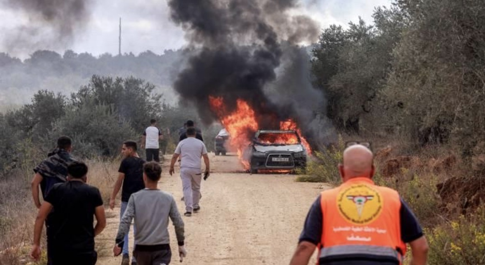

# Tepi Barat: Politik Pemukiman, Kekerasan terhadap Warga Sipil, Kebebasan Pers, dan Tanggung Jawab Negara

*Ilustrasi (pic: en.royanews.tv).*

  
***Bukan hanya persoalan pemukim yang menyerang petani atau jurnalis yang terluka tetapi juga menguji apakah perlindungan warga sipil, kebebasan pers, dan kewajiban negara benar-benar diterapkan di wilayah pendudukan***
  

Peristiwa yang paling menonjol terjadi pada Jumat, 16 Oktober 2026, di Desa Abu Falah, dekat Ramallah, Tepi Barat yang diduduki Israel. Pada 17 Oktober, laporan lanjutan menunjukkan kekerasan juga terjadi di beberapa komunitas lain.

Menurut laporan saksi dan Reuters, sekitar 80 pemukim Israel menyerang warga Palestina yang sedang memanen zaitun. Para penyerang dilaporkan melempar batu, menggunakan ketapel, dan membakar pohon zaitun. Jurnalis foto Amerika Heidi Levine dari The Washington Post turut menjadi korban.

Heidi Levine, jurnalis foto Amerika Levine dilaporkan mengalami luka-luka serius, termasuk patah tulang rusuk, luka robek, dan cedera tangan yang memerlukan operasi. Ia mengenakan perlengkapan bertanda pers ketika diserang.

Pohon zaitun serta kendaraan dibakar atau dirusak. Serangan terhadap panen bukan hanya kekerasan fisik, tetapi juga merusak sumber pendapatan keluarga petani. AP melaporkan serangan di sedikitnya delapan desa.

Pada 17 Oktober, Al Jazeera juga melaporkan serangan di Ma’in, Deir Ammar, Kafr Malek, dan sejumlah desa lain. Di Ma’in, enam orang, termasuk empat perempuan dan seorang anak, dilaporkan terluka. 

Laporan tersebut juga mencatat penembakan, penahanan petani, dan perusakan ternak serta lahan di lokasi berbeda. Detail tiap kejadian berasal dari sumber dan saksi yang berbeda sehingga perlu dibaca secara terpisah.

Serangan terhadap Levine yang terdokumentasi terjadi pada 16 Oktober, sedangkan perkembangan kekerasan yang diberitakan pada 17 Oktober mencakup insiden-insiden lain.

## Mengapa Musim Panen Zaitun Menjadi Titik Konflik?

Pohon zaitun bukan sekadar komoditas pertanian. Bagi banyak keluarga Palestina, kebun zaitun merupakan aset ekonomi lintas generasi, sumber pendapatan musiman, dan bagian dari hubungan mereka dengan tanah.

Karena itu, kekerasan selama panen mempunyai setidaknya empat dampak:
- Ekonomi: hasil panen hilang, pohon rusak, kendaraan hancur, dan biaya pengobatan meningkat.
- Akses terhadap tanah: ancaman dapat membuat petani takut kembali ke kebun mereka.
- Keberlanjutan: pohon zaitun yang dibakar membutuhkan waktu lama untuk pulih atau diganti.
- Demografi: jika ancaman berulang membuat keluarga meninggalkan lahan, penguasaan wilayah dapat berubah secara de facto tanpa pemindahan kepemilikan melalui proses hukum yang sah.

Poin keempat adalah persoalan politik yang paling serius. Namun, untuk menyimpulkan bahwa suatu serangan tertentu sengaja bertujuan mengusir penduduk secara permanen, penyelidik perlu membuktikan pola tindakan, pernyataan pelaku, konteks, serta dampaknya. 

Motif tidak boleh dianggap terbukti hanya karena akibatnya menguntungkan pihak tertentu.

## Hukum Internasional: Apa yang Dapat Kita Simpulkan?

Ada tiga lapisan hukum yang relevan:

A. Hukum pendudukan

Pendapat penasihat Mahkamah Internasional (ICJ) pada 19 Juli 2024 menyimpulkan bahwa keberadaan Israel di wilayah Palestina yang diduduki secara keseluruhan adalah melanggar hukum internasional, serta menyatakan kewajiban untuk mengakhiri keberadaan tersebut secepat mungkin dan menghentikan aktivitas permukiman baru. Israel menolak kesimpulan tersebut.

B. Perlindungan warga sipil

Hukum humaniter internasional mewajibkan perlindungan terhadap warga sipil dan melarang kekerasan yang tidak dibenarkan terhadap mereka. 

Pembakaran kebun, pemukulan, dan perusakan harta benda harus dinilai berdasarkan fakta, konteks, dan ketentuan hukum yang berlaku. 

Serangan yang disengaja terhadap warga sipil atau penghancuran harta tanpa kebutuhan militer yang sah dapat menimbulkan tanggung jawab hukum.

C. Perlindungan jurnalis

Jurnalis yang menjalankan tugas profesionalnya di wilayah konflik pada prinsipnya diperlakukan sebagai warga sipil berdasarkan hukum humaniter internasional, selama mereka tidak mengambil bagian langsung dalam permusuhan. 

Pakaian bertanda pers tidak memberikan kekebalan mutlak dalam setiap keadaan, tetapi juga bukan alasan untuk menyerang mereka.

Dalam kasus Levine, fakta bahwa ia dilaporkan mengenakan identitas pers dan mengalami pemukulan berat membuat penyelidikan yang independen, transparan, dan berbasis bukti menjadi sangat penting.

Kita perlu membedakan pelanggaran yang telah terdokumentasi, dugaan tindak pidana, dan penetapan tanggung jawab hukum. 

Tidak semua serangan otomatis memenuhi unsur kejahatan perang. Penetapan itu membutuhkan analisis unsur hukum, konteks konflik, dan bukti yang relevan.

## Jika Tentara Hadir, Siapa yang Bertanggung Jawab?

Inilah bagian yang membutuhkan ketelitian paling tinggi. Reuters melaporkan bahwa tentara Israel tiba ketika serangan berlangsung, melepaskan gas air mata dan tembakan peringatan, tetapi kekerasan tetap berlanjut. 

Keterangan militer Israel menyebut bahwa tentara dan polisi perbatasan dikerahkan serta mengecam kekerasan terhadap warga sipil. Otoritas Israel menyatakan insiden tersebut sedang diselidiki.

Dari sini muncul tiga pertanyaan berbeda:
- Tanggung jawab pelaku langsung: siapa yang memukul, membakar, mengancam, atau merusak?
- Tanggung jawab aparat: apakah aparat mengambil langkah yang wajar untuk melindungi warga sipil, menghentikan serangan, dan menyelidiki pelaku?
- Tanggung jawab negara: apakah terdapat kegagalan sistematis dalam pencegahan, penegakan hukum, atau perlindungan terhadap penduduk wilayah yang diduduki?

Kehadiran tentara saja tidak membuktikan bahwa seluruh aparat terlibat dalam serangan. Sebaliknya, kehadiran aparat juga tidak otomatis membebaskan negara dari pertanyaan tentang kewajiban perlindungan.

Ukuran yang relevan bukan sekadar apakah aparat datang, melainkan apa yang mereka lakukan, kapan mereka melakukannya, siapa yang mereka lindungi, dan apakah pelaku akhirnya dimintai pertanggungjawaban.

## Mengapa Serangan terhadap Jurnalis Amerika Mempunyai Dimensi Diplomatik?

Kasus Levine menghubungkan tiga kepentingan yang biasanya dibahas secara terpisah:
- keselamatan warga negara Amerika di luar negeri;
- kebebasan pers dan hak publik memperoleh informasi;
- hubungan strategis Amerika Serikat dengan Israel.

Departemen Luar Negeri AS menyatakan keprihatinan dan menawarkan bantuan konsuler. Sejumlah anggota Kongres juga menyerukan penyelidikan dan pertanggungjawaban. 

Perdana Menteri Benjamin Netanyahu menyatakan bahwa fakta insiden masih perlu diklarifikasi dan sedang diselidiki.

Ada paradoks diplomatik di sini: sebuah negara dapat mempunyai hubungan keamanan yang erat dengan negara lain, tetapi tetap berkewajiban menanggapi serangan terhadap warga negaranya dan mempertahankan prinsip perlindungan jurnalis.

Respons yang serius dapat dinilai melalui indikator konkret: penyelidikan yang independen, identifikasi pelaku, penuntutan jika bukti mencukupi, perlindungan bagi saksi dan korban, serta langkah untuk mencegah pengulangan.

Pernyataan kecaman adalah permulaan diplomatik. Akuntabilitas memerlukan tindakan yang dapat diperiksa.

## Pola Sistemik atau Rangkaian Insiden Terpisah?

Laporan pada 17 Oktober menggambarkan serangan di berbagai komunitas, bukan hanya Abu Falah. Namun, angka keseluruhan berbeda antarorganisasi karena periode pengamatan, definisi serangan, dan metode verifikasinya tidak selalu sama.

Untuk menguji hipotesis adanya pola sistemik, peneliti perlu membandingkan:

| Indikator | Pertanyaan penelitian |
|------|-------|
|Frekuensi|Apakah jumlah serangan meningkat dibanding periode sebelumnya?|
|Geografi|Apakah serangan terkonsentrasi di sekitar permukiman atau pos terdepan tertentu?|
|Modus operandi|Apakah pelaku menggunakan pola ancaman, pembakaran, atau pemukulan yang berulang?|
|Respons aparat|Seberapa sering aparat mencegah serangan, hadir setelah kejadian, atau menangkap tersangka?|
|Akuntabilitas|Berapa banyak perkara yang berujung pada penyelidikan dan penuntutan?|
|Dampak penduduk|Apakah petani kehilangan akses terhadap tanah atau terpaksa mengungsi?|

Jika indikator-indikator itu memperlihatkan pola konsisten, argumen mengenai kegagalan perlindungan yang bersifat struktural akan memperoleh dasar empiris lebih kuat daripada sekadar mengandalkan satu insiden yang mengerikan.

## Menguji Kekuasaan melalui Hukum

Kasus Abu Falah bukan hanya persoalan pemukim yang menyerang petani atau jurnalis yang terluka. Ia juga menguji apakah perlindungan warga sipil, kebebasan pers, dan kewajiban negara benar-benar diterapkan di wilayah pendudukan.

Ada tiga kesimpulan yang dapat dipertahankan berdasarkan laporan yang tersedia:
- Serangan terhadap warga Palestina dan jurnalis telah dilaporkan dengan bukti saksi serta dokumentasi media.
- Kerusakan kebun zaitun dan ancaman terhadap petani berpotensi menimbulkan dampak ekonomi dan sosial jauh melampaui hari kejadian.
- Tanggung jawab individu dan kemungkinan kegagalan institusional harus ditentukan melalui penyelidikan yang transparan, bukan hanya pernyataan politik.

Jika hukum internasional menjanjikan perlindungan bagi penduduk wilayah yang diduduki, bagaimana efektivitas perlindungan itu harus diukur ketika serangan berulang terjadi, lahan pertanian dirusak, dan jurnalis yang mendokumentasikannya ikut menjadi korban?

Jawabannya tidak cukup berupa kecaman. Ia membutuhkan data, penyelidikan independen, penegakan hukum, dan konsekuensi yang nyata.

  
**Referensi**

Reuters. (2026, October 16). Israeli settlers burn olive trees, injure journalist in West Bank attack. Baca laporan Reuters⁠.

Associated Press. (2026, October 16). Israeli settlers torch cars and trees in West Bank villages, disrupting Palestinians’ olive harvest. Baca laporan AP⁠.

Al Jazeera. (2026, October 17). Child, four women among Palestinians injured in West Bank pogroms. Baca laporan Al Jazeera⁠.

International Court of Justice. (2024, July 19). Summary of the Advisory Opinion of 19 July 2024. Baca dokumen resmi ICJ⁠.

The Washington Post. (2026, October 16). Congress members condemn Israeli settler attack on Washington Post photographer. Baca laporan Washington Post⁠.
