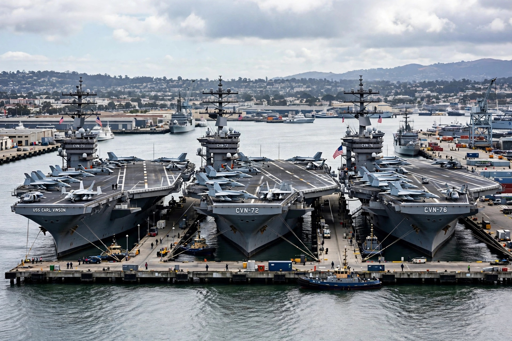

# Tiga Kapal Induk, Tujuh Syarat, dan Diplomasi yang Membeku: Trump Menyiapkan Perang Babak Kedua Iran?

*Ilustrasi (pic: Meta AI).*

  
***Tiga kapal induk telah tiba. Namun meja perundingan masih kosong dari kesepakatan***
  

Ini sudah bukan sekadar gertakan diplomatik. Kapal induk ketiga Amerika, USS Theodore Roosevelt, telah tiba di kawasan Timur Tengah pada 16 November 2026. Sekarang ada tiga kelompok tempur kapal induk AS di kawasan tersebut.

Dan yang membuat situasinya menarik, Washington memperbesar kekuatan militernya ketika jalur diplomasi justru tersendat. Trump mengatakan perang secara militer pada dasarnya sudah selesai, tetapi pada saat bersamaan ia mempertahankan opsi serangan baru.

Kita bedah. Kali ini bukan cuma soal kapal induk, melainkan permainan tekanan, blokade, nuklir, dan politik domestik Amerika. 

## Kapal Induk Ketiga Sudah Dikirim?

Dikonfirmasi 16 November 2026 USS Theodore Roosevelt sudah tiba di Timur Tengah dan bergabung dengan dua kapal induk lainnya.

| Kapal induk | Status |
|------|-------|
|USS George H.W. Bush|Berada di kawasan sejak April|
|USS George Washington|Berada di kawasan sejak Agustus|
|USS Theodore Roosevelt|Tiba 16 November|

Menurut Associated Press, kekuatan laut AS di kawasan juga mencakup 13 kapal perusak, dua kapal penjelajah, dan satu kapal tempur litoral. Dua kapal perusak tambahan berada di Laut Merah.

Ini konsentrasi kekuatan yang tidak biasa. AP mencatat pengerahan tiga kelompok tempur kapal induk terakhir terjadi pada April 2026, dan sebelum itu pada 2003.

Mengapa kapal induk penting? Kapal induk adalah pangkalan udara bergerak. Ia membawa pesawat tempur, pesawat pengintai, sistem pertahanan, dan kapal pengawal.

Dengan tiga kelompok tempur, AS memiliki kemampuan lebih besar untuk:
- Melakukan operasi udara dari laut.
- Mengawasi wilayah udara dan maritim.
- Menyediakan pertahanan terhadap serangan rudal dan drone.
- Mendukung operasi terhadap sasaran darat.
- Mengamankan kepentingan maritim dan blokade.

Tetapi satu hal harus kita garis bawahi: tiga kapal induk tidak otomatis berarti keputusan menyerang sudah dibuat. Kehadiran mereka memperbesar pilihan militer Washington, sekaligus memperkuat tekanan terhadap Teheran.

## Mengapa Perundingan AS-Iran Macet?

Masalahnya bukan karena kedua negara sama sekali tidak memiliki jalur komunikasi. Kontak melalui mediator masih berlangsung, tetapi posisi dasar kedua pihak bertabrakan.

Tujuh tuntutan Iran

Menurut pernyataan pejabat Iran yang dilaporkan CBS, tujuh syarat utama Teheran meliputi:
- Penghentian permusuhan di seluruh front, termasuk Lebanon dan Gaza.
- Pelonggaran sanksi yang dijatuhkan kepada Iran.
- Pencabutan blokade laut Amerika terhadap pelabuhan dan kapal Iran.
- Mekanisme pengaturan lalu lintas Selat Hormuz yang melibatkan Iran dan Oman.
- Kompensasi atas kerusakan akibat perang.
- Pembebasan aset keuangan Iran yang dibekukan di luar negeri.
- Penghentian ancaman terhadap Iran.

Iran bahkan menyatakan bersedia mempersingkat tahap pelaksanaan proposal awal dari tujuh hari menjadi dua hari. Namun, Teheran tidak mengubah tuntutan pokoknya.

Apa yang diminta Amerika?

Washington ingin penyelesaian yang mencakup persoalan nuklir Iran, khususnya:
- Pembatasan program pengayaan uranium.
- Penyelesaian masalah persediaan uranium yang diperkaya tinggi.
- Pengawasan internasional.
- Jaminan bahwa Iran tidak akan mengembangkan senjata nuklir.

Sementara itu, Iran menolak menyerahkan persediaan uranium yang diperkaya tinggi ke luar negeri. Pejabat Iran menyatakan tidak akan membiarkan satu partikel pun material nuklir dipindahkan keluar negeri.

Mereka bersedia membicarakan pengenceran material di bawah pengawasan PBB, tetapi belum menerima tuntutan Washington mengenai pemindahan stok uranium tersebut.

Titik benturan utama Washington adalah masalah nuklir harus menjadi bagian dari kesepakatan akhir. Sedangkan Teheran adalah blokade, sanksi, dan penghentian perang harus diselesaikan lebih dahulu.

Kedua pihak berbeda bukan hanya mengenai isi kesepakatan, tetapi juga urutan pelaksanaannya.

Ini yang membuat negosiasi seperti dua orang yang bersedia duduk di meja yang sama, tetapi masing-masing meminta lawannya menyerahkan kartu terlebih dahulu.

## Selat Hormuz: Senjata Ekonomi yang Membuat Semua Pihak Ikut Menanggung Akibatnya

Ini salah satu pusat gravitasi konflik. Sebelum perang, sekitar seperlima perdagangan minyak dunia melewati Selat Hormuz.

Iran membatasi pelayaran melalui selat tersebut dan menuntut agar kapal mengikuti jalur yang disetujuinya. Amerika kemudian memberlakukan blokade terhadap pelabuhan dan pengiriman Iran.

Akibatnya, terjadi pertarungan dua lapis:
- Iran menggunakan kendali geografis dan risiko pelayaran untuk menekan Amerika.
- Amerika menggunakan kekuatan laut dan blokade untuk membatasi ekspor Iran.

Menurut AP, lalu lintas kapal melalui Hormuz kini berada di bawah sepertiga tingkat sebelum perang. Serangan dan risiko ranjau masih mengganggu pelayaran.

Pada 11 November, Iran menyebut tiga kapal tanker terkena ranjau. UK Maritime Trade Operations juga melaporkan insiden terhadap kapal komersial di sekitar kawasan tersebut. Klaim Iran mengenai penyebab setiap ledakan tetap perlu diperiksa secara independen.

Mengapa ini sangat serius? Karena Selat Hormuz bukan sekadar persoalan Iran dan Amerika.

Gangguan berkepanjangan memengaruhi:
- Harga minyak mentah.
- Biaya pengiriman dan asuransi kapal.
- Pasokan energi Asia.
- Inflasi dan biaya produksi industri.
- Stabilitas ekonomi negara pengimpor energi.

Jadi, ketika Washington dan Teheran beradu kekuatan, konsumen energi di Asia ikut membayar tagihannya.

## Mengapa Trump Mengirim Kapal Induk Ketiga jika Mengatakan Perang Sudah Selesai?

Nah, ini bagian paling menarik secara ilmu politik. Trump memperlihatkan dua pesan yang tampaknya kontradiktif.

Pada satu sisi, ia menyatakan perang secara militer sudah efektif berakhir dan Amerika tidak lagi membutuhkan kesepakatan dengan Iran.

Pada sisi lain, ia mengatakan militer AS siap menyerang kembali apabila situasi tidak berkembang sesuai harapan. Ia juga memperingatkan Iran bahwa Amerika locked and loaded.

Ada tiga penjelasan strategis yang dapat kita uji:

1. Coercive diplomacy

Ini adalah diplomasi yang menggunakan ancaman kekuatan militer untuk memengaruhi keputusan lawan.

Logikanya:
- Amerika memperlihatkan kekuatan militer.
- Iran menghitung risiko jika perang kembali berlangsung.
- Teheran diharapkan mengubah posisi negosiasinya.
- Washington berharap mendapatkan konsesi tanpa harus melancarkan serangan besar.

Dengan demikian, kapal induk dapat berfungsi sebagai instrumen negosiasi, bukan hanya instrumen perang. Namun, strategi ini memiliki risiko. 

Jika Iran menganggap pengerahan tersebut sebagai ancaman eksistensial, Teheran justru bisa memperkeras pertahanan dan tuntutannya.

2. Deterrence atau pencegahan

Kehadiran tiga kapal induk juga dapat dimaksudkan untuk mencegah Iran atau kelompok bersenjata yang bersekutu dengannya melakukan serangan lebih lanjut.

Ini disebut deterrence by punishment dan deterrence by denial:
- Punishment: menunjukkan bahwa serangan terhadap kepentingan AS akan dibalas.
- Denial: memperlihatkan kemampuan untuk menggagalkan serangan lawan.
Namun, deterrence hanya bekerja jika lawan percaya bahwa ancaman itu kredibel dan biaya eskalasinya dapat dikendalikan.

3. Military option preservation

Amerika sedang mempertahankan pilihan untuk melanjutkan perang tanpa harus segera memutuskan.

Tiga kelompok tempur kapal induk memberi fleksibilitas lebih besar kepada Pentagon.
Artinya, Washington tidak perlu langsung memilih antara diplomasi dan perang. Ia dapat mempertahankan keduanya sebagai pilihan.

Tetapi kemampuan militer yang semakin besar juga meningkatkan risiko salah perhitungan.

## Trump Sedang Menghadapi Persoalan Politik di dalam Negeri

Jangan lupa bahwa perang ini memiliki biaya politik domestik.

Associated Press melaporkan bahwa Partai Republik mengalami kekalahan besar dalam pemilu sela November. Ketidakpopuleran perang Iran dan dampak ekonominya menjadi salah satu faktor yang disebut berkontribusi. Wakil Presiden JD Vance bahkan secara terbuka menyalahkan perang sebagai salah satu penyebab kekalahan partainya.

Ada pula perkembangan menarik: Trump mengalihkan JD Vance, yang sebelumnya terlibat dalam perundingan gencatan senjata, ke agenda domestik pemerintahannya.
Sementara itu, Trump menyatakan tidak lagi membutuhkan kesepakatan dengan Teheran. 

Ini menghasilkan dilema politik:
- Jika Trump kembali menyerang, ia menghadapi risiko perang berkepanjangan dan penolakan publik.
- Jika ia menerima kesepakatan yang dianggap terlalu lunak, ia menghadapi kritik karena tidak berhasil mencapai tujuan awal perang.
- Jika ia mempertahankan blokade tanpa penyelesaian diplomatik, biaya ekonomi dan ketegangan regional terus berlangsung.

Trump menghadapi masalah yang tidak bisa diselesaikan hanya dengan menambah kapal perang.

## Faktor Israel: Netanyahu Mendorong Perang Kembali?

Ada laporan Reuters yang patut diperhatikan. Tiga orang yang mengetahui pembicaraan internal Trump mengatakan kepada Reuters bahwa Trump sedang mempertimbangkan untuk menahan serangan baru jika Iran tidak melakukan provokasi. Namun, laporan itu juga menyebut Wakil Presiden Vance khawatir karena Netanyahu berulang kali menelepon Trump dan mendesak agar perang dilanjutkan.

Menurut sumber yang dikutip, Vance menilai Netanyahu memberikan nasihat yang buruk dan prediksi yang keliru tentang bagaimana perang akan berlangsung. Ini merupakan laporan mengenai pandangan internal pejabat AS, bukan bukti bahwa Netanyahu mengendalikan keputusan Trump.

Di sinilah kepentingan Israel dan Amerika perlu dianalisis secara terpisah. 

Israel memandang kemampuan nuklir dan rudal Iran sebagai ancaman keamanan langsung. Amerika memiliki kepentingan lebih luas: keamanan sekutu, stabilitas energi, kredibilitas militernya, hubungan dengan negara-negara Teluk, dan biaya perang bagi ekonomi domestik. Kepentingan kedua negara saling beririsan, tetapi tidak selalu identik.

Jadi, tidak tepat menganggap setiap keputusan Washington merupakan instruksi dari Tel Aviv. Namun, tekanan diplomatik Israel merupakan faktor yang relevan untuk diperhitungkan.

## Perang Babak Kedua Akan Terjadi?

Kita perlu melihat indikatornya, bukan meramal berdasarkan jumlah kapal induk:

| Indikator | Kondisi terkini |
|------|-------|
|Tiga kapal induk di kawasan|Eskalasi kekuatan|
|Negosiasi nuklir|Buntu|
|Blokade laut AS|Berlangsung|
|Gangguan Selat Hormuz|Berlangsung|
|Ancaman serangan baru Trump|Terbuka|
|Keputusan resmi untuk serangan besar baru|Diumumkan|

Ada satu perkembangan tambahan: USS Theodore Roosevelt berangkat bersama kelompok kapal amfibi USS Makin Island, yang membawa sekitar 2.000 Marinir. Namun kelompok kapal amfibi itu belum tiba di kawasan menurut laporan AP. Kehadirannya menambah opsi operasi militer, tetapi tidak membuktikan bahwa pendaratan darat telah diputuskan.

Tiga skenario yang perlu diperhatikan:

Skenario A: Tekanan militer menghasilkan kesepakatan terbatas

Amerika mempertahankan blokade dan kekuatan laut, Iran memperoleh sebagian konsesi mengenai sanksi atau pelayaran, lalu kedua pihak menyepakati pengaturan sementara.

Skenario B: Konflik berkepanjangan tanpa perang besar

Blokade terus berlangsung, kapal dagang menghadapi risiko, serangan terbatas terjadi, dan diplomasi bergerak sangat lambat.

Skenario C: Serangan besar kembali dilancarkan

Jika salah satu pihak menganggap garis merahnya telah dilanggar, serangan terhadap fasilitas militer atau nuklir dapat kembali terjadi. Iran dapat membalas melalui rudal, drone, operasi maritim, dan jaringan sekutunya.

Ketiga skenario ini merupakan kemungkinan analitis, bukan prediksi bahwa salah satunya pasti terjadi.

## Tiga Kapal Induk Tidak Bisa Menyelesaikan Konflik yang Akar Masalahnya Politik

Ada ironi besar di sini. Amerika memiliki kemampuan untuk mengerahkan tiga kelompok tempur kapal induk ke Timur Tengah. 

Tetapi pengerahan kekuatan sebesar itu belum menghasilkan kesepakatan mengenai persoalan paling mendasar:
Siapa yang mengendalikan Selat Hormuz?
Bagaimana blokade Iran akan berakhir?
Apa yang terjadi dengan stok uranium yang diperkaya?
Siapa yang menanggung biaya kerusakan perang?
Bagaimana penghentian permusuhan dijamin di seluruh kawasan?
Masalahnya bukan kekurangan daya tembak. Masalahnya adalah kedua pihak belum sepakat tentang apa yang disebut sebagai penyelesaian yang dapat diterima.

Amerika menginginkan pembatasan nuklir dan jaminan keamanan. Iran menginginkan pencabutan blokade, pelonggaran sanksi, penghentian perang, dan pengakuan terhadap kepentingan strategisnya di kawasan.

Sementara itu, masyarakat sipil dan ekonomi regional menanggung biaya dari kebuntuan tersebut.

Kapal induk bisa memperbesar daya tawar, tetapi tidak dapat menggantikan kompromi politik.

Ketika diplomasi gagal, negara sering menambah kapal perang. Tetapi semakin besar kekuatan yang dikumpulkan, semakin besar pula harga yang harus dibayar jika salah satu pihak salah membaca maksud pihak lainnya.

Tiga kapal induk telah tiba. Namun meja perundingan masih kosong dari kesepakatan.

Pengerahan tiga kapal induk adalah sinyal kekuatan yang sangat serius, tetapi bukan bukti bahwa keputusan perang babak kedua sudah diambil. 

Kita perlu mengawasi perubahan sikap Pentagon, pergerakan kelompok amfibi, status blokade, dan terutama apakah Washington kembali membuka jalur negosiasi melalui mediator.

Jangan sampai dunia kembali membayar harga minyak dan pangan yang lebih mahal hanya karena dua pemerintah tidak menemukan cara untuk duduk di meja yang sama. 

  
**Referensi**

Associated Press. (2026, November 16). Third US aircraft carrier arrives in the Middle East as Trump keeps options open in the Iran war.

Al Jazeera. (2026, November 16). USS Roosevelt arrives in Middle East: Is the US-Iran war about to resume?

Reuters. (2026, November 2). Iran says contacts over ending war continue after talks finish with no breakthrough.

Al Jazeera. (2026, November 11). Iran denies talks with US, says Hormuz will stay shut until demands are met.

Reuters. (2026, November 14). Trump tells advisers he may not attack Iran as long as it doesn’t provoke US, sources say.

CBS News. (2026, November 13). Trump says “we don’t need a deal with Iran,” as Tehran sticks to its demands.
