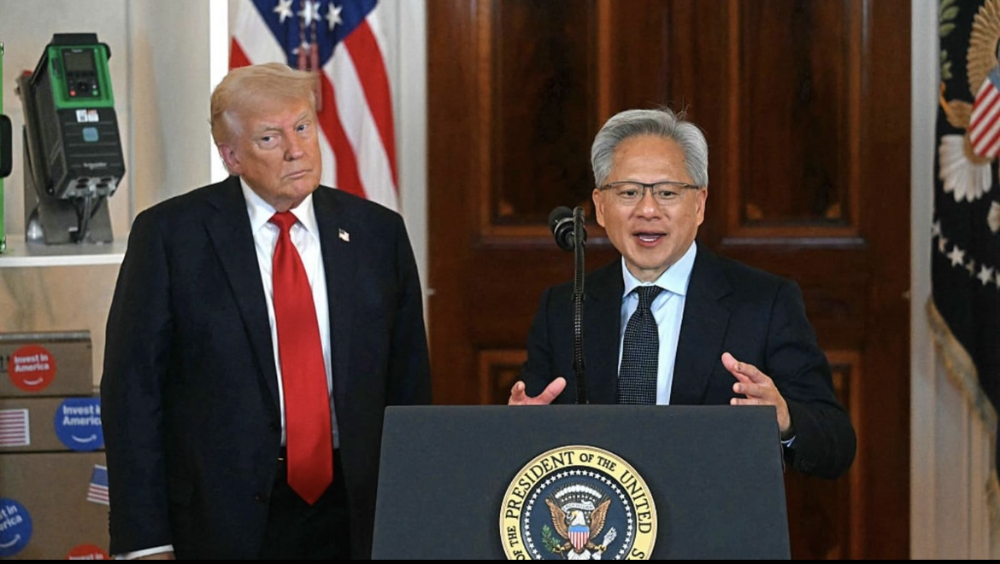

# Trump Turun Tangan, Jensen Huang Kembali Memimpin Nvidia: Persilangan Kekuasaan Politik dan Wall Street? 

*(pic: cnbc.com.*

  
***Trump memiliki kepemilikan saham Nvidia dengan nilai yang diperkirakan berada pada kisaran US$11 juta sampai US$55 juta***
  

Dramanya luar biasa, bahkan ada sesuatu yang lebih menarik daripada kenaikan saham hampir US$1 triliun: presiden Amerika Serikat mengakui secara terbuka bahwa ia ikut memengaruhi keputusan dewan direksi sebuah perusahaan teknologi swasta untuk mengembalikan CEO-nya.

Ini bukan sekadar kisah seorang CEO yang kembali bekerja. Ini menyentuh tiga wilayah sekaligus:
Tata kelola perusahaan dan independensi dewan direksi.
Kepentingan keamanan nasional Amerika dalam persaingan teknologi dengan China.
Hubungan antara kekuasaan politik, kepemilikan saham, dan stabilitas pasar modal.
Ringkasan faktanya:

| Peristiwa | Fakta |
|:-----|:------:|
|Jensen Huang mengundurkan diri|12 November 2026|
|Nvidia mengangkatnya kembali|23 November 2026|
|Pengaruh Trump|Trump mengakui ikut membujuk dewan|
|Kenaikan saham Nvidia|31,5% pada perdagangan Senin|
|Tambahan kapitalisasi pasar|Hampir US$1 triliun|
|Pemeriksaan internal|Tetap berlangsung|
|Pemeriksaan Kongres|Huang dijadwalkan bersaksi 3 Desember|

Sumber utama: Reuters, AP, dokumen pengungkapan resmi Nvidia kepada SEC.

## Mengapa Jensen Huang Sampai Mengundurkan Diri?

Jensen Huang bukan CEO biasa. Ia adalah salah satu pendiri Nvidia pada 1993 dan telah memimpin perusahaan selama lebih dari tiga dekade.

Di bawah kepemimpinannya, Nvidia berubah dari perusahaan pembuat chip grafis menjadi pemasok utama prosesor komputasi AI yang digunakan perusahaan teknologi, pusat data, laboratorium riset, dan infrastruktur kecerdasan buatan dunia.

Namun, pada 12 November 2026, Huang mengundurkan diri di tengah skandal pribadi dan investigasi yang berkembang.

Ada beberapa lapisan masalah:

A. Pengakuan mengenai hubungan pribadi

Huang mengakui telah berselingkuh dari istrinya dan menyampaikan permintaan maaf. Laporan media menyebut dugaan hubungan dengan sejumlah perempuan, termasuk seorang pengusaha bernama Alice Huang yang dikaitkan dengan perusahaan Megaspeed.

B. Dugaan hubungan dengan intelijen China

Alice Huang diduga memiliki hubungan dengan intelijen China. Dugaan ini menjadi persoalan keamanan nasional karena Megaspeed berada dalam ekosistem bisnis yang berhubungan dengan distribusi dan akses terhadap teknologi komputasi canggih.

Namun, ini harus dibedakan secara tegas:
- Hubungan pribadi yang diakui Huang adalah satu persoalan.
- Dugaan hubungan Alice Huang dengan intelijen China adalah persoalan lain.
- Dugaan keterlibatan Huang sendiri dalam kegiatan intelijen atau pelanggaran hukum belum terbukti.

China membantah tuduhan spionase tersebut. Reuters juga melaporkan bahwa penyelidikan mengenai kemungkinan operasi intelijen asing dan penyimpangan ekspor masih berjalan.

C. Masalah tata kelola perusahaan

Dewan Nvidia sebelumnya menyatakan menerima pengunduran diri Huang dan tidak bermaksud mengangkatnya kembali. Ketua dewan Harvey Jones bahkan telah menyampaikan bahwa perusahaan memiliki tim manajemen berpengalaman dan mulai mencari calon CEO permanen.

Namun, hanya sekitar sebelas hari kemudian, keputusan itu berbalik.

Di sinilah persoalannya berubah dari skandal pribadi menjadi persoalan tata kelola korporasi.

## Bagaimana Trump Bisa Ikut Menentukan CEO Nvidia?

Ini bagian yang paling kontroversial. Trump mengakui bahwa intervensinya sangat penting dalam mengembalikan Huang.

Dalam wawancara dengan CNBC, Trump menyatakan bahwa ia telah meyakinkan Nvidia untuk membawa Huang kembali. Ia juga berpendapat bahwa kehilangan kemampuan dan kepemimpinan Huang akan menjadi kerugian besar bagi Amerika.

Associated Press melaporkan bahwa Trump melibatkan Wakil Presiden JD Vance dan pejabat senior pemerintah dalam pendekatan kepada anggota dewan Nvidia.

Tetapi, apakah Trump secara hukum dapat mengangkat atau memecat CEO Nvidia? Tidak.

Nvidia adalah perusahaan publik swasta. Pengangkatan CEO merupakan kewenangan dewan direksi berdasarkan tata kelola perusahaan dan hukum korporasi yang berlaku.

Trump tidak memiliki kewenangan formal untuk mengangkat CEO Nvidia. Yang terjadi adalah pengaruh politik terhadap keputusan perusahaan swasta.

Perbedaannya penting:
- Trump tidak menandatangani keputusan pengangkatan Huang.
- Dewan direksi Nvidia melakukan pemungutan keputusan dan menyatakan pengangkatan kembali disetujui secara bulat.

Namun, Nvidia mengakui bahwa dewan menerima masukan dari pejabat senior pemerintah AS sebelum mengambil keputusan.
Dengan demikian, secara formal keputusan berada pada dewan direksi, tetapi secara politik keputusan itu berlangsung di bawah tekanan dan dorongan pemerintah.

Ini contoh menarik tentang batas antara kewenangan formal dan kekuasaan informal.
Sebuah keputusan bisa sah secara prosedural, tetapi tetap menimbulkan pertanyaan tentang independensi pihak yang mengambilnya.

## Mengapa Trump Begitu Berkepentingan Menyelamatkan Jensen Huang?

Jawabannya jauh lebih besar daripada persoalan satu orang CEO. Nvidia merupakan salah satu aset strategis paling penting dalam persaingan teknologi Amerika Serikat dan China.

Coba lihat rantai kepentingannya:

A. Nvidia bukan sekadar perusahaan semikonduktor

Chip Nvidia menjadi komponen penting untuk:
- Pelatihan model AI berskala besar.
- Pengoperasian pusat data.
- Komputasi ilmiah.
- Sistem otonom dan robotika.
- Aplikasi pertahanan dan intelijen.
- Pengembangan teknologi AI generatif.

Dalam persaingan teknologi, penguasaan komputasi AI berpengaruh terhadap produktivitas ekonomi, kemampuan industri, dan kapasitas militer.

Karena itu, pemerintah Amerika memiliki kepentingan langsung terhadap kelangsungan Nvidia sebagai perusahaan yang mampu mempertahankan posisi teknologi AS.

B. Huang memiliki pengaruh yang sulit digantikan dalam waktu singkat

Ada konsep dalam ekonomi organisasi yang disebut key-person risk. Artinya, sebuah organisasi memiliki ketergantungan yang sangat besar terhadap satu individu.

Huang memiliki kombinasi yang tidak mudah digantikan:
- Pengetahuan teknis mendalam tentang arsitektur komputasi Nvidia.
- Hubungan dengan pemasok dan mitra manufaktur.
- Relasi dengan perusahaan teknologi besar.
- Pengaruh terhadap ekosistem pengembang AI.
- Kemampuan menjelaskan strategi teknologi kepada investor dan pemerintah.

Kita tidak sedang berbicara mengenai CEO yang hanya mengelola rapat dan laporan keuangan. Huang sangat terlibat dalam arah produk dan strategi teknologi perusahaan.

Reuters melaporkan bahwa pengunduran dirinya menimbulkan ketidakpastian pada pelanggan, investor, dan perusahaan yang bergantung pada pasokan Nvidia.

C. Trump menghubungkan Huang dengan kepentingan nasional

Dalam perspektif pemerintahan Trump, kehilangan Huang dapat melemahkan posisi Amerika dalam perlombaan AI.

AP melaporkan Trump khawatir China dapat memanfaatkan situasi tersebut dan menarik keahlian Huang ke dalam ekosistem teknologi China.

Namun, perlu dicatat bahwa kekhawatiran tersebut merupakan argumentasi politik pemerintah, bukan bukti bahwa Huang benar-benar akan pindah ke China.

Jadi, Trump melihat persoalan ini sebagai risiko strategis, bukan hanya krisis manajemen perusahaan.

## Saham Nvidia Naik 31,5%, Lulu Bertambah Hampir US$1 Triliun. Bagaimana Mungkin?

Nah, ini bagian yang akan membuat investor menoleh dari layar sahamnya. 

Pada perdagangan Senin, 23 November 2026, saham Nvidia melonjak sekitar 31,5%. Kapitalisasi pasarnya bertambah hampir US$1 triliun.

Reuters melaporkan bahwa kenaikan itu membawa nilai pasar Nvidia mendekati US$4 triliun dan menjadikannya kembali perusahaan publik terbesar kedua setelah Apple dalam ukuran kapitalisasi pasar pada saat itu.

## Bagaimana Menghitung Tambahan Kapitalisasi Pasar?

Rumus sederhananya: Market Cap= Harga Saham x Jumlah Saham Beredar.

Misalnya, sebuah perusahaan memiliki 10 miliar saham dengan harga US$100. Maka kapitalisasi pasarnya: 10 miliar x $100 = $1 triliun.

Jika harga saham naik 31,5%, dengan jumlah saham tetap, kapitalisasi pasar juga naik sekitar 31,5%.

Namun, penting membedakan:
- Market capitalization: nilai pasar seluruh saham perusahaan.
- Cash atau uang perusahaan: dana yang benar-benar dimiliki perusahaan.
- Kekayaan pemegang saham: nilai kepemilikan saham mereka.

Jadi, tambahan hampir US$1 triliun bukan berarti Nvidia memperoleh uang tunai US$1 triliun dalam satu hari. Itu adalah kenaikan nilai pasar berdasarkan harga saham yang diperdagangkan.

## Mengapa Pasar Bereaksi Begitu Ekstrim?

Pasar saham tidak hanya membeli laporan keuangan. Pasar juga membeli ekspektasi masa depan.

Kembalinya Huang dianggap mengurangi beberapa risiko:

| Risiko sebelum Huang kembali | Persepsi setelah ia kembali |
|:-----|:------:|
|Ketidakpastian kepemimpinan|Berkurang|
|Risiko pelanggan kehilangan kepercayaan|Berkurang|
|Kekhawatiran strategi AI berubah|Berkurang|
|Ketidakpastian hubungan dengan pemerintah AS|Sebagian berkurang|
|Risiko investigasi keamanan nasional|Belum hilang|

Dengan demikian, reli tersebut dapat dibaca sebagai relief rally: investor membeli kembali saham setelah satu sumber ketidakpastian besar mereda.

Tetapi jangan salah, reli 31,5% tidak membuktikan bahwa semua persoalan Nvidia telah selesai.

## Persoalan yang Lebih Sensitif: Trump juga Memiliki Saham Nvidia

Ini yang membuat intervensi Trump mendapat sorotan politik.

Menurut penelusuran Reuters terhadap laporan kekayaan dan transaksi keuangan Trump, presiden AS tersebut memiliki kepemilikan saham Nvidia dengan nilai yang diperkirakan berada pada kisaran US$11 juta sampai US$55 juta.

Dengan kenaikan saham Nvidia sebesar 31,5%, nilai kepemilikan tersebut berpotensi meningkat hingga sekitar US$17 juta, gile beneeer!

Tentu, ada satu penjelasan dari Gedung Putih: portofolio Trump dikelola secara independen oleh lembaga keuangan pihak ketiga dan Trump maupun keluarganya tidak dapat mengarahkan investasi tersebut.

Tetapi persoalan etika publiknya tetap menarik. Bayangkan seorang presiden:
- Memiliki kepentingan finansial dalam sebuah perusahaan.
- Menggunakan pengaruh politik untuk mendorong keputusan strategis perusahaan tersebut.
- Mengumumkan keberhasilan intervensinya.

Kemudian perusahaan itu mengalami kenaikan harga saham yang sangat besar.
Itu menimbulkan pertanyaan tentang potensi konflik kepentingan, sekalipun pengelolaan portofolio dilakukan pihak ketiga.

Konflik kepentingan tidak selalu membutuhkan bukti bahwa seseorang secara langsung memanipulasi pasar. Pertanyaan tentang apakah kepentingan pribadi dan kewenangan publik dapat dipisahkan juga merupakan bagian penting dari etika pemerintahan.

Chuck Schumer dan sejumlah anggota Kongres mempertanyakan keterlibatan Trump dan mendesak pengawasan lebih lanjut.

## Apakah Dewan Direksi Nvidia Kehilangan Independensinya?

Ini persoalan tata kelola perusahaan yang sangat menarik.

Dalam prinsip corporate governance, dewan direksi memiliki tanggung jawab untuk mengawasi manajemen dan bertindak demi kepentingan perusahaan serta pemegang saham.

Ada tiga prinsip yang relevan:

Pertama, fiduciary duty.
Direksi harus menjalankan tanggung jawabnya dengan itikad baik, kehati-hatian, dan kepentingan perusahaan.

Kedua, board independence.
Dewan harus mampu mengambil keputusan tanpa tekanan yang tidak semestinya dari CEO, pemegang saham dominan, pemerintah, atau pihak eksternal.

Ketiga, accountability.
Keputusan penting harus dapat dijelaskan dan dipertanggungjawabkan kepada pemegang saham.

Sekarang perhatikan kontradiksinya. Pada 17 November, ketua dewan menyatakan bahwa Nvidia tidak bermaksud mengangkat Huang kembali. Namun, pada 23 November, dewan menyatakan telah menerima masukan dari pejabat senior pemerintah AS dan memutuskan mengembalikannya.

Reuters menilai perubahan mendadak ini menimbulkan pertanyaan mengenai independensi dewan dan standar tata kelola perusahaan.

Pertanyaan kritisnya:
- Apakah dewan benar-benar melakukan evaluasi independen?
- Apakah kepentingan perusahaan menjadi pertimbangan utama?
- Apakah keamanan nasional digunakan sebagai alasan yang sah atau sebagai pembenaran atas keputusan yang sudah diinginkan pemerintah?
- Apakah standar etik CEO menjadi berbeda ketika CEO tersebut dianggap terlalu penting untuk digantikan?

Ini bukan berarti keputusan dewan otomatis ilegal. Tetapi keputusan tersebut layak diawasi secara serius.

## Masalah yang Belum Selesai: China, Chip AI, dan Keamanan Nasional

Kita perlu menghubungkan peristiwa ini dengan kontroversi ekspor chip Nvidia ke China yang pernah kita bahas.

Amerika Serikat sedang berusaha membatasi akses China terhadap teknologi komputasi AI tertentu karena teknologi tersebut memiliki penggunaan ganda (dual-use).

Artinya, teknologi yang dapat digunakan untuk kepentingan sipil juga berpotensi dimanfaatkan untuk:
- Pengembangan senjata otonom.
- Simulasi militer.
- Analisis intelijen.
- Sistem pengawasan.
- Pengembangan teknologi pertahanan.

Nvidia berada di tengah konflik tersebut karena China merupakan pasar potensial yang sangat besar.

Namun, kepentingan Nvidia dan pemerintah AS tidak selalu identik.
| Kepentingan Nvidia | Kepentingan pemerintah AS |
|:-----|:------:|
|Mempertahankan pendapatan global|Membatasi akses teknologi strategis China|
|Menjaga pangsa pasar|Mempertahankan keunggulan teknologi AS|
|Memperluas pelanggan|Mencegah pengalihan chip kepada pengguna terlarang|
|Mempertahankan ekosistem AI|Mengawasi keamanan nasional dan rantai pasok|

Di sinilah Huang menjadi tokoh yang sangat strategis. Ia memiliki kepentingan bisnis untuk mempertahankan akses pasar China, sementara pemerintah AS memiliki kepentingan keamanan untuk mengendalikan distribusi chip canggih. Kedua kepentingan ini bisa berkolaborasi, tetapi juga bisa berbenturan.

Reuters melaporkan bahwa pemerintah AS memasukkan Megaspeed dan anak perusahaan Alibaba di Singapura ke dalam daftar pembatasan perdagangan pada 23 November, di tengah penyelidikan mengenai kemungkinan pengalihan teknologi komputasi ke pengguna yang tidak diizinkan. Alibaba membantah tuduhan pengalihan tersebut.

Jadi, kembalinya Huang tidak berarti persoalan ekspor chip Nvidia ke China telah selesai.

## Apakah Kenaikan Saham 31% Bertahan?

Ini bagian yang harus diperhatikan investor. Pada 24 November, sehari setelah reli besar, saham Nvidia kembali menghadapi tekanan. 

Reuters melaporkan saham turun lebih dari 4% dalam perdagangan pra-pembukaan, sedangkan laporan pasar berikutnya mencatat penurunan sekitar 6% pada sesi perdagangan tersebut.

Pergerakan yang perlu dibedakan, 23 November +31,5%, 24 November turun sekitar 6%. Angka 24 November merujuk pada laporan perdagangan yang tersedia, bukan harga penutupan terbaru yang telah diverifikasi dari bursa.

Artinya, pasar menyambut kepulangan Huang dengan antusias, tetapi investor masih harus memperhitungkan persoalan yang belum terselesaikan.

Ada empat risiko yang tetap relevan:
- Investigasi dugaan pelanggaran ekspor dan pengalihan chip.
- Investigasi internal terkait hubungan pribadi dan potensi risiko intelijen asing.
- Pengawasan Kongres terhadap keputusan pemerintah dan Nvidia.
- Pertanyaan mengenai profitabilitas investasi infrastruktur AI secara keseluruhan.

Huang dijadwalkan memberikan kesaksian publik di hadapan Senate Banking Committee pada 3 Desember 2026.

Dengan demikian, reli satu hari tidak dapat dijadikan bukti bahwa fundamental bisnis Nvidia telah berubah secara permanen.

## Nvidia Sudah Menjadi Terlalu Strategis untuk Diperlakukan sebagai Perusahaan Biasa

Inilah inti geopolitik peristiwa tersebut, Nvidia adalah perusahaan swasta, tetapi produk, teknologi, dan pengaruh ekonominya telah menjadi bagian dari kepentingan strategis negara.

Kita bisa melihat tiga lapisan kekuasaan:

Lapisan 1: Kekuasaan teknologi

Nvidia menguasai komponen penting dalam ekosistem komputasi AI. Perusahaan yang menguasai infrastruktur komputasi memiliki pengaruh terhadap arah perkembangan teknologi.

Lapisan 2: Kekuasaan ekonomi

Investor, perusahaan teknologi, pusat data, dan industri keuangan memiliki eksposur terhadap kinerja Nvidia. Ketidakpastian kepemimpinannya dapat memengaruhi pasar yang jauh lebih luas.

Lapisan 3: Kekuasaan negara

Pemerintah AS memiliki instrumen regulasi ekspor, keamanan nasional, dan diplomasi ekonomi yang dapat memengaruhi bisnis Nvidia.

Ketika ketiga lapisan itu bertemu pada satu orang, yakni Jensen Huang, keputusan perusahaan dapat berubah menjadi persoalan politik nasional.

Ada konsep yang relevan yaitu strategic interdependence. Negara membutuhkan perusahaan teknologi untuk mempertahankan keunggulan strategis. Perusahaan membutuhkan pemerintah untuk memperoleh kepastian regulasi, perlindungan kepentingan nasional, dan akses terhadap pasar.

Hubungan tersebut menciptakan ketergantungan dua arah. Namun, ada bahaya ketika ketergantungan itu berkembang menjadi ketergantungan berlebihan terhadap satu figur.

Jika perusahaan bernilai triliunan dolar dianggap tidak dapat berjalan tanpa satu CEO, maka pertanyaan tentang suksesi, pengawasan, dan akuntabilitas menjadi semakin penting.

Perusahaan teknologi strategis tidak boleh menjadi kerajaan pribadi hanya karena pendirinya sangat hebat. Kepemimpinan yang luar biasa tetap harus tunduk pada tata kelola yang dapat diaudit.

## Trump Menyelamatkan CEO, tetapi Apakah Ia Menyelesaikan Masalah Nvidia?

Fakta utama terkonfirmasi, kita bisa menarik enam kesimpulan:
- Jensen Huang benar-benar mengundurkan diri pada 12 November dan kembali menjadi CEO pada 23 November 2026.
- Donald Trump mengakui ikut membujuk dewan Nvidia untuk mengembalikan Huang.
- Nvidia naik 31,5% dalam satu sesi, dengan tambahan kapitalisasi pasar hampir US$1 triliun.
- Trump memiliki kepemilikan saham Nvidia yang memunculkan pertanyaan etika konflik kepentingan.
- Investigasi terkait hubungan pribadi, dugaan intelijen asing, dan kepatuhan ekspor belum selesai.
- Kenaikan saham tidak otomatis berarti persoalan fundamental dan tata kelola Nvidia sudah beres.

Peristiwa ini memperlihatkan bahwa persaingan AI telah membuat perusahaan teknologi tertentu memiliki nilai strategis yang begitu besar sehingga pemerintah ikut berkepentingan terhadap stabilitas kepemimpinannya.

Trump tidak memiliki kewenangan formal mengangkat CEO Nvidia, tetapi ia menggunakan pengaruh politiknya untuk mendorong keputusan tersebut. Dan pasar memberikan respons yang sangat besar.

Tetapi ada pertanyaan yang lebih mendasar daripada apakah Huang pantas kembali menjadi CEO: Jika sebuah perusahaan begitu penting bagi keamanan nasional sehingga pemerintah merasa perlu ikut menyelamatkan pemimpinnya, siapa yang kemudian mengawasi perusahaan tersebut ketika kepentingan bisnis, kepentingan politik, dan kepentingan keamanan nasional saling bertabrakan? Itulah persoalan yang jauh lebih besar daripada kenaikan saham 31%.

Jangan sampai kita menyamakan reli karena perubahan sentimen dengan perubahan nilai fundamental perusahaan. Keduanya bisa beriringan, tetapi bukan hal yang sama.

Harga saham bisa melonjak karena pasar merasa seorang tokoh telah kembali. Nilai perusahaan jangka panjang tetap harus dibuktikan oleh pendapatan, arus kas, daya saing, dan tata kelola. Itu bedanya euforia Wall Street dengan analisis investasi. 

  
**Referensi**

1. Reuters. (2026, November 23). Huang returns as Nvidia CEO after Trump intervention in abrupt board reversal. Baca laporan Reuters⁠.

2. Associated Press. (2026, November 23). Why Donald Trump believed he needed to get Jensen Huang back on top at AI behemoth Nvidia. Baca laporan AP⁠.

3. Reuters. (2026, November 12). Jensen Huang steps down, hands on kingmaker behind AI boom. Baca laporan Reuters⁠.

4. Fortune. (2026, November 23). Wall Street just put a $1 trillion price on Jensen Huang as Nvidia stock soars 31% after his return as CEO. Baca analisis Fortune⁠.

5. The New York Times. (2026, November 24). Board Heeds Call After Scandal Hurt Stocks. Baca laporan NYT⁠.

6. NVIDIA Corporation. (2026, November 23). Current Report on Form 8-K. Baca dokumen resmi pengungkapan kepada SEC⁠.

7. Reuters. (2026, November 23). Nvidia reinstates Jensen Huang as CEO, igniting tech surge. Baca laporan pasar Reuters⁠.

