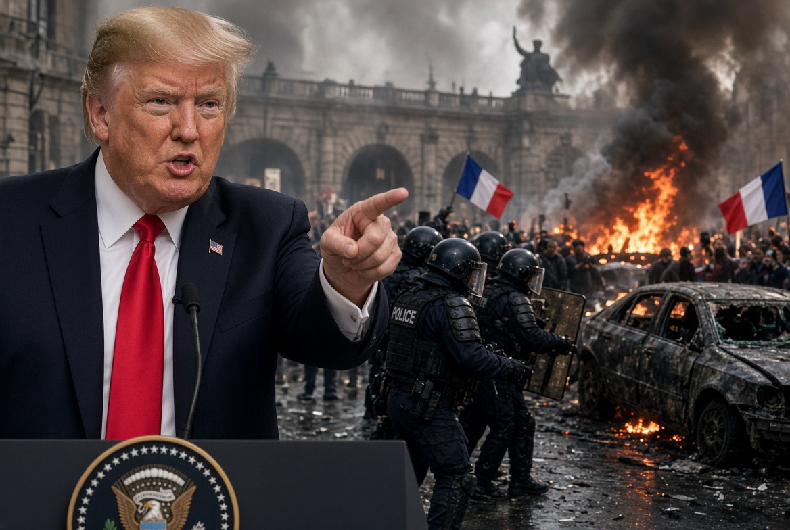

# Trump, Islam, dan Kambing Hitam Bernama Imigran

*Ilustrasi (pic: Grok AI).*

  
***Kritik terhadap pemerintah, ideologi, atau kelompok bersenjata harus berbasis tindakan dan bukti. Ketika identitas agama dijadikan pengganti bukti, analisis berubah menjadi stereotip***
  

Kalau semua orang yang membuat Trump kesal kita masukkan ke satu daftar, lama-lama daftar itu bisa menjadi ensiklopedia geopolitik: Iran, Palestina, Muslim Amerika, imigran, Ilhan Omar, lalu sekarang Prancis. Tinggal jilid khusus orang yang namanya Muhammad, lengkap dengan indeks alfabet.

Tapi di balik lelucon ini, ada pertanyaan serius: apakah Trump sedang mengkritik masalah keamanan yang nyata, atau mengubah tindakan sebagian orang menjadi tuduhan terhadap seluruh kelompok agama?

Dari laporan terbaru yang bisa diperiksa sampai 20 Oktober 2026, ada alasan kuat untuk mengkritik generalisasi Trump. Klaim bahwa kerusuhan Prancis disebabkan imigran tidak sesuai dengan penyebab awal demonstrasi yang dilaporkan media, dan belum ada bukti yang ditampilkan dalam laporan tersebut bahwa imigran sebagai kelompok merupakan penyebab kerusuhan.

Kita bedah dengan tiga kacamata sekaligus: fakta kerusuhan, politik identitas, dan tanggung jawab historis Amerika Serikat. 

## Apa yang Sebenarnya Terjadi di Prancis?

Menurut laporan Associated Press pada 19 Oktober, demonstrasi nasional Prancis berawal dari protes siswa mengenai kondisi sekolah dan kekurangan guru, lalu meluas karena keresahan terhadap kenaikan biaya hidup dan layanan publik. 

Banyak orang ikut berdemonstrasi secara damai, sementara sebagian peserta dan kelompok lain terlibat dalam penjarahan, pembakaran, serta bentrokan dengan polisi. Sekitar 2.400 orang ditangkap selama akhir pekan tersebut.

Presiden Emmanuel Macron mengecam kekerasan dan menyebut adanya unsur radikal kiri serta pelaku kriminal oportunistis. Pemerintah juga memerintahkan penyelidikan mengenai kegagalan intelijen dan persiapan aparat dalam menghadapi demonstrasi.

Lalu datanglah Donald Trump dengan narasi berbeda. Pada 18 dan 19 Oktober, ia menghubungkan kerusuhan dengan imigrasi, menyatakan para migran telah mengambil alih Prancis, dan memperingatkan bahwa Paris akan segera menjadi “kota Muslim”. Ia mendesak Prancis menutup perbatasan.

Perhatikan perbedaan dua narasi tersebut:
- Laporan tentang pemicu demonstrasi: kondisi sekolah, biaya hidup, ketidakpuasan sosial, lalu kekerasan oleh sebagian orang.
- Narasi Trump: imigrasi sebagai penyebab utama keruntuhan sosial dan perubahan identitas Prancis.
Narasi kedua membutuhkan bukti tambahan. Fakta bahwa kerusuhan terjadi di negara yang memiliki penduduk imigran tidak membuktikan bahwa imigranlah penyebabnya.

Dan ada detail penting: laporan AP dan Financial Times tidak menyajikan bukti bahwa imigran secara kolektif menjadi penyebab kerusuhan. Financial Times juga melaporkan bahwa polisi belum secara eksplisit menghubungkan kerusuhan tersebut dengan imigrasi.

Kekerasan dan penjarahan memang terjadi, tetapi menyalahkan imigran sebagai kelompok adalah klaim yang berbeda, dan klaim itu belum dibuktikan oleh fakta yang tersedia dalam laporan tersebut.

## Apakah Para Pelakunya Memang Imigran?

Kita tidak bisa menyimpulkan status imigrasi para pelaku hanya dari jumlah penangkapan atau dari video kerusuhan.

Angka sekitar 2.400 penangkapan menunjukkan skala penindakan polisi, bukan identitas etnis, agama, kewarganegaraan, atau status imigrasi seluruh orang yang ditangkap. 

Dalam laporan AP, sebagian besar perkara yang disebut berkaitan dengan perusakan properti, keterlibatan dalam kelompok yang dibentuk untuk melakukan kekerasan, serta penyerangan terhadap polisi.

Untuk menguji tuduhan Trump secara serius, kita membutuhkan data seperti:
Berapa banyak tersangka yang merupakan warga negara Prancis, warga negara asing, atau imigran?
Apakah mereka pendatang baru, imigran yang telah lama menetap, atau keturunan imigran yang lahir di Prancis?
Berapa banyak pelaku kekerasan dibandingkan dengan jumlah seluruh peserta demonstrasi dari setiap kelompok?
Apakah proporsi pelaku benar-benar lebih tinggi setelah memperhitungkan umur, jenis kelamin, kondisi sosial-ekonomi, lokasi, dan faktor lain yang relevan?
Tanpa data itu, kita tidak bisa menghitung apakah suatu kelompok secara tidak proporsional terlibat dalam kerusuhan.

Bahkan jika nantinya ditemukan bahwa sejumlah tersangka adalah imigran, hal itu hanya membuktikan keterlibatan orang-orang tersebut. Tidak otomatis membuktikan bahwa imigrasi menyebabkan kerusuhan secara keseluruhan.

Inilah kekeliruan logika yang sering muncul dalam politik identitas yaitu lompatan logika  bahwa jika sebagian pelaku kerusuhan adalah imigran maka imigrasi menyebabkan kerusuhan. Kesimpulan ini tidak mengikuti premisnya.

Untuk menghubungkan imigrasi dengan tingkat kerusuhan, kita membutuhkan data pembanding dan analisis sebab-akibat, bukan hanya identitas beberapa tersangka.

Seseorang yang membakar gedung harus dimintai pertanggungjawaban atas tindakannya. Tetapi jika pemerintah menggunakan tindakannya untuk menuduh jutaan orang lain yang tidak melakukan kejahatan, yang terjadi bukan lagi sekadar penegakan hukum. Itu adalah generalisasi kolektif.

## Paris Sebentar Lagi Menjadi Kota Muslim, Benarkah secara Demografis?

Mari kita cek angka, bukan meramal masa depan dengan bola kristal politik. 

Menurut penelitian Institut Statistik Nasional Prancis, INSEE, terhadap penduduk metropolitan Prancis berusia 18 sampai 59 tahun pada 2019–2020, afiliasi agama di Prancis metropolitan, yang tidak beragama 51%, Katolik 29%, Muslim 10%. Maret ni berdasar hasil survei populasi berusia 18–59 tahun. Angka ini bukan sensus seluruh penduduk dan bukan data khusus Paris.

Angka tersebut tidak mendukung klaim bahwa Prancis sudah menjadi negara mayoritas Muslim. Namun, kita juga harus berhati-hati: survei itu tidak cukup untuk meramalkan komposisi penduduk Prancis beberapa dekade mendatang.

Ada dua persoalan lain dengan ucapan Trump:

Pertama, Muslim bukan sinonim imigran. Sebagian Muslim adalah warga negara Prancis yang lahir di sana, termasuk keturunan keluarga imigran yang telah tinggal di Prancis selama beberapa generasi. Menganggap seluruh Muslim sebagai orang asing menghapus kenyataan tersebut.

Kedua, imigran bukan sinonim Muslim. Imigran Prancis berasal dari berbagai wilayah dan memiliki latar belakang agama yang beragam, termasuk Kristen, agama lain, dan tidak beragama.

Dengan demikian, pernyataan “Paris akan segera menjadi kota Muslim” bukan sekadar komentar tentang imigrasi. Ia menggabungkan isu demografi, agama, dan ancaman identitas nasional tanpa menyajikan perhitungan demografis yang mendukung prediksinya.

Untuk membuktikan klaim seperti itu, Trump perlu menunjukkan proyeksi penduduk yang kredibel, asumsi tentang migrasi, kelahiran, perpindahan agama, dan identifikasi penduduk. Sejauh sumber yang saya periksa, tidak ada proyeksi semacam itu yang disajikan untuk mendukung ucapannya.

## Mengapa Trump Begitu Sering Mengaitkan Muslim dengan Ancaman?

Kita tidak dapat mengetahui isi hati Trump hanya dari pidatonya. Jadi, dugaan bahwa Muslim mungkin banyak melukai hatinya boleh menjadi bahan lelucon, tetapi bukan penjelasan psikologis yang bisa dibuktikan. 
Yang bisa kita analisis adalah pola pernyataan publik dan insentif politik di sekitarnya.

A. Politik identitas dan mobilisasi pemilih

Pada Oktober 2026, Trump menghubungkan kerusuhan Prancis dengan imigrasi ketika pemilu sela Amerika Serikat tinggal beberapa minggu lagi. 

Reuters dan Guardian melaporkan bahwa Trump dan tokoh Republik lain menggunakan kerusuhan itu untuk memperkuat pesan anti-imigrasi dan memperingatkan pemilih tentang apa yang mereka gambarkan sebagai bahaya kebijakan Demokrat.

Pola komunikasinya cukup jelas: kejadian yang dramatis di luar negeri diangkat sebagai gambaran tentang ancaman yang diklaim juga akan terjadi di dalam negeri.

Strategi ini memiliki beberapa keuntungan politik:
Isu keamanan dan identitas nasional mudah menarik perhatian publik.
Peristiwa yang penuh kekerasan menghasilkan gambar yang kuat secara emosional.
Menghubungkan peristiwa tersebut dengan lawan politik memungkinkan seorang kandidat mengubah masalah luar negeri menjadi argumen untuk kebijakannya sendiri.
Namun, kita harus membedakan analisis insentif tersebut dari tuduhan bahwa Trump pasti merencanakan setiap pernyataannya demi suara. Yang dapat dibuktikan adalah konteks kampanye dan pesan yang disampaikan, bukan motif pribadinya secara pasti.

B. Menyamakan Islam dengan ancaman keamanan

Pada 16 Oktober 2026, Reuters melaporkan Trump mengejek popularitas nama Muhammad dalam pidato yang membahas Iran. Ia mengatakan bahwa menyapa seseorang dari Timur Tengah dengan nama Muhammad memberinya peluang sekitar 65 persen untuk benar. Pidato tersebut juga mengandung ejekan terhadap situasi politik Iran.

Mengapa ini patut dikritik? Karena nama Muhammad merupakan nama yang lazim di banyak komunitas Muslim, bukan penanda bahwa seseorang mendukung pemerintah Iran, organisasi bersenjata, atau ideologi tertentu.

Ketika nama yang terkait dengan identitas agama dijadikan bahan olok-olok dalam pembicaraan tentang negara yang dianggap musuh, batas antara kritik terhadap pemerintah dan stereotip terhadap kelompok agama menjadi kabur.

Kritik terhadap pemerintah Iran sah. Kritik terhadap kebijakan imigrasi juga sah. Tetapi mengolok-olok nama yang umum di kalangan Muslim tidak memberikan bukti apa pun tentang kebijakan nuklir Iran atau perilaku seseorang.

C. Pola lama dalam kebijakan Trump

Ini bukan fenomena yang muncul tiba-tiba pada Oktober 2026.

Pada Januari 2017, Trump mengeluarkan pembelaan resmi terhadap kebijakan pembatasan perjalanan yang melibatkan beberapa negara mayoritas Muslim. 

Ia menyatakan kebijakan tersebut bukan larangan Muslim, melainkan langkah keamanan untuk memeriksa pelancong dari negara-negara tertentu.

Jadi, ada dua fakta yang harus dibaca bersamaan:
- Trump dan pemerintahannya membingkai pembatasan tersebut sebagai kebijakan keamanan nasional.
- Sejak awal, kebijakan dan retorika tersebut memicu perdebatan tentang diskriminasi terhadap Muslim.

Tidak setiap kebijakan keamanan yang melibatkan negara mayoritas Muslim otomatis merupakan kebencian terhadap Islam. Namun, ketika pembatasan kebijakan itu disertai penggambaran Muslim secara luas sebagai ancaman, kritik mengenai Islamofobia menjadi relevan untuk diperiksa.

Pada Oktober 2026, Reuters juga mendokumentasikan serangkaian pernyataan Trump yang menargetkan warga Amerika keturunan Somalia, kandidat Muslim, dan tokoh politik Muslim. 

Laporan itu mencatat kritik bahwa kasus penipuan yang melibatkan sebagian orang digunakan untuk membenarkan kecurigaan terhadap komunitas yang lebih luas.

Pola yang dapat diamati bukan bahwa kita mengetahui perasaan pribadi Trump, melainkan bahwa retorika yang menghubungkan identitas Muslim atau imigran dengan bahaya muncul berulang kali dalam isu keamanan, pemilu, dan konflik internasional.

## Apakah Amerika Ikut Menciptakan Krisis yang Kemudian Dipakai untuk Menyalahkan Imigran?

Kebijakan dan intervensi Amerika Serikat ikut membentuk sejumlah krisis yang menyebabkan pengungsian, tetapi bukan satu-satunya penyebab migrasi dari Timur Tengah.

Kita lihat tiga contoh berikut:

Irak: invasi 2003

Invasi yang dipimpin Amerika Serikat menggulingkan pemerintahan Saddam Hussein, tetapi diikuti keruntuhan institusi, kekerasan sektarian, pemberontakan bersenjata, dan konflik berkepanjangan. 

Keputusan pendudukan serta pembubaran sejumlah institusi keamanan menjadi bagian penting dari perdebatan tentang bagaimana konflik memburuk.

Irak telah mengalami pengungsian dalam jumlah besar. Namun, penyebabnya juga meliputi kekerasan oleh kelompok bersenjata, konflik internal, dan perkembangan politik berikutnya.

Libya: intervensi NATO 2011

Operasi militer NATO, yang didukung Amerika Serikat, Inggris, dan Prancis, berlangsung dalam konteks pemberontakan terhadap Muammar Gaddafi dan mandat perlindungan warga sipil dari Dewan Keamanan PBB.

Setelah Gaddafi jatuh, Libya menghadapi ketidakstabilan politik, persaingan kelompok bersenjata, dan kelemahan institusi negara. Intervensi, keputusan pascakonflik, serta dinamika internal Libya semuanya perlu diperhitungkan ketika menjelaskan krisis yang terjadi kemudian.

Suriah: perang yang melibatkan banyak aktor

Perang Suriah berawal dari pemberontakan terhadap pemerintahan Bashar al-Assad pada 2011, kemudian berkembang menjadi konflik multiarah yang melibatkan pemerintah Suriah, kelompok oposisi, ISIS, Rusia, Iran, Turki, Amerika Serikat, dan aktor lain.

Amerika Serikat melakukan operasi militer, terutama terhadap ISIS, serta mendukung kelompok-kelompok tertentu.

Skala krisis Suriah sendiri sangat besar. UNHCR memperkirakan jutaan orang masih menjadi pengungsi lintas negara dan jutaan lainnya mengungsi di dalam Suriah pada periode 2025. Organisasi itu menggambarkan krisis tersebut sebagai akibat konflik panjang dan keadaan kemanusiaan yang terus memburuk.

Apa pelajaran geopolitiknya? Negara kuat dapat ikut menciptakan atau memperburuk kondisi yang mendorong pengungsian melalui intervensi militer, dukungan terhadap pihak yang berkonflik, atau keputusan politik pascaperang. 

Tetapi arus pengungsi juga dipengaruhi pemerintahan lokal, perang saudara, kelompok bersenjata, keruntuhan ekonomi, dan kekerasan lainnya.

Karena itu, tidak tepat mengatakan seluruh imigran Muslim datang ke Eropa akibat Amerika Serikat. Namun, sama tidak tepatnya jika negara-negara Barat mengabaikan dampak kebijakan luar negerinya sendiri ketika membahas krisis pengungsian.

Ada ironi yang layak disorot: negara dapat ikut membentuk lingkungan geopolitik yang mendorong orang melarikan diri, lalu memperlakukan kedatangan sebagian dari mereka hanya sebagai masalah keamanan di negara tujuan.

Itu kritik kebijakan yang sah. Tetapi tanggung jawab atas krisis harus ditelusuri per konflik, bukan dipukul rata.

## Iran, Palestina, Houthi, Hizbullah, Ilhan Omar, dan Zohran Mamdani: Mengapa Semuanya Bisa Masuk ke Satu Keranjang?

Dalam politik, isu-isu yang berbeda dapat dipersatukan oleh sebuah narasi besar. Namun, secara analitis, daftar di atas sebenarnya berisi kategori yang sangat berbeda:

| Subjek | Apa yang perlu dibedakan |
|------|-------|
|Iran|Negara dengan pemerintah, kepentingan strategis, dan kebijakan luar negeri tertentu. Kritik terhadap pemerintah Iran tidak sama dengan kritik terhadap Muslim secara umum.|
|Palestina|Rakyat yang memiliki hak menentukan nasib sendiri. Pemerintah, kelompok bersenjata, dan warga sipil tidak boleh dianggap satu kesatuan.|
|Houthi dan Hizbullah|Gerakan politik dan bersenjata dengan struktur serta agenda tersendiri. Tindakan mereka harus dinilai berdasarkan bukti dan hukum yang relevan.|
|Ilhan Omar|Politikus Amerika Serikat yang beragama Islam. Pernyataannya dapat dikritik sebagai pernyataan politik tanpa menganggap agamanya sebagai bukti ekstremisme.|
|Zohran Mamdani|Politikus Muslim Amerika Serikat dengan agenda politik domestik. Kebijakan dan pendapatnya harus dinilai berdasarkan isi, bukan identitas agamanya.|

Kesamaan agama tidak membuktikan kesamaan kepentingan, ideologi, atau tindakan. Muslim Indonesia, Muslim Prancis, pemerintah Iran, warga Palestina, dan anggota Hizbullah bukan satu aktor politik kolektif.

Jika semuanya diperlakukan sebagai satu blok yang mengancam Barat, perbedaan mendasar antara warga sipil, pemerintah, kelompok bersenjata, dan politisi demokratis menjadi hilang.

Inilah mekanisme penting dalam politik identitas: peristiwa yang berbeda-beda disatukan menjadi cerita sederhana tentang satu kelompok yang dianggap sebagai sumber ancaman. 

Cerita semacam itu mudah dipahami, mudah diulang, dan bisa mengalihkan perhatian dari penyebab setiap persoalan yang sebenarnya berbeda.

## Apakah Trump sedang Menggunakan Islam sebagai Kambing Hitam Politik?

Sejumlah pernyataan dan tindakan publiknya mendukung kritik bahwa ia menggunakan retorika anti-imigran dan retorika yang menstigmatisasi Muslim. Tetapi kita tidak dapat memastikan motif batinnya tanpa bukti langsung.

Kita bisa menguji retorikanya melalui empat pertanyaan:
Apakah ia membedakan pelaku kekerasan dari masyarakat luas?
Apakah tuduhannya didukung data yang relevan?
Apakah ia menerapkan standar yang sama ketika pelaku kejahatan bukan imigran atau bukan Muslim?
Apakah ia membahas penyebab struktural, atau hanya menghubungkan masalah dengan identitas kelompok tertentu?
Dalam kasus Prancis, fakta yang tersedia menunjukkan bahwa demonstrasi bermula dari persoalan pendidikan dan biaya hidup, kemudian disertai kekerasan oleh sebagian orang. 

Trump mengangkatnya sebagai bukti kegagalan imigrasi, tetapi laporan yang saya periksa tidak membuktikan bahwa imigran secara kolektif menyebabkan kerusuhan itu.

Jadi, kritik terhadap narasinya punya dasar faktual. Yang belum bisa kita pastikan adalah apakah ia secara pribadi mempercayai setiap generalisasi tersebut, atau sejauh mana setiap pernyataan dirancang untuk kepentingan elektoral.

## Jangan Biarkan Identitas Menggantikan Bukti

Ada tiga hal yang perlu kita pegang sekaligus:

Pertama, kekerasan tetap harus ditindak. Imigran, warga asli, Muslim, Kristen, ateis, atau siapa pun yang melakukan kejahatan harus bertanggung jawab atas tindakannya.

Kedua, kelompok tidak boleh dihukum secara kolektif. Keterlibatan beberapa individu tidak membuktikan bahwa seluruh komunitas agama atau pendatang menjadi penyebab masalah.

Ketiga, kebijakan luar negeri Barat juga layak diperiksa. Invasi, intervensi, dukungan terhadap aktor bersenjata, dan keputusan pascakonflik dapat berkontribusi pada ketidakstabilan dan pengungsian. Negara-negara yang terlibat perlu menghadapi pertanyaan tentang dampak kebijakannya sendiri.

Ucapan Trump bahwa Paris akan segera menjadi kota Muslim, data yang tersedia tidak mendukungnya sebagai kesimpulan demografis. 

Mengenai kerusuhan Prancis, penyebab awal demonstrasi yang dilaporkan adalah persoalan sekolah dan biaya hidup, sementara klaim bahwa imigran sebagai kelompok menjadi penyebabnya belum dibuktikan oleh laporan apapun.

Jadi, kita tidak perlu menebak siapa yang pernah melukai hati Trump. Yang bisa kita evaluasi adalah kata-kata dan kebijakannya.

Dan ini bagian yang paling penting: kritik terhadap pemerintah, ideologi, atau kelompok bersenjata harus berbasis tindakan dan bukti. Ketika identitas agama dijadikan pengganti bukti, analisis berubah menjadi stereotip.

Sebuah negara boleh menegakkan hukum, menolak kekerasan, dan mengatur imigrasi. Tetapi ketika seorang pemimpin mengubah masalah yang rumit menjadi cerita tentang satu agama sebagai ancaman, tugas kita adalah kembali ke data, memisahkan pelaku dari masyarakat, dan menuntut bukti untuk setiap tuduhan. 

  
**Referensi**

AP News. (2026, October 19). How France’s worst rioting in years erupted and how the government responded. Associated Press⁠.

Reuters. (2026, October 16). Trump mocks popularity of the name Mohammad, common among Muslims. Reuters⁠.

Reuters. (2026, October 9). Trump online: A burst of anti-Somali and anti-Muslim rhetoric. Reuters⁠.

Institut national de la statistique et des études économiques. (2023). Religious diversity in France: Intergenerational transmissions and practices by origins. INSEE⁠.

United Nations High Commissioner for Refugees. (2025). Syria situation. UNHCR⁠.

The Guardian. (2026, October 19). Trump attacks ‘migrants and communists’ as he tries to exploit France unrest. The Guardian⁠.
