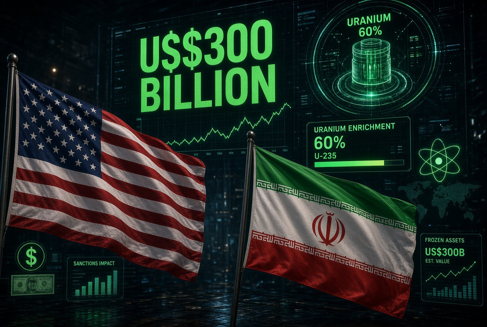

# US$300 Miliar vs Uranium 60%: Amerika Menawarkan Duit tetapi Iran Wajib Membayar Kapasitas Nuklirnya

*Ilustrasi (pic: Grok AI).*

  
***Meja perundingannya bukan meja makan biasa. Di atasnya ada tiga piring sekaligus: uranium, uang, dan Hormuz. Salah satu digeser sedikit saja, dua lainnya ikut jatuh***
  

Perang AS-Israel dengan Iran dimulai 28 Februari 2026. Pada Juni, Washington dan Tehran sempat mencapai framework awal untuk menghentikan permusuhan.

Framework itu antara lain mencakup penghentian operasi militer, pembukaan kembali Selat Hormuz, keringanan sanksi, pembahasan program nuklir, dan rancangan mekanisme ekonomi besar untuk Iran. 

Kemudian muncul angka yangmembuat mata membesar: US$300 miliar.

Reuters melaporkan pada 17 Juni bahwa framework tersebut memuat private investment fund sekitar US$300 miliar, dan sumber yang mengetahui langsung mengatakan lebih dari separuhnya sudah memiliki komitmen pembiayaan. Yang sangat penting: itu bukan uang pemerintah AS.

Menurut sumber Reuters, kendaraan investasi tersebut akan berasal dari sektor swasta, dengan perusahaan dari AS, negara-negara Teluk, Asia, Amerika Selatan, dan Afrika. Investasinya diarahkan antara lain keenergi, logistik, manufaktur, serta transportasi. 

Jadi jangan dibayangkan Washington mengambil US$300 miliar dari APBN lalu mengirimkannya ke Tehran.

Lebih tepatnya Washington dan mitra regional menciptakan kerangka yang diharapkan menarik modal swasta sebesar itu ke ekonomi Iran. Ini beda kelas secara ekonomi.

## Tapi Di sinilah Cerita Menjadi Pedas 

Karena Amerika sedang memainkan dua kartu sekaligus, kartu pertama adalah “Kami bisa membuka pintu ekonomi Iran.” Sementara kartu kedua “Tetapi kapasitas pengayaan nuklir kalian harus dikurangi secara berarti.”

Dan sekarang JD Vance secara eksplisit mengatakan bahwa Iran harus melakukan “meaningful reduction”terhadap kapasitas pengayaan uranium jika ingin memenuhi tuntutan AS dan mengakhiri perang. 

Jadi formula strategis Washington Economic normalization ↔ Nuclear constraint, bukan “Damai dulu, nuklir belakangan.” Justru nuklir adalah salah satu harga utama untuk mencapai normalisasi tersebut.

## Mengapa Vance Ngotot Soal Enrichment?

Karena problemnya bukan sekadar Iran punya nuklir atau tidak, ada spektrum yang jauh lebih rumit.

Iran sebelumnya memperkaya uranium sampai 60%, sedangkan uranium untuk senjata nuklir umumnya sekitar 90% enrichment. Jadi 60% bukan otomatis berarti Iran sudah punya bom.

IAEA sebelumnya mengatakan tidak memiliki bukti kredibel tentang program senjata nuklir terkoordinasi yang aktif. Tetapi 60% enrichment dalam jumlah besar memberikan nuclear breakout capability yang jauh lebih dekat dibanding enrichment tingkat sipil biasa. 

Sebelum serangan 2026, IAEA memperkirakan Iran memiliki sekitar 440,9 kg uranium yang diperkaya sampai 60%. Dan di sinilah Washington melihat persoalannya: Kalau Iran memang hanya membutuhkan uranium untuk energi sipil, mengapa harus memiliki enrichment setinggi itu? Itulah argumen Vance.

Namun Iran mempunyai argumen tandingan, hak atas pengayaan uranium untuk tujuan damai adalah bagian dari posisi nuklirnya dan bukan sesuatu yang bisa begitu saja diserahkan.

Jadi konflik sebenarnya bukan hanya Iran mau bom vs Amerika tidak mau bom. Lebih dalamnya adalahsiapa yang mempunyai hak menentukan batas kapasitas nuklir Iran?

Iran mengatakan: “Kami.” Sementara Washington mengatakan: “Tidak cukup. Kapasitas itu sendiri harus dibatasi.” Nah, di sinilah meja negosiasinya mulai retak. 

## Iran Bahkan Tidak Diketahui Sedang Melakukan Enrichment

Ini bagian yang sering hilang dalam headline. Serangan AS-Israel telah menghancurkan atau merusak berat tiga fasilitas enrichment Iran yang diketahui beroperasi.

Reuters melaporkan bahwa Iran saat ini tidak diketahui sedang melakukan enrichment, tetapi masalahnya, stok uranium dan lokasi centrifuge tidak sepenuhnya diketahui.

Iran juga membatasi akses IAEA setelah serangan tersebut. Reuters melaporkan IAEA memperkirakan sekitar 200 kg uranium yang diperkaya 60% mungkin masih berada di sekitar Isfahan dan Natanz, sementara jumlah dan lokasi centrifuge yang tersisa tidak sepenuhnya diketahui. 

Maka Washington tidak hanya meminta “Jangan memperkaya sekarang.” Washington menginginkanpengurangan kapasitas jangka panjang.

Itulah kenapa Vance menggunakan istilah enrichment capacity, bukan sekadar aktivitas enrichment hari ini. 

## Sekarang Masuk ke US$300 Miliar

Ini sebenarnya desain yang sangat menarik secara ekonomi.

Bayangkan Iran mendapatkan akses investasi, energi, transportasi, manufaktur, perdagangan, serta pengurangan sanksi. Sebagai imbalannya, Amerika menginginkan jaminan nuklir, pembatasan enrichment, dan verifikasi. Secara teori, ini adalah bentuk klasik security-for-economics bargain.

Keamanan strategis ditukar dengan integrasi ekonomi. Tetapi ada masalah besar, Iran harus percaya bahwa AS benar-benar akan mempertahankan akses ekonomi tersebut. Dan AS harus percaya Iran benar-benar akan mempertahankan pembatasan nuklir.

Boom! Kita kembali ke commitment problem.

## Problem yang Membuat Deal Sebelumnya Rapuh

Amerika bisa berkata: “Iran, batasi enrichment dulu. Setelah itu sanksi dibuka.” Iran bisa menjawab: “Kalau kami menyerahkan leverage nuklir, siapa yang menjamin AS tidak keluar lagi dari kesepakatan?”

Dan pertanyaan itu bukan abstrak. Karena pada 2018, pemerintahan Trump pertama keluar dari JCPOA, kesepakatan nuklir 2015. Akibatnya, pengalaman historis itu menjadi bagian dari kalkulasi Iran.

Dari sudut Tehran: “Kenapa kami harus memberikan aset strategis sekarang kalau pemerintahan AS berikutnya bisa membatalkan deal?”

Sedangkan dari sudut Washington: “Kenapa kami harus memberikan keringanan ekonomi kalau Iran bisa membangun kembali kapasitas enrichment?”

Ini bukan sekadar pertengkaran diplomatik, ini masalah desain kontrak internasional.

## Klaim Isu Nuklir Ditunda Dulu?

Nah, ini harus dibedakan. Memang framework Juni memberikan waktu 60 hari untuk merundingkan kesepakatan nuklir yang lebih komprehensif.

Framework tersebut tidak menyelesaikan seluruh persoalan nuklir saat itu. Reuters menyebut stok uranium dan isu nuklir penting lainnya ditinggalkan untuk tahap negosiasi berikutnya. 

Tetapi sekarang, Oktober, Washington justru kembali menjadikan enrichment sebagai syarat penting untuk mengakhiri perang. Vance mengatakan secara eksplisit bahwa Iran harus melakukan pengurangan berarti pada kapasitas enrichment. 

Jadi kalimat: “isu nuklir ditunda” lebih tepat untuk menggambarkan tahap awal framework Juni, bukan posisi Washington sekarang.

Nuklir ditunda untuk dinegosiasikan, bukan dihapus dari agenda. Dan sekarang justru dia kembali menjadi monster yang nongol dari bawah meja. 

## Trump dengan “Horror Show” itu Apa?

Trump pada 7 Oktober/8 Oktober kembali memperingatkan bahwa jika Iran menyerang kota-kota AS seperti Los Angeles atau San Diego, konsekuensinya akan sangat buruk. Ia menggunakan frasa “horror show.” 

Ini harus dibaca sebagai deterrence rhetoric, bukan sebagai pengumuman resmi bahwa AS sedang mempersiapkan serangan terhadap kota-kota Iran.

Logikanya, jika Iran menyerang homeland AS, eskalasi akan menjadi sangat berat. Trump kemudian juga mengatakan AS tidak akan membiarkan kota-kota Amerika diserang. 

Jadi kata “horror show” berfungsi sebagai threat signaling. Tujuannya, dalam istilah strategi nuklir dan keamanan, adalah membuat lawan memperhitungkan biaya eskalasi.

Masalahnya adalah bahasa seperti ini punya efek samping deterrence, signaling, dan miscalculation risk.

Semakin keras ancaman publik, semakin besar kemungkinan lawan salah membaca: “Apakah ini gertakan atau persiapan serangan?”

Dan dalam perang yang sudah berjalan tujuh bulan, salah hitung bisa sangat mahal.

## Paradoks Besar

Perhatikan susunan politiknya:

Amerika: “Iran harus mengurangi kapasitas enrichment.”

Iran: “Hak enrichment tidak bisa dinegosiasikan.”

Amerika: “Kalau begitu perang belum selesai.”

Amerika juga: “Kami punya framework ekonomi US$300 miliar.”

Iran: “Kalau kami menerima deal, siapa yang menjamin deal itu tidak dibatalkan lagi?”

Trump: “Horror show.”

Ini bukan negosiasi yang kekurangan uang, ini negosiasi yang kekurangan kepercayaan.

## US$300 Miliar Bukan Hadiah

Ini penting banget sebab angka US$300 miliar terdengar seperti Amerika mau membangun kembali Iran, padahal tidak.

Draft MoU menyebut AS dan mitra regional akan mengembangkan rencana minimal US$300 miliar untuk rekonstruksi dan pembangunan ekonomi Iran, dengan mekanisme finalnya ditentukan dalam final deal. 

Reuters kemudian melaporkan bahwa dana tersebut dirancang sebagai private investment vehicle, bukan program reparasi atau hibah pemerintah. 

Jadi secara ekonomi bukan reparations, bukan Marshall Plan versi Iran, juga bukan cek US$300 miliar dari Washington Melainkan mekanisme untuk membuat Iran kembali menjadi tempat yang layak dan aman bagi modal internasional.

Dan itu sangat penting karena investasi swasta membutuhkan keamanan, kepastian hukum, akses pembayaran, stabilitas politik, perlindungan aset, kemampuan repatriasi keuntungan, dan prediktabilitas sanksi.

Investor tidak datang hanya karena ada tulisan “Iran sekarang damai, silakan masuk.” Investor akan bertanya: “Besok disanksi lagi gak?”, “Pelabuhan aman gak?”, “Bank bisa transfer dolar gak?”, “Centrifuge meledak lagi gak?”, “AS berubah pemerintahan, deal batal gak?”

## Inti Perang Mulai Bergeser

Awalnya military problem Iran vs AS-Israel. Kemudian nuclear problem, Enrichment, stockpile, centrifuges, inspections. Sekarang muncul economic normalization problem, sanksi, minyak, investasi, Hormuz, perbankan, perdagangan. Dan semuanya saling mengunci.

Kita bisa menggambarkannya seperti ini:

NUKLIR
⬇️
SANKSI
⬇️
INVESTASI
⬇️
MINYAK
⬇️
HORMUZ
⬇️
INFLASI GLOBAL
⬇️
TEKANAN POLITIK DOMESTIK AS

Jadi perang Iran bukan lagi sekadar perang Timur Tengah. Ia sudah menjadi konflik keamanan, energi, nuklir, serta ekonomi internasional sekaligus.

## Deal Damai Sangat Rapuh

Framework Juni sebenarnya sudah menunjukkan problem tersebut.

Kesepakatan awal: ceasefire, Hormuz dibuka, sanksi dilonggarkan, investasi disiapkan, dan isu nuklir dinegosiasikan kemudian. Tetapi setelah itu kesepakatan final tidak lahir.

Sekarang Vance kembali mengatakan pengurangan enrichment adalah bagian penting untuk mengakhiri perang. Artinya, Amerika tidak lagi puas dengan: “kita hentikan perang dulu, nuklir nanti.”

Washington ingin memastikan nuklir menjadi bagian dari arsitektur perdamaian itu sendiri. 

AS bukan menawarkan US$300 miliar, Iran tinggal menyerah soal nuklir. Itu terlalu dangkal.

Yang sebenarnya terjadi adalah Washington sedang mencoba mengubah Iran dari negara yang menggunakan enrichment, minyak, dan Hormuz sebagai leverage keamanan menjadi negara yang memperoleh keuntungan ekonomi melalui integrasi dan investasi internasional, dengan syarat kapasitas nuklirnya dibatasi secara permanen.

Dan Iran menghadapi dilema. Jika menerima maka akses ekonomi terbuka, minyak kembali mengalir, Hormuz lebih stabil, investasi masuk, dan tekanan ekonomi berpotensi turun
Tetapi harus menerima pembatasan nuklir, harus menghadapi verifikasi, harus mempercayai Washington, serta kehilangan sebagian leverage strategisnya

Jika menolak maka mempertahankan posisi enrichment dan mempertahankan leverage strategis. Tetapi perang berlanjut, Hormuz tetap menjadi titik tekanan, investasi tertahan, ekonomi tetap tertekan, dan risiko eskalasi tetap tinggi.

Jadi US$300 miliar itu bukan “uang damai”. Itu lebih tepat dibaca sebagai harga potensial untuk menciptakan struktur ekonomi yang membuat perdamaian menjadi lebih menguntungkan daripada perang.

Dan justru pertanyaan paling sulitnya bukan:“Berapa harga Iran untuk berdamai?” melainkan: “Apa jaminan bahwa setelah Iran menyerahkan sebagian leverage nuklirnya, sistem ekonomi yang dijanjikan benar-benar bertahan?” Karena kalau jaminan itu tidak kredibel, US$300 miliar hanya angka di atas kertas.

Dan kalau Iran tidak bersedia membatasi enrichment secara permanen, Washington punya alasan untuk mempertanyakan apakah investasi sebesar itu aman.

Jadi meja perundingannya bukan meja makan biasa. Di atasnya ada tiga piring sekaligus: uranium, uang, dan Hormuz. Salah satu digeser sedikit saja, dua lainnya ikut jatuh.

Referensi
Reuters, 6–7 Oktober 2026: Vance, enrichment sebagai syarat penting untuk mengakhiri perang; status stok uranium Iran. 
Reuters, 17 Juni 2026: US$300 miliar private investment fund dan lebih dari separuh disebut telah committed. 
Reuters, 17 Juni 2026: isi dan risiko framework AS-Iran, termasuk 60 hari dan isu nuklir yang belum terselesaikan. 
AP, 17 Juni 2026: framework awal, negosiasi nuklir 60 hari dan potensi US$300 miliar. 
Los Angeles Times, 7 Oktober 2026: klarifikasi Trump mengenai ancaman terhadap Los Angeles/San Diego dan istilah “horror show.” 
