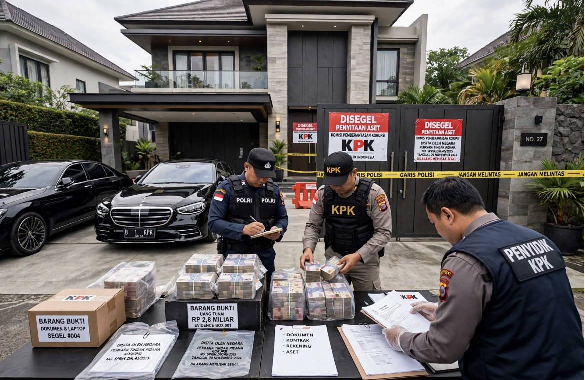

# UU Perampasan Aset: Pepesan Kosong, Duplikasi KUHAP, atau Senjata Antikorupsi yang Sengaja Tak Kunjung Jadi?

*(pic: Meta AI).*

  
***Undang-undang bukan prestasi final. Ia adalah perangkat yang harus diuji melalui hasil, bukan melalui tepuk tangan saat paripurna***
  

Kita bedah dari anatomi hukum, bukan dari slogan “UU Perampasan Aset pasti menyelamatkan negara” ataupun slogan sebaliknya “semuanya sudah ada di KUHAP dan Tipikor, jadi UU ini tidak berguna.” 

Klaim bahwa perampasan aset sudah diatur dalam KUHAP dan UU Tipikor sehingga UU Perampasan Aset tidak diperlukan, secara doktrinal merupakan klaim yang terlalu menyederhanakan persoalan.

Ada mekanisme penyitaan, pembekuan, perampasan, uang pengganti dan instrumen lain dalam hukum Indonesia. Tetapi keberadaan mekanisme tersebut belum tentu identik dengan sistem non-conviction based asset forfeiture yang dirancang untuk memungkinkan perampasan aset melalui proses hukum tertentu tanpa harus terlebih dahulu memperoleh putusan pidana terhadap pemilik atau pelaku.

Namun, apakah UU yang sedang diperdebatkan benar-benar menawarkan solusi substantif? Itu pertanyaan berbeda. Dan kita akan membedahnya.

## Statusnya Bukan Lagi Sekadar RUU yang Masih Berputar-Putar

Pada 19 November 2026, DPR mengumumkan pengesahan RUU Perampasan Aset dalam rapat paripurna.

Ini berarti, berdasarkan pemberitaan resmi DPR yang terbit kemarin, proses legislasi telah mencapai pengambilan keputusan di tingkat paripurna. 

Kita perlu membedakan keputusan paripurna dengan tahapan promulgasi dan berlakunya undang-undang secara formal.

DPR sendiri mengklaim regulasi tersebut menjadi instrumen baru pemulihan aset negara dan korban tindak pidana.

Namun, jangan sampai kata disahkan membuat kita berhenti membaca isi pasalnya. Sebab, pertanyaan yang jauh lebih penting ialah: Apa yang benar-benar berubah setelah undang-undang ini dibandingkan hukum yang sudah ada?

## Perampasan Aset Sudah Diatur dalam KUHAP?

Ya, mekanisme penyitaan dan perampasan memang telah ada. Tetapi penyitaan dan perampasan bukan konsep yang identik.

| Konsep | Fungsi |
|------|-------|
|Penyitaan|Mengambil alih atau menempatkan benda dalam penguasaan hukum aparat untuk kepentingan proses hukum.|
|Pembekuan|Menghentikan sementara transaksi, penggunaan atau pemindahan aset.|
|Perampasan|Mengalihkan hak atau penguasaan aset kepada negara berdasarkan dasar hukum dan putusan atau mekanisme yang sah.|
|Uang pengganti|Kewajiban terpidana untuk membayar sejumlah uang guna mengganti kerugian atau keuntungan tertentu sesuai ketentuan hukum.|
|Asset recovery|Proses keseluruhan: menelusuri, mengidentifikasi, mengamankan, mengelola, merampas dan mengembalikan aset.|

KUHAP memang memiliki instrumen untuk menangani benda yang berkaitan dengan tindak pidana. Dalam hukum pidana konvensional, penyitaan berfungsi mendukung pembuktian dan penanganan perkara, sedangkan perampasan dapat menjadi konsekuensi hukum berdasarkan putusan atau ketentuan tertentu.

Namun, keberadaan prosedur tersebut tidak otomatis memberikan mekanisme universal untuk merampas kekayaan yang diduga berasal dari kejahatan ketika perkara pidana terhadap pelaku tidak dapat diselesaikan.

KUHAP menyediakan prosedur hukum acara pidana. UU Perampasan Aset berupaya menyediakan jalur dan kerangka hukum yang lebih khusus untuk pemulihan aset.

Jadi, mengatakan “sudah ada di KUHAP, maka UU ini tidak berguna” adalah kesimpulan yang tidak tepat secara konseptual.

## Sudah Diatur dalam UU Tipikor?

Ini bagian yang sering dipakai untuk menyatakan RUU Perampasan Aset tidak diperlukan.

UU Tipikor memang sudah mempunyai instrumen perampasan

UU Nomor 31 Tahun 1999 sebagaimana diubah dengan UU Nomor 20 Tahun 2001 menyediakan sejumlah instrumen penting, terutama:
- Pasal 18: pidana tambahan, termasuk perampasan barang yang digunakan atau diperoleh dari tindak pidana korupsi, pembayaran uang pengganti, dan mekanisme terkait lainnya.
- Pasal 38: berkaitan dengan kemungkinan perampasan dalam kondisi tertentu ketika terdakwa meninggal dunia sebelum putusan dijatuhkan, termasuk ketentuan mengenai harta yang diduga diperoleh dari korupsi.
- Pasal 38B: berkaitan dengan pembuktian harta terdakwa yang diduga berasal dari tindak pidana korupsi, dalam konteks yang diatur undang-undang.

Jadi, Indonesia bukan negara yang sama sekali tidak memiliki hukum perampasan aset sebelum UU ini.

Tetapi instrumen yang sudah ada memiliki konteks, persyaratan, prosedur, dan batasan masing-masing.

Perbedaan yang sering luput:

| UU Tipikor | UU Perampasan Aset |
|------|-------|
|Perampasan berkaitan dengan mekanisme penanganan tindak pidana korupsi yang sudah diatur dalam UU Tipikor.|Mengatur kerangka khusus perampasan aset yang terkait dengan sejumlah tindak pidana, termasuk mekanisme berdasarkan putusan pidana dan mekanisme tertentu tanpa putusan pidana terhadap pelaku.|
|Pidana tambahan, uang pengganti dan mekanisme perampasan lainnya memiliki ketentuan dan syarat tersendiri.|Mengatur prosedur khusus penelusuran, pemblokiran, penyitaan, pemeriksaan permohonan, putusan, pengelolaan dan pelaksanaan perampasan.|
|Pembuktian dan penanganan mengikuti mekanisme yang berlaku pada perkara Tipikor.|Membuka mekanisme yang lebih spesifik dalam kasus tertentu ketika perkara terhadap pelaku tidak dapat disidangkan karena keadaan yang ditentukan.|
|Tidak identik dengan sistem NCB yang dirumuskan dalam UU ini.|Menambahkan jalur non-conviction-based forfeiture dalam kondisi terbatas.|

Dengan demikian, UU Perampasan Aset ini bukan sekadar mengganti istilah penyitaan menjadi perampasan.

## NCB dalam UU Perampasan Aset Ternyata Tidak Seluas yang Dibayangkan Publik

Inilah bagian yang paling layak dikritik secara substantif.

Banyak orang mengira UU Perampasan Aset akan memberikan mekanisme untuk merampas kekayaan yang tidak dapat dijelaskan asal-usulnya, secara luas dan efektif, tanpa perlu menunggu pemiliknya dihukum.

Tetapi dalam naskah hasil pembahasan yang disampaikan DPR, mekanisme perampasan tanpa putusan pidana terhadap pelaku dibatasi pada kondisi tertentu.

Berdasarkan naskah yang dipublikasikan DPR:

Pasal 6: mekanisme NCB

Perampasan aset tanpa putusan pidana terhadap pelaku tindak pidana dapat dilakukan dalam kondisi:
- Tersangka atau terdakwa meninggal dunia.
- Tersangka atau terdakwa melarikan diri.
- Tersangka atau terdakwa sakit permanen.
- Pelaku tidak diketahui.
- Pelaku tidak diketahui keberadaannya.

Selain kondisi tersebut, aset harus memenuhi nilai minimum Rp1 miliar.

Ketentuan tersebut terdapat dalam naskah yang dipublikasikan DPR pada 19 November 2026.

Ini bukan NCB tanpa batas

Dalam desain tersebut, negara tidak otomatis dapat merampas aset hanya karena:
- seseorang memiliki kekayaan besar,
- seseorang tidak mampu menjelaskan sumber kekayaannya,
- seseorang dicurigai melakukan korupsi,
- seseorang memiliki gaya hidup tidak sesuai penghasilan,
- atau penyidik merasa ada kejanggalan.

NCB dalam naskah ini dibatasi oleh kondisi yang secara eksplisit dirumuskan, bukan sekadar ketidaksesuaian kekayaan dan penghasilan.

Dan ini penting untuk perlindungan hak milik.
Negara tidak boleh menjadikan dugaan semata sebagai alasan untuk mengambil harta warga. 

Perampasan harus memiliki dasar hukum, pembuktian, proses pengadilan, mekanisme keberatan, dan perlindungan terhadap pihak ketiga yang beritikad baik.

Tetapi di sisi lain, pembatasan yang terlalu ketat juga dapat membuat instrumen asset recovery kurang efektif terhadap pelaku yang masih hidup, berada di dalam negeri, dan mampu menghindari pembuktian atau penindakan pidana melalui berbagai cara.
Di sinilah desain legislasi menjadi pertaruhan.

## Apa yang Benar-Benar Baru? Dan di Mana Kelemahannya?

Dari naskah hasil pembahasan yang tersedia, ada beberapa substansi yang memang bukan sekadar kosmetik.

A. Jalur perampasan tanpa putusan pidana yang lebih khusus

Ini merupakan tambahan penting dalam kerangka asset recovery.

NCB bukan berarti tidak ada pengadilan, tidak ada pembuktian, atau aset boleh diambil sesuka penyidik. Mekanisme yang dibahas tetap melibatkan permohonan, pemeriksaan, proses hukum dan putusan.

Tetapi ruang penerapannya dalam naskah ini relatif terbatas karena kondisi pemicu dan nilai minimum aset ditentukan secara spesifik.

B. Pengelolaan aset rampasan

Perampasan aset bukan sekadar memenangkan putusan. Aset bisa berupa:
- Tanah dan bangunan.
- Saham.
- Kendaraan.
- Barang mewah.
- Rekening dan instrumen keuangan.
- Aset yang memerlukan pengelolaan khusus.

Aset yang disita dapat mengalami penurunan nilai, rusak, kehilangan biaya pemeliharaan, atau menjadi objek manipulasi dalam proses penjualan.

Karena itu, asset management merupakan bagian penting dari asset recovery. Negara yang berhasil menyita aset tetapi gagal mengelolanya secara transparan bisa menciptakan korupsi baru di hilir.

DPR mengklaim naskah hasil pembahasan memperkuat transparansi penjualan aset dan mencegah under valuation. Itu merupakan tujuan yang baik, tetapi efektivitasnya baru bisa dinilai melalui pelaksanaan, audit, transparansi data, serta mekanisme pengawasan.

C. Pemulihan hak korban

Perampasan aset seharusnya tidak hanya berorientasi pada pemasukan kas negara.
Dalam kejahatan tertentu, korban dapat berupa:
- Korban investasi bodong.
- Korban penipuan digital.
- Korban perdagangan manusia.
- Korban tindak pidana yang menghasilkan kerugian finansial.

Jika aset yang berhasil dipulihkan dapat dikembalikan kepada korban secara adil, transparan dan sesuai prosedur, manfaatnya jauh lebih konkret daripada sekadar statistik penindakan.

## Apakah UU ini Berpotensi Menjadi Instrumen yang Terlalu Sempit?

Kritik yang paling kuat terhadap desain UU ini bukan bahwa ia sama sekali tidak berguna, melainkan bahwa efektivitasnya mungkin tidak sebanding dengan ekspektasi publik terhadap sebuah undang-undang perampasan aset.

Ada beberapa titik kritis:

Kritik pertama: NCB yang terbatas

Jika tujuan asset recovery adalah mencegah pelaku kejahatan mempertahankan keuntungan kriminal, mekanisme NCB idealnya dirancang untuk menghadapi berbagai hambatan nyata dalam penegakan hukum.

Tetapi naskah yang dibahas membatasi NCB pada kondisi tertentu, dengan ambang nilai aset Rp1 miliar.

Ini menciptakan pertanyaan:
- Bagaimana jika tersangka masih hidup, tidak melarikan diri, tidak sakit permanen, tetapi perkara pidananya tidak efektif diselesaikan?
- Bagaimana jika aset dipindahkan kepada pihak lain?
- Bagaimana jika kekayaan kriminal tersebar dalam struktur kepemilikan yang kompleks?
- Bagaimana jika perkara pidana gagal bukan karena pelaku meninggal atau melarikan diri, melainkan karena hambatan pembuktian yang tidak dapat diatasi?

Tidak semuanya otomatis dapat dijawab dengan NCB. Bahkan beberapa situasi tersebut mungkin memiliki instrumen lain. Tetapi desain NCB yang terlalu sempit berpotensi mengurangi kemampuan sistem untuk menangani kasus asset recovery tertentu.

Kritik kedua: Rp1 miliar dapat menciptakan celah struktural

Ambang Rp1 miliar merupakan batas yang harus dianalisis secara kritis.

Secara teoritis, jika mekanisme NCB hanya dapat diterapkan pada aset dengan nilai minimum tertentu, maka:
- Aset di bawah ambang tersebut tidak dapat menggunakan jalur NCB yang sama.
- Penanganan aset dapat menjadi lebih kompleks apabila aset tersebar.
- Penilaian nilai aset dapat menimbulkan persoalan.
- Penggabungan atau pemisahan kepemilikan dapat menimbulkan sengketa.

Ambang nilai dapat menjadi alat proporsionalitas, tetapi juga berpotensi menjadi batas yang mengurangi jangkauan mekanisme.

Efek sebenarnya bergantung pada bagaimana nilai aset dihitung, bagaimana aset yang terfragmentasi diperlakukan, dan bagaimana ketentuan tersebut diterapkan oleh pengadilan.

Kritik ketiga: pembatasan tindak pidana

Dalam pembahasan Panja, cakupan tindak pidana lainnya di luar korupsi dikurangi dari 13 kriteria menjadi enam jenis.

Enam kategori tersebut, menurut laporan DPR, meliputi:
- Narkotika dan psikotropika.
- Terorisme dan pendanaan terorisme.
- Penyelundupan manusia.
- Penyelundupan senjata, amunisi dan bahan berbahaya.
- Perdagangan orang.
- Penipuan dan/atau penggelapan menggunakan sarana teknologi informasi dan/atau berdampak pada perekonomian masyarakat luas.

Korupsi tetap menjadi cakupan utama, sehingga enam kategori ini bukan keseluruhan tindak pidana yang dapat menjadi sasaran perampasan aset.

DPR menjelaskan pembatasan tersebut sebagai upaya mencegah penyalahgunaan kewenangan aparat.

Argumen perlindungan hak warga itu sah. Negara memang tidak boleh membuat instrumen perampasan aset yang terlalu luas, kabur, dan rentan digunakan secara sewenang-wenang.

Tetapi ada trade-off legislasi yang nyata: Semakin sempit ruang lingkup mekanisme, semakin mudah membatasi potensi abuse of power, tetapi semakin besar pula risiko bahwa instrumen asset recovery tidak mampu menjangkau berbagai pola kejahatan yang kompleks.

Solusinya bukan membuat kewenangan tanpa batas. Solusinya adalah merancang kewenangan yang cukup kuat dengan pengawasan yang cukup kuat pula.

Kritik keempat: perlindungan hak tidak boleh hanya menjadi ornamen

Fraksi-fraksi di Komisi III sendiri menekankan perlindungan pihak ketiga yang beritikad baik, pengawasan pengadilan, serta pengawasan terhadap pengelolaan aset.

Ini penting karena perampasan aset merupakan tindakan negara yang menyentuh hak milik.

Kita membutuhkan:
- Pembuktian yang jelas mengenai hubungan aset dengan tindak pidana.
- Beban pembuktian yang tidak secara sewenang-wenang dibalik.
- Kesempatan bagi pemilik dan pihak ketiga untuk membela haknya.
- Pengadilan yang independen.
- Transparansi pengelolaan aset.
- Audit.
- Mekanisme restitusi apabila perampasan terbukti keliru.
- Pertanggungjawaban aparat apabila kewenangan disalahgunakan.

Tanpa itu, instrumen asset recovery dapat menjadi senjata yang sangat kuat, tetapi kekuatan tersebut justru dapat menjadi sumber penyalahgunaan.

## Jadi, Pepesan Kosong atau Bukan?

| Klaim | Penilaian |
|------|-------|
|Perampasan aset sudah diatur dalam KUHAP, sehingga UU tidak diperlukan|Keliru secara konseptual. Instrumen yang ada tidak identik dengan mekanisme khusus yang dirancang UU.|
|UU Tipikor sudah memiliki mekanisme perampasan aset|Benar. Tetapi tidak identik dengan seluruh mekanisme NCB dalam UU.|
|UU Perampasan Aset tidak menghasilkan hal baru|Tidak tepat. Ada mekanisme khusus, termasuk NCB dalam kondisi tertentu.|
|NCB dalam UU ini sangat luas|Tidak sesuai dengan naskah yang dibahas. Mekanismenya dibatasi kondisi tertentu dan nilai minimum Rp1 miliar.|
|UU ini pasti efektif mengembalikan aset koruptor|Belum dapat dibuktikan. Efektivitas membutuhkan implementasi, penegakan, pengelolaan, transparansi dan pengawasan.|
|UU ini berpotensi terlalu sempit untuk memenuhi ekspektasi publik|Kritik yang substantif dan layak diuji.|

Bukan pepesan kosong secara hukum, tetapi juga bukan senjata pamungkas pemberantasan korupsi seperti yang mungkin dibayangkan publik.

UU ini memang menambahkan kerangka dan mekanisme khusus yang tidak dapat disamakan begitu saja dengan KUHAP maupun UU Tipikor. Namun, desain NCB-nya relatif terbatas, dan keberhasilan asset recovery tidak ditentukan oleh satu undang-undang saja.

Kalau DPR menjual pengesahan ini sebagai game changer pemberantasan korupsi, maka publik berhak menuntut bukti berupa hasil nyata: aset berhasil dipulihkan, korban memperoleh haknya, proses transparan, dan tidak ada aset yang dirampas secara sewenang-wenang.

Undang-undang bukan prestasi final. Ia adalah perangkat yang harus diuji melalui hasil, bukan melalui tepuk tangan saat paripurna.

  
**Referensi**

Dewan Perwakilan Rakyat Republik Indonesia. (2026, November 19). DPR sahkan RUU Perampasan Aset, Habiburokhman: Instrumen baru pemulihan kerugian negara dan korban. DPR RI⁠.

Dewan Perwakilan Rakyat Republik Indonesia. (2026, November 19). Puan pimpin rapat paripurna pengesahan UU Perampasan Aset, apresiasi masukan dari masyarakat. DPR RI⁠.

Dewan Perwakilan Rakyat Republik Indonesia. (2026, November 11). Panja RUU Perampasan Aset kerucutkan 13 kriteria tindak pidana menjadi enam, batasi abuse of power aparat. DPR RI⁠.

Dewan Perwakilan Rakyat Republik Indonesia. (2026, November 19). Naskah RUU Perampasan Aset hasil pembahasan. Dokumen DPR RI⁠.

Republik Indonesia. (1999). Undang-Undang Nomor 31 Tahun 1999 tentang Pemberantasan Tindak Pidana Korupsi.

Republik Indonesia. (2001). Undang-Undang Nomor 20 Tahun 2001 tentang Perubahan atas Undang-Undang Nomor 31 Tahun 1999 tentang Pemberantasan Tindak Pidana Korupsi.

Republik Indonesia. (2025). Undang-Undang Nomor 20 Tahun 2025 tentang Kitab Undang-Undang Hukum Acara Pidana.
