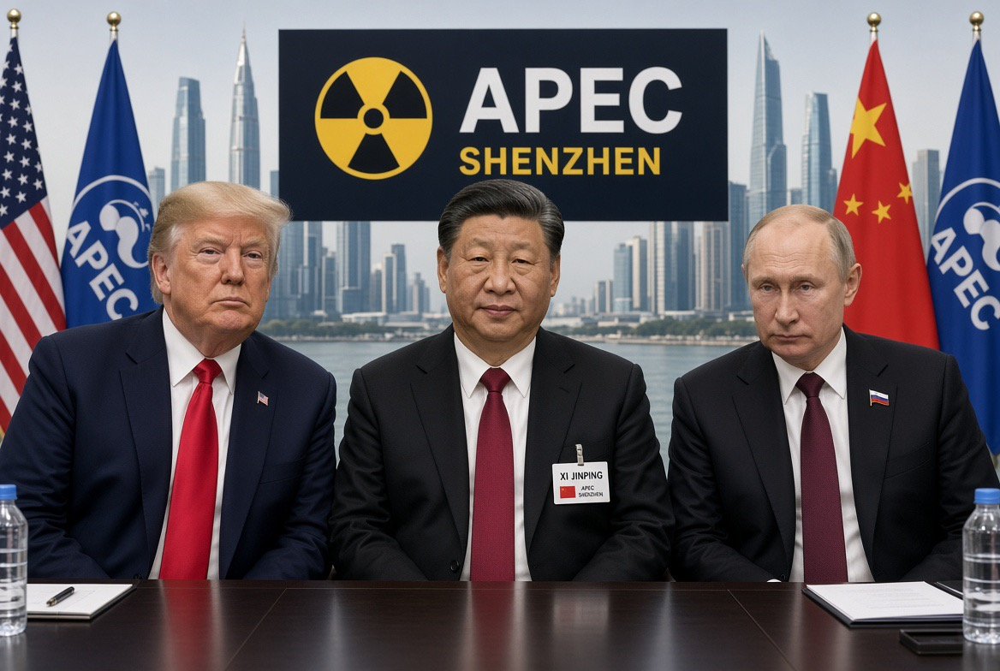

# Yalta 2.0 di Shenzhen? Tiga Penguasa Nuklir, Satu Meja, dan Masa Depan Dunia yang Dipertaruhkan

*Ilustrasi (pic: Grok AI).*

  
***Dunia tidak kekurangan meja perundingan. Dunia sedang menguji apakah orang-orang yang duduk di meja itu masih bersedia mengakui bahwa ada manusia lain di luar meja mereka***
  

Bayangkan satu meja, tiga presiden, tiga kekuatan nuklir, dan tiga proyek besar tentang bagaimana dunia seharusnya diatur. Trump, Putin, dan Xi Jinping akan bertemu di Shenzhen pada 19 November, di sela-sela KTT APEC.

Namun, ada koreksi penting: pertemuan ini sudah dikonfirmasi oleh Gedung Putih dan Kremlin, tetapi belum berlangsung per 15 November 2026. Jadi kita sedang menganalisis agenda, kalkulasi, dan konsekuensi potensialnya, bukan hasil perundingan yang belum terjadi.

Trump–Putin–Xi sebuah diplomasi kekuatan besar, ambisi tatanan multipolar, dan risiko dunia dibagi tanpa persetujuan mereka yang terdampak.

## Mengapa Pertemuan ini Disebut Historis?

Karena ini direncanakan menjadi pertemuan trilateral langsung antara pemimpin tiga negara yang memiliki persenjataan nuklir sangat besar dan pengaruh global yang menentukan.

Ketiganya bukan sekadar pemimpin negara besar:
- Donald Trump: presiden Amerika Serikat, pemimpin kekuatan militer dan ekonomi yang masih memiliki jaringan aliansi global paling luas.
- Xi Jinping: pemimpin China, negara dengan kekuatan manufaktur, perdagangan, teknologi, dan militer yang terus berkembang.
- Vladimir Putin: presiden Rusia, pemimpin kekuatan nuklir besar yang sedang berperang dengan Ukraina dan mempertahankan pengaruh strategis melalui energi serta kemitraan militer.

APEC sendiri adalah forum kerja sama ekonomi Asia-Pasifik yang melibatkan 21 ekonomi. Pertemuan trilateral ini dijadwalkan berlangsung pada 19 November di Shenzhen, bukan sebagai agenda resmi utama APEC, melainkan pertemuan para pemimpin di sela-sela KTT.

Mengapa penting? Karena ketiga negara itu memiliki kepentingan yang saling bertabrakan, tetapi juga saling membutuhkan.

Amerika ingin mempertahankan keunggulan teknologi dan militer. China ingin memperoleh ruang strategis lebih besar. Rusia ingin menghindari isolasi dan mempertahankan posisinya sebagai kekuatan besar.

Mereka datang bukan dengan kepentingan yang sama, melainkan dengan kepentingan yang saling bernegosiasi.

## Agenda Pertama: Senjata Nuklir dan Berakhirnya Era Pengendalian Senjata?

Ini agenda yang secara resmi paling menonjol dari pihak Amerika.

Gedung Putih menyatakan Trump ingin membahas pengurangan senjata nuklir dunia. Washington juga menginginkan China masuk ke dalam pembicaraan pengendalian senjata bersama Amerika dan Rusia.

Ada latar belakang yang sangat serius. Perjanjian New START antara Amerika Serikat dan Rusia telah berakhir pada Februari 2026. Perjanjian itu sebelumnya membatasi jumlah hulu ledak nuklir strategis yang dikerahkan serta sistem peluncurnya.

Berakhirnya perjanjian tersebut menghilangkan batasan hukum yang selama lebih dari satu dekade menjadi salah satu instrumen utama pengendalian persenjataan strategis kedua negara.

Sekarang muncul persoalan baru yaitu China. Menurut estimasi Pentagon yang dikutip AP, China memiliki lebih dari 600 hulu ledak nuklir, sedangkan Amerika dan Rusia masing-masing diperkirakan memiliki lebih dari 5.000. Angka tersebut merupakan estimasi pemerintah Amerika, bukan inventaris yang diverifikasi secara independen.

Mengapa Washington menginginkan China masuk? Karena pengendalian senjata bilateral Amerika-Rusia tidak lagi dianggap cukup untuk menghadapi lingkungan nuklir yang melibatkan tiga kekuatan besar.

Tetapi Beijing memiliki keberatan yang rasional dari sudut pandang strategisnya.
Jika China diminta menerima batasan ketika persenjataannya jauh lebih kecil daripada Amerika dan Rusia, perjanjian itu berpotensi mengunci ketimpangan yang sudah ada.

Dengan kata lain:
- Amerika ingin China ikut membatasi persenjataan.
- Rusia ingin mempertahankan posisi strategisnya dalam negosiasi nuklir.
- China tidak ingin membatasi diri sebelum mencapai keseimbangan kekuatan yang dianggap memadai.
Di sini kita menemukan dilema klasik arms control: negara-negara menginginkan keamanan, tetapi tidak ingin keamanan itu dibeli dengan mengurangi keunggulan strategis mereka sendiri.

Pertemuan ini bisa membuka dialog nuklir, tetapi belum tentu menghasilkan perjanjian. Bahkan pejabat Amerika menyatakan tidak mengharapkan kesepakatan diumumkan dari pertemuan tersebut.

## Ukraina: Apakah Nasib Sebuah Negara Akan Dibicarakan Tanpa Negaranya?

Inilah bagian yang paling sensitif secara politik.

Rusia telah melancarkan invasi skala penuh ke Ukraina sejak Februari 2022. Perang itu bukan hanya konflik teritorial. Ia menyangkut kedaulatan, keamanan Eropa, tatanan hukum internasional, dan kredibilitas aliansi Barat.

Pertemuan tiga pemimpin di Shenzhen menimbulkan pertanyaan: apakah masa depan Ukraina akan menjadi bahan pembicaraan tiga negara besar tanpa keterlibatan Ukraina?

Ada satu detail yang perlu diperhatikan. Menurut pejabat senior Amerika yang dikutip AP, Trump berencana membahas perang Iran dalam pertemuan trilateral, tetapi tidak berencana membahas Ukraina. Namun, Putin sebelumnya menginginkan agar pertemuan semacam ini menjadi ruang untuk membicarakan perang Ukraina.

Jadi, kita harus membedakan:
- Agenda resmi yang disampaikan Washington.
- Kepentingan strategis Moskow.
- Kekhawatiran Kyiv dan negara-negara Eropa.
- Kemungkinan pembicaraan informal di luar agenda resmi.

Presiden Ukraina Volodymyr Zelenskyy telah menyampaikan kekhawatiran bahwa pertemuan tersebut dapat menjadi panggung bagi pembicaraan mengenai masa depan Ukraina tanpa keterlibatan Kyiv.

## Mengapa ini Mengingatkan Dunia Pada Konferensi Yalta 1945?

Pada Februari 1945, Franklin D. Roosevelt, Winston Churchill, dan Joseph Stalin bertemu di Yalta untuk membicarakan tatanan Eropa pasca-Perang Dunia II.

Konferensi itu menjadi simbol diplomasi kekuatan besar: nasib wilayah dan negara dapat dipengaruhi oleh negosiasi beberapa pemimpin yang memiliki kekuatan militer dominan. Karena itulah pertemuan Shenzhen mulai dibandingkan dengan Yalta.

Yalta bukan cetak biru yang dapat langsung diterapkan pada Shenzhen. Eropa tahun 2026 memiliki institusi, kekuatan ekonomi, militer, dan kapasitas politik yang tidak sama dengan Eropa tahun 1945.

Tetapi peringatan normatifnya tetap relevan: Negara yang menjadi objek negosiasi harus memiliki suara dalam menentukan masa depannya.

Tidak ada penyelesaian Ukraina yang memiliki legitimasi kuat jika Ukraina sendiri tidak ikut menentukan persyaratannya.

## Iran: Mengapa Perang di Timur Tengah Masuk ke Meja APEC?

Ini bagian yang membuat pertemuan Shenzhen jauh lebih luas daripada sekadar persaingan Amerika-China-Rusia. Trump ingin membicarakan perang Iran bersama Xi dan Putin.

Mengapa dua negara itu penting? China merupakan pembeli utama energi dari kawasan Teluk dan memiliki hubungan ekonomi serta diplomatik dengan Iran. 

Stabilitas jalur pelayaran dan pasokan energi sangat penting bagi perekonomian China. Rusia memiliki kemitraan strategis dengan Iran, termasuk hubungan militer, intelijen, dan diplomatik. Moskow juga berkepentingan terhadap perubahan keseimbangan kekuatan di Timur Tengah.

Amerika Serikat terlibat langsung dalam perang dan memiliki kepentingan pada keamanan Israel, negara-negara Teluk, jalur perdagangan, serta posisi militernya di kawasan.

Jadi, Trump mungkin sedang mencoba memanfaatkan pengaruh dua negara tersebut untuk mengubah kalkulasi Iran.

Tetapi ada persoalan mendasar: 
- China dan Rusia tidak otomatis memiliki kendali atas keputusan Teheran.
- Hubungan strategis bukan hubungan komando.
- Kedua negara bisa membantu diplomasi, menawarkan insentif, atau menyampaikan tekanan. Namun Iran tetap memiliki kepentingan nasional dan kalkulasi keamanannya sendiri.

Artinya, kehadiran Xi dan Putin di meja tidak menjamin bahwa Iran akan menerima hasil yang mereka bicarakan.

## Siapa Sebenarnya yang Paling Diuntungkan?

Kita jangan menilai pertemuan diplomatik hanya berdasarkan siapa yang mendapatkan kesepakatan tertulis. Dalam geopolitik, foto, pengakuan status, dan posisi simbolis juga dapat menghasilkan keuntungan.

- Vladimir Putin: memperoleh pengakuan status

Kehadiran Putin dalam forum bersama presiden Amerika dan China memberikan panggung internasional yang sangat berharga. Ia dapat tampil sebagai pemimpin kekuatan besar yang tetap harus diperhitungkan, meskipun Rusia menghadapi sanksi dan perang berkepanjangan di Ukraina.

- Xi Jinping: menjadi tuan rumah dan pusat diplomasi

Shenzhen memberi China kesempatan menampilkan dirinya sebagai penyelenggara diplomasi global. Xi dapat memperlihatkan bahwa Beijing bukan hanya pesaing Washington, tetapi juga pusat pertemuan dan pengaturan agenda internasional.

- Donald Trump: menunjukkan kemampuan bernegosiasi

Trump dapat menampilkan dirinya sebagai pemimpin yang mampu mempertemukan dua rival utama Amerika, sekaligus membuka percakapan mengenai nuklir dan Iran. Tetapi ia juga menghadapi risiko bahwa pertemuan tersebut memberi keuntungan simbolis kepada Putin dan Xi tanpa menghasilkan konsesi berarti.

Analisis Brookings pada 12 November menyoroti perbedaan kalkulasi tersebut: bagi Rusia, pengakuan status internasional merupakan keuntungan; bagi China, menjadi tuan rumah memperkuat citra diplomatik; sedangkan bagi Amerika, risiko simbolis dan kepentingan aliansi harus diperhitungkan.

Ini menarik karena ketiganya mungkin pulang dengan klaim kemenangan yang berbeda, bahkan jika tidak ada kesepakatan konkret.

## Apakah ini Awal Tatanan Dunia Baru?

Kita masuk ke konsep yang lebih besar: great-power concert dan multipolaritas.

Dalam teori hubungan internasional, great-power concert menggambarkan pola ketika negara-negara besar berusaha mengelola konflik dan stabilitas melalui konsultasi langsung.

Sementara itu, multipolaritas menggambarkan sistem internasional yang memiliki beberapa pusat kekuatan, bukan hanya satu negara dominan. Shenzhen dapat dibaca sebagai panggung bagi kemungkinan pola tersebut.

Tetapi ada paradoks, China selama ini mempromosikan multilateralisme dan menekankan pentingnya lembaga internasional. Namun pertemuan tiga pemimpin yang sangat eksklusif dapat menciptakan kesan bahwa keputusan global sebaiknya dibuat oleh segelintir negara besar.

Di sinilah ada ketegangan antara dua model:

Model A: Tata kelola multilateral
- Negara kecil dan menengah memiliki ruang partisipasi.
- Aturan dibuat melalui institusi internasional.
- Legitimasi diperoleh melalui proses kolektif.

Model B: Diplomasi kekuatan besar
- Negara dengan kemampuan militer dan ekonomi dominan menjadi penentu.
- Negosiasi berlangsung langsung di tingkat pemimpin.
- Negara lain dapat terdampak tanpa menjadi peserta utama.

Kedua model tidak selalu bertentangan. Diplomasi pemimpin dapat membuka jalan bagi kesepakatan yang kemudian dibawa ke lembaga internasional.

Masalah muncul ketika konsultasi tiga negara berubah menjadi klaim bahwa mereka berhak menentukan kepentingan negara lain.

Karena itu, pertemuan Shenzhen tidak otomatis menandai lahirnya tatanan dunia baru. Ia lebih tepat dipahami sebagai ujian terhadap kemampuan tiga kekuatan besar mengelola persaingan tanpa mengorbankan kepentingan negara lain.

## Bagaimana Dampaknya bagi Indonesia?

Indonesia bukan peserta dalam pertemuan trilateral tersebut, tetapi hasil hubungan ketiga negara itu dapat memengaruhi kepentingan Indonesia.

A. Dilema teknologi

Indonesia membutuhkan investasi, teknologi, dan perdagangan dari China, tetapi juga berkepentingan mempertahankan akses ke pasar dan teknologi Amerika.

Jika Washington dan Beijing mencapai kesepakatan tertentu mengenai chip, AI, atau ekspor teknologi, negara-negara Asia Tenggara dapat menghadapi perubahan aturan perdagangan.

B. Dilema energi

Konflik Iran dan stabilitas jalur energi dapat memengaruhi harga minyak dunia. Indonesia sebagai negara pengimpor bersih minyak memiliki kepentingan langsung terhadap stabilitas pasokan dan harga.

C. Dilema diplomasi

Indonesia selama ini mengedepankan politik luar negeri bebas aktif. Artinya, Indonesia memiliki alasan untuk menjaga hubungan dengan semua kekuatan besar tanpa secara otomatis masuk ke dalam blok geopolitik tertentu.

Tetapi bebas aktif bukan berarti pasif. Indonesia perlu memiliki kepentingan yang jelas dalam isu keamanan maritim, perdagangan, kedaulatan digital, dan stabilitas kawasan.

## Tiga Skenario Setelah Pertemuan Shenzhen

Karena pertemuan belum berlangsung, kita bisa menyusun tiga skenario analitis. Ini bukan prediksi pasti, melainkan kemungkinan berdasarkan agenda dan kepentingan yang sudah diumumkan.

Skenario 1

Diplomasi simbolis, tanpa kesepakatan besar

Ketiganya menyampaikan komitmen untuk berdialog mengenai nuklir, Iran, dan stabilitas global. Tidak ada perjanjian substantif, tetapi saluran komunikasi tingkat pemimpin terbuka.

Skenario 2

Kesepahaman terbatas

Mereka menyepakati prinsip umum mengenai pengurangan risiko nuklir atau koordinasi diplomatik terhadap Iran. Implementasinya diserahkan kepada diplomat dan pejabat teknis.

Skenario 3

Foto bersama, ketegangan tetap berlangsung

Pertemuan menghasilkan keuntungan simbolis, tetapi konflik kepentingan mengenai Ukraina, Taiwan, Iran, perdagangan, dan pengendalian senjata tetap tidak terselesaikan.

Ada pula satu kemungkinan yang tidak boleh diabaikan: pertemuan justru memperbesar kecurigaan sekutu Amerika di Eropa dan Asia terhadap komitmen Washington.

Jika mereka melihat keputusan strategis dibuat melalui hubungan personal tiga pemimpin, mereka mungkin semakin terdorong membangun kemampuan pertahanan sendiri dan mengurangi ketergantungan terhadap Amerika.

Itu dapat menjadi konsekuensi jangka panjang yang jauh lebih besar daripada hasil konferensi pers.

Tiga Pemimpin, tetapi Bukan Tiga Pemilik Dunia

Pertemuan Trump–Putin–Xi di Shenzhen memiliki tiga dimensi sekaligus:
- Strategis: pembicaraan pengendalian senjata nuklir dan keamanan internasional.
- Diplomatik: pengakuan status dan legitimasi sebagai kekuatan besar.
- Sistemik: kemungkinan perubahan pola pengelolaan konflik internasional.

Namun ada batas yang tidak boleh dilupakan. Amerika, China, dan Rusia memang memiliki kekuatan militer dan ekonomi luar biasa. Tetapi mereka tidak memiliki kedaulatan atas Ukraina, Taiwan, Iran, atau negara-negara lain yang mungkin terdampak oleh keputusan mereka.

Tiga pemimpin dapat membuat kesepahaman. Mereka tidak dapat secara otomatis membuat bangsa lain wajib menerimanya.

Pertanyaan terbesar dari Shenzhen bukan apakah Trump bisa membuat Putin dan Xi berjabat tangan. Pertanyaannya adalah: Apakah diplomasi kekuatan besar akan digunakan untuk membangun stabilitas bersama, atau justru untuk menghidupkan kembali politik pembagian dunia berdasarkan siapa yang memiliki rudal, uang, dan daya tawar terbesar?

Dan satu paradoks yang menarik: pertemuan ini diselenggarakan di Shenzhen, kota yang menjadi simbol kebangkitan ekonomi dan teknologi China. Di kota yang dibangun melalui perdagangan, inovasi, dan keterhubungan global, tiga pemimpin justru akan membicarakan persoalan yang dapat menentukan batas-batas baru keterhubungan dunia.

Kita mungkin sedang menyaksikan pergeseran dari globalisasi yang bertumpu pada efisiensi menuju globalisasi yang semakin ditentukan oleh keamanan dan kekuasaan.

Tiga hal menarik untuk diamati setelah 19 November: apakah ada pernyataan bersama mengenai nuklir, apakah Ukraina benar-benar dibicarakan, dan apakah Xi memperoleh posisi diplomatik baru sebagai penghubung Washington-Moskow.

Ketiganya akan memberi petunjuk apakah Shenzhen hanya menghasilkan foto bersejarah atau menjadi awal proses diplomasi yang lebih panjang. 

Dunia tidak kekurangan meja perundingan. Dunia sedang menguji apakah orang-orang yang duduk di meja itu masih bersedia mengakui bahwa ada manusia lain di luar meja mereka.

  
**Referensi**

Associated Press. (2026, November 13). Trump, Xi and Putin plan unprecedented joint meeting on APEC sidelines, White House and Kremlin say. Baca laporan AP⁠.

Anadolu Agency. (2026, November 14). Kremlin says Putin, Xi, Trump to hold trilateral meeting in Shenzhen on Nov. 19. Baca laporan Anadolu⁠.

Anadolu Agency. (2026, November 14). Trump to hold trilateral talks with Xi, Putin in China next week: White House. Baca laporan Anadolu⁠.

Reuters. (2026, November 8). Trump thinks he will meet Xi and Putin at China APEC summit. Baca laporan Reuters⁠.

Brookings Institution. (2026, November 12). Trump, Xi, and Putin: What to expect from the APEC summit. Baca analisis Brookings⁠.

Washington Post. (2026, November 13). Trump, Xi and Putin plan an unprecedented joint meeting on the sidelines of APEC, officials say. Baca laporan Washington Post⁠.

Waltz, K. N. (1979). Theory of International Politics. Addison-Wesley.

Mearsheimer, J. J. (2001). The Tragedy of Great Power Politics. W. W. Norton & Company.

Ikenberry, G. J. (2011). Liberal Leviathan: The Origins, Crisis, and Transformation of the American World Order. Princeton University Press.
